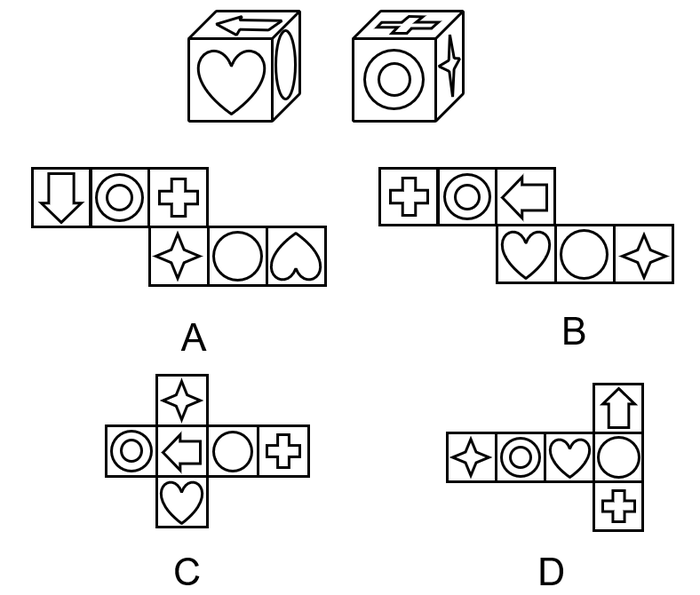
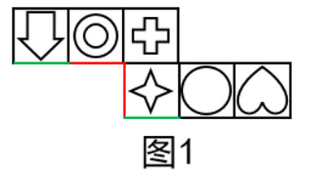

# 空间重构-立方体展开图折叠（相邻面公共边定位+特征面箭头指向验证）

考点：[[20-考点/判断推理/图形推理/空间重构-立方体展开图折叠（相邻面公共边定位+特征面箭头指向验证）|图形推理 / 空间重构-立方体展开图折叠（相邻面公共边定位+特征面箭头指向验证）]]

**问法模型**：同一立方体两个角度视图+'哪项不可能'选非问法 → 以视图锁定面相邻关系及有方向图案（箭头）的指向约束，将各选项折叠后比对指向，不符者即不可能

## 推理链
1. 第1步：视图①提取约束——顶面箭头、正面心形、右侧面圆面，且箭头指向左侧、背离右侧的圆面，即'题干箭头背向圆面'；视图②提取约束——顶面十字、正面同心圆、右侧面四角星三者两两相邻
2. 第2步：所用规则——折叠前后相邻面及其公共边上的图案指向关系不变；对展开图中隔角不相邻的面用'共边定位法'确定折叠后重合的边
3. 第3步：折叠A项——同心圆面与四角星面在展开图中隔角相邻，折叠后共一条边（官方图1红线），据此定位箭头面与四角星面折叠后的公共边（图1绿线）
4. 第4步：沿绿线公共边判定指向——A项中箭头面内箭头指向四角星面，箭尾背向四角星面的相对面，即心形面
5. 第5步：与题干对照——题干要求箭头背向（右侧面）圆面而非心形面，指向关系矛盾，A项不可能
6. 第6步：B、C、D折叠后箭头均背向圆面且相邻关系与两视图一致，予以排除；本题为选非题，故选A

**最快解法**：⚡ 箭头指向法：折叠A项，先借'同心圆面与四角星面共边（红线）'定位箭头面与四角星面的公共边（绿线），看出箭头指向四角星、背向心形；而题干箭头背向圆面，指向矛盾，秒选A（选非题）

## 易错点
- ⚠ 只验证面与面的相邻关系，忽略箭头这类有方向图案的'指向/背向'约束，漏掉决定性信息
- ⚠ 展开图中隔角不相邻的两面（A项同心圆面与四角星面）折叠后恰好共边，误判为不相邻导致公共边定位错误
- ⚠ 视图①右侧面画成单个椭圆，误与同心圆面混同为同一面，忽视'单圆面'与'同心圆面'是两个不同面

## 母题抽象
> 🧩 当立方体双视图题干中出现箭头等带方向的特征面时，先由视图提炼'箭头指向/背向某面'的方向约束，再折叠选项（或用共边定位法）验证箭头指向，指向不符者即为不可能的展开图

**同类特征**：同一立方体双视图、选非题（问不可能的展开图）、面图案含方向性箭头、单圆面与同心圆面易混、隔角面折叠后共边、六面图案：箭头/心形/圆/十字/同心圆/四角星

## 相关题
（暂无）

---

### 题干

图①和图②分别是某立方体从不同角度的视图，下列哪项不可能是该立方体的外表面展开图?

### 选项
- A. A　✅
- B. B
- C. C
- D. D

### 官方解析

A项：选项中同心圆面与四角星面之间的直角边为同一条边（如图1红线所示），则箭头面与四角星面的公共边为图1绿线所示，此时箭头面内箭头指向四角星面，背向四角星面的相对面，即心形面，而题干箭头背向圆面，与题干不一致，当选。

本题为选非题，故正确答案为A。

### 给定材料
（无）
