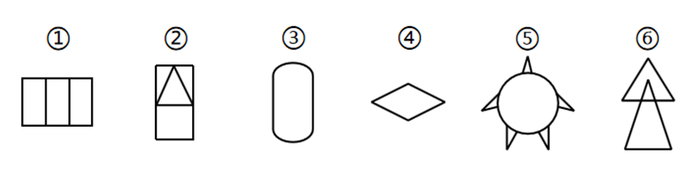

# 对称性-轴对称与中心对称的组合判定（分组分类）

考点：[[20-考点/判断推理/图形推理/对称性-轴对称与中心对称的组合判定（分组分类）|图形推理 / 对称性-轴对称与中心对称的组合判定（分组分类）]]

**问法模型**：'把六个图形分为两类，使每一类都有各自的共同特征' → 分组分类题，元素组成不同优先看属性规律，用'对称类型二分法'（仅轴对称 vs 既轴对称又中心对称）分组

## 推理链
1. 第1步：六图元素组成各不相同（三栏矩形、含三角形的矩形、胶囊形、菱形、带角圆形、双三角形），属性规律优先；②④⑤⑥中含等腰元素，提示从对称性切入
2. 第2步：对每图先找对称轴，再用'旋转180°是否与原图重合'验证中心对称
3. 第3步：图①三等分矩形有横、竖两条对称轴且旋转180°重合；图③竖直胶囊形同理；图④扁平菱形同理——①③④均为既轴对称又中心对称图形
4. 第4步：图②矩形上部为正立三角形，仅竖直一条对称轴，旋转180°后三角形朝下不重合；图⑤圆形周边的角上、下分布不对称，旋转180°不重合；图⑥两个三角形叠放仅竖直对称轴——②⑤⑥均为仅轴对称图形
5. 第5步：按对称类型分组：①③④一组，②⑤⑥一组，对照选项只有D符合

**最快解法**：⚡ 旋转180°验证法（中心对称判定口诀）：逐图旋转180°看是否与原图重合——①③④重合、②⑤⑥不重合，再结合均有对称轴，直接锁定'①③④既轴又中心对称，②⑤⑥仅轴对称'，选D

## 易错点
- ⚠ 只数对称轴条数或只看'有等腰元素'就分组，漏掉中心对称这一二分维度
- ⚠ 图④扁平菱形易被误看成箭头状而归入仅轴对称一组，实际其横竖对称轴均成立且中心对称
- ⚠ 图⑤带角圆形的角分布杂乱，易凭感觉判为中心对称，须实际验证旋转180°后上、下的角并不对应重合

## 母题抽象
> 🧩 当分组分类题各图元素组成不同、且多个图形含等腰或规则外框（矩形、菱形、圆形、三角形组合）时，用'对称类型二分法'：先确认均有对称轴，再验证旋转180°是否重合，把'既轴对称又中心对称'与'仅轴对称'各归一组

**同类特征**：分组分类（六图分两类）、元素组成不同，属性规律优先、多个图形含等腰三角形/等腰元素、矩形、菱形、胶囊形、圆形等规则外框、需区分仅轴对称与既轴又中心对称、答案分组形如①③④/②⑤⑥

## 相关题
- [[10-真题/判断推理/图形推理/1752676 数量规律-交点数（分组分类）|1752676]]（北京 2016，相关度1）
- [[10-真题/判断推理/图形推理/19283883 分组分类-特殊元素位置规律（正方形居中-居边）|19283883]]（国考 2025，相关度1）
- [[10-真题/判断推理/图形推理/19283956 数量规律-笔画数（一笔画与多笔画）|19283956]]（国考 2025，相关度1）
- [[10-真题/判断推理/图形推理/2434290 数量规律-线数量（直线数与曲线数做差运算）|2434290]]（新疆 2019，相关度1）
- [[10-真题/判断推理/图形推理/2444750 图形推理-属性规律（轴对称-黑白区域分别看对称性）|2444750]]（四川 2019，相关度1）

---

### 题干

把下面的六个图形分为两类，使每一类图形都有各自的共同特征或规律，分类正确的一项是：

### 选项
- A. ①②④，③⑤⑥
- B. ①④⑤，②③⑥
- C. ①④⑥，②③⑤
- D. ①③④，②⑤⑥　✅

### 官方解析
本题为分组分类题目，元素组成不同，优先考虑属性规律。观察发现，图②④⑤⑥中均出现等腰元素，考虑对称性。图①③④为既轴对称又中心对称图形，图②⑤⑥为轴对称图形。即图①③④为一组，图②⑤⑥为一组。
故正确答案为D。

### 给定材料
（无）
