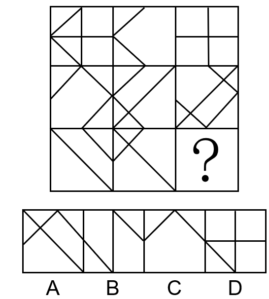

# 样式规律-求同存异（线条去同存异-叠加运算）

考点：[[20-考点/判断推理/图形推理/样式规律-求同存异（线条去同存异-叠加运算）|图形推理 / 样式规律-求同存异（线条去同存异/叠加运算）]]

**问法模型**：九宫格'选择最合适的一个填入问号处'→ 外轮廓相同、线条相似重复，优先按行做样式叠加运算（去同存异）

## 推理链
1. 第1步：九宫格每格外轮廓均为正方形，内部线条组成相似且相同线条大量重复出现，定位为样式规律而非属性/数量规律
2. 第2步：九宫格优先按行看，第一行图1与图2叠加时，两图重合的公共线条（重合的对角线段）相互抵消，各自独有的线条（水平中线、竖直中线）保留，恰好得到图3，即'图1去同存异图2=图3'
3. 第3步：第二行代入验证，图1与图2去同存异后同样得到图3，规律成立
4. 第4步：第三行应用规律：将图1与图2中重复出现的公共线条全部消去，仅保留两图各自独有的线条，即为问号处图形
5. 第5步：逐项对照：A、B、D所含线条与'两图独有线条'不吻合（或仍保留本应抵消的公共线条），仅C项与去同存异的结果一致，故选C

**最快解法**：⚡ 叠加口诀'去同存异'：第一行确认图1⊕图2=图3、第二行验证后，第三行直接把图1与图2中重合的线条在心里划掉，将剩余独有线条与四个选项比对，C项唯一吻合，无需逐段作图

## 易错点
- ⚠ 观察路径错误：未优先按行看，误按列或整体九宫找规律而浪费时间
- ⚠ 运算规则记混：把'求异（去同存异）'误当作'求同（保留相同线条）'或简单相加叠加
- ⚠ 线条核对不精细：内部线条多且方位相近，只数条数不比对线条的方位与经过位置，导致与干扰项混淆

## 母题抽象
> 🧩 当九宫格各图外轮廓一致、内部线条相似且相同线条重复出现时，优先按行做'去同存异（异或）'运算：图1⊕图2=图3，用第二行验证，第三行照此消去公共线条后与选项比对

**同类特征**：九宫格、元素组成相似、相同线条重复出现、外轮廓一致而内部线条不同、问号处填图、样式规律

## 相关题
- [[10-真题/判断推理/图形推理/12019768 样式规律-加减同异（求同）与位置旋转的复合规律|12019768]]（浙江 2026，相关度3）
- [[10-真题/判断推理/图形推理/16070178 样式规律-加减同异（翻转+去同存异）|16070178]]（重庆 2026，相关度3）
- [[10-真题/判断推理/图形推理/17056529 样式规律-求同求异（分元素：直线求同、小圆圈求异）|17056529]]（上海 2026，相关度3）
- [[10-真题/判断推理/图形推理/17058551 样式规律-加减同异（多图相加-叠加）|17058551]]（选调 2023，相关度3）
- [[10-真题/判断推理/图形推理/18643914 样式规律-去同存异（求异）与位置旋转的复合规律|18643914]]（四川 2026，相关度3）

---

### 题干

从所给的四个选项中，选择最合适的一个填入问号处，使之呈现一定的规律性：

### 选项
- A. A
- B. B
- C. C　✅
- D. D

### 官方解析
图形元素组成相似，相同线条重复出现，优先考虑样式规律。九宫格优先按行看，第一行中，图1和图2求异得到图3，第二行验证符合此规律，第三行应用此规律，只有C选项符合。
故正确答案为C。

### 给定材料
（无）
