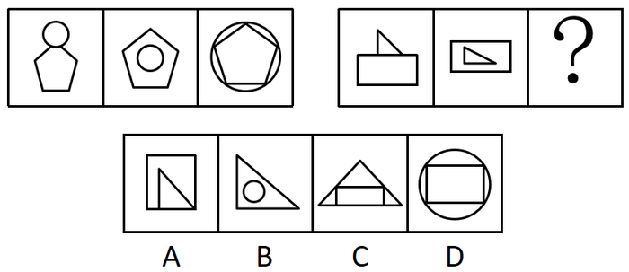

# 位置规律-两图形相对位置关系递变（上方外离→内部不相交→外部相交）

考点：[[20-考点/判断推理/图形推理/位置规律-两图形相对位置关系递变（上方外离→内部不相交→外部相交）|图形推理 / 位置规律-两图形相对位置关系递变（上方外离→内部不相交→外部相交）]]

**问法模型**：两组图类比型'填入问号使呈现规律性'→ 先归纳第一组三图的位置关系序列，再将该序列映射到第二组推问号处图形

## 推理链
1. 第1步：第一组三幅图元素组成一致，均由'圆形+五边形'两个图形构成，规律应在两图形的相对位置上
2. 第2步：第一组位置关系依次为：图1圆形位于五边形上方（外离）、图2圆形在五边形内部且不相交（内含）、图3圆形位于五边形外部且边线相交
3. 第3步：第二组前两幅图元素为'三角形+矩形'，位置关系依次为：图1三角形位于矩形上方（外离）、图2三角形在矩形内部且不相交（内含），与第一组前两步完全对应
4. 第4步：按序列递推，'？'处应为'三角形+矩形'且三角形位于矩形外部、两图形边线相交
5. 第5步：逐项对照——A项三角形与矩形但三角形在矩形内部（共边），B项为三角形+圆形（元素不符），C项为三角形+矩形且相交，D项为矩形+圆形（元素不符）
6. 第6步：只有C项同时满足元素一致与'外部相交'的位置要求，故选C

**最快解法**：⚡ 排除法+位置序列口诀'上方→内部→外部相交'：先按元素组成排除B（三角+圆）、D（矩+圆），再按位置排除A（三角形仍在矩形内部），锁定C

## 易错点
- ⚠ 只看元素组成、忽略位置关系递变，误选同样含三角形和矩形的A项
- ⚠ A项中三角形与矩形共边紧贴，易误判为'相交'，需区分'内部/相邻不相交'与'边线交叉相交'
- ⚠ 第二组图1中三角形底边贴在矩形上沿，易与第三组要求的'相交'混淆，实为外离相贴

## 母题抽象
> 🧩 当两组类比图中每幅图均由两个固定图形构成且元素种类不变时，优先观察两图形相对位置（上/内/外、是否相交）的序列递变，用该序列推问号处图形并排除元素不符项

**同类特征**：两组图类比（3+3结构）、每幅图由两个图形组合而成、第一组'圆形+五边形'、第二组'三角形+矩形'元素一致、位置关系三段式：上方→内部不相交→外部相交、问号处需同时满足元素组成与位置关系双重条件

## 相关题
（暂无）

---

### 题干

从所给的四个选项中，选择最合适的一个填入问号处，使之呈现一定的规律性：

### 选项
- A. A
- B. B
- C. C　✅
- D. D

### 官方解析
观察发现，第一组三幅图形均由圆形和五边形构成，且两个图形间的关系依次为圆形位于五边形上方、圆形位于五边形内部（不相交）、圆形位于五边形外部（相交）。第二组前两幅图形均由三角形和矩形构成，且两个图形间的关系依次为三角形位于矩形上方、三角形位于矩形内部（不相交），故“？”处图形应由三角形和矩形构成，且三角形应位于矩形外部（相交），只有C项符合。
故正确答案为C。

### 给定材料
（无）
