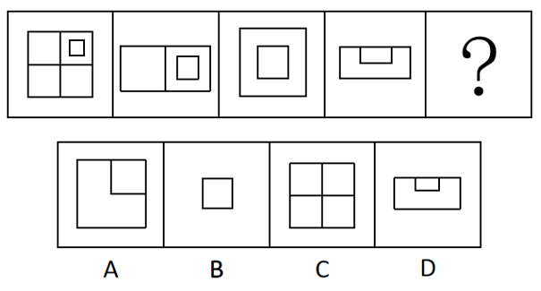

# 位置规律-翻折（沿水平-竖直中线交替翻折）

考点：[[20-考点/判断推理/图形推理/位置规律-翻折（沿水平-竖直中线交替翻折）|图形推理 / 位置规律-翻折（沿水平/竖直中线交替翻折）]]

**问法模型**：问号处填入最合适图形使序列呈规律 → 观察相邻图形间的翻折关系，按'翻折轴交替'规律对图四沿竖直中线翻折推出答案

## 推理链
1. 第1步：提取图形特征——图一为'田'字四格且右上格含小正方形；图二为左右两格的扁长方形、右格含小正方形；图三为大小正方形同心嵌套；图四为扁长方形且顶部中央有一个向下凸的小长方形
2. 第2步：归纳相邻图关系为'沿中线翻折'，且翻折轴按'水平→竖直→水平→竖直'交替
3. 第3步：验证前段——图一沿水平中线把下半向上翻折，只剩上排左右两格（右格带小正方形）得图二；图二沿竖直中线把左半折到右半上，小正方形居中呈同心样式得图三；图三沿水平中线翻折，小正方形折起立在顶部中央、外框变扁长方形得图四
4. 第4步：应用规律——图四应沿竖直中线翻折：扁长方形对折后外框变为正方形，顶部中央的小长方形被折到折痕一侧、落在角部成小正方形折边
5. 第5步：对照选项——A项为正方形且右上角有小正方形折边，符合；B项只剩小正方形缺外框、C项为无小正方形的田字格、D项与图四原样重复，均不符合翻折结果

**最快解法**：⚡ 翻折轴交替法：先锁定'水平→竖直→水平→竖直'的翻折轴循环，再脑内（或借助草稿折纸）把图四沿竖直中线对折——外框减半成正方形、顶部小凸块折到角上，直接锁定A

## 易错点
- ⚠ 误把规律当成长方形/正方形形状交替或面数量变化，忽略'翻折'这一位置规律
- ⚠ 不实际模拟小凸块翻折后的落点，误以为图四翻折后仍是图四样式而错选D
- ⚠ 看不懂图四顶部小长方形是图三小正方形'折起立起'的画法，导致图三→图四一步验证卡壳

## 母题抽象
> 🧩 当题干相邻图形呈'外框尺寸沿中线减半、某小元素翻起贴边/立起'的特征时，用'翻折轴水平竖直交替'模型，逐段脑内折纸验证折起元素的位置再选答案

**同类特征**：相邻图形外框沿中线减半（正方形与扁长方形交替）、翻折轴水平/竖直交替出现、小正方形翻折后呈顶部凸出小长方形、小元素位置随翻折逐步传递、前四图构成完整翻折循环，问号处补全下一环

## 相关题
（暂无）

---

### 题干

从所给的四个选项中，选择最合适的一个填入问号处，使之呈现一定的规律性：

### 选项
- A. A　✅
- B. B
- C. C
- D. D

### 官方解析
本题考查翻折。图一从水平中间位置进行翻折可得到图二，图二从竖直中间位置进行翻折可得到图三，图三从水平中间位置进行翻折可得到图四，因此，问号处应该是图四从竖直中间位置进行翻折得到，只有A项符合。
故正确答案为A。

### 给定材料
（无）
