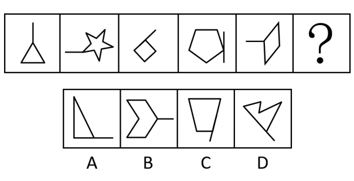

# 数量规律-面的细化（面的轴对称性+出头线方向遍历）

考点：[[20-考点/判断推理/图形推理/数量规律-面的细化（面的轴对称性+出头线方向遍历）|图形推理 / 数量规律-面的细化（面的轴对称性+出头线方向遍历）]]

**问法模型**：'选择最合适的一个填入问号处使之呈现规律性'且元素组成不同→优先数量规律，面数量相同无法排除时进入面的细化考法（面的对称性、面外出头线的方向/位置）

## 推理链
1. 第1步：题干五幅图元素组成不同，对称、曲直等属性规律不统一，转向数量规律
2. 第2步：数面发现每幅图均只含1个面（三角形、五角星、菱形、五边形、平行四边形），面数量无法排除选项，进入面的细化
3. 第3步：细化面的形状——题干各面均为轴对称图形，而A项直角三角形面、D项不规则四边形面非轴对称，排除A、D
4. 第4步：观察每幅图中与面相连的出头线，方向依次为竖（图1）、横（图2）、斜（图3）、竖（图4）、横（图5），呈'竖、横、斜'三步遍历循环，问号处应为斜向出头线
5. 第5步：剩余B、C中，B项出头线为横向，C项（等腰梯形+右下斜出头线）为斜向，排除B，选C

**最快解法**：⚡ 面的细化两步排除法：第一步验证'面的轴对称性'排除A、D；第二步按'竖、横、斜'遍历口诀判断出头线方向为斜，直接锁定C

## 易错点
- ⚠ 只数出面数量均为1就停滞不前，未进入面的细化（对称性、出头线），导致无法作答
- ⚠ 忽略出头线方向'竖、横、斜'的遍历规律，被官方解法二的干扰思路带偏而误选B
- ⚠ 对称性判断失误：A项直角三角形、D项不规则四边形易被误判为轴对称图形

## 母题抽象
> 🧩 当题干各图形面数量相同且无法排除选项时，用'面的细化'两板斧：先看面的对称性排除，再看面外附加线（出头线）的方向/长度/位置规律（如竖横斜遍历）锁定答案

**同类特征**：每幅图均只有一个面、面均为轴对称图形、每图有一条出头线与面相连、出头线方向呈竖、横、斜遍历循环、元素组成不同且无明显属性规律、问号为六宫格顺推型

## 相关题
- [[10-真题/判断推理/图形推理/14403697 图形推理-数量规律（外框边数与内部元素个数作差恒定分组）|14403697]]（山东 2025，相关度1）
- [[10-真题/判断推理/图形推理/16070043 数量规律-灰色多边形边数与白色面数量的差值运算分组|16070043]]（贵州 2026，相关度1）
- [[10-真题/判断推理/图形推理/16070177 数量规律-部分数（黑白块分堆-同色连通区域数）|16070177]]（重庆 2026，相关度1）
- [[10-真题/判断推理/图形推理/2423328 图形推理-数量规律（内部线条与外框角端点相接个数）|2423328]]（甘肃 2019，相关度1）
- [[10-真题/判断推理/图形推理/2448487 数量规律-曲直交点数与曲线数的倍数运算关系|2448487]]（国考 2020，相关度1）

---

### 题干

从所给的四个选项中，选择最合适的一个填入问号处，使之呈现一定的规律性：

### 选项
- A. A
- B. B
- C. C　✅
- D. D

### 官方解析
解法一：元素组成不同，且无明显属性规律，考虑数量规律。观察发现题干图形均有一个面，但无法排除选项，考虑面的细化。发现题干图形中的面都是轴对称图形，排除A、D两项；继续观察发现，题干图形都存在一条出头线与面相连，且出头线的方向依次为竖、横、斜、竖、横，故？处应填入出头线方向为斜的图形，排除B项。
故正确答案为C。
解法二：元素组成不同，且无明显属性规律，考虑数量规律。观察发现题干图形均有一个面，但无法排除选项，考虑面的细化。发现题干图形中的面都是轴对称图形，排除A、D两项；继续观察发现，题干图形都存在一条出头线与面相交于点，通过该交点能引出图形的对称轴，排除C项。
故正确答案为B。
注：解法一和解法二均根据面的对称性和出头线的规律选出答案，但题干图形出头线方向“竖、横、斜”的遍历规律明显，因此粉笔更倾向于选C。

### 给定材料
（无）

> [!note] 复核版本状态
> 原题不可计分（underdetermined；来源记录的答案键/竞争项：B、C）；仅当前明确标注的编辑版按答案C计分。
> 详细原题疑点、修订题面、解析和证据见下方独立复核记录。

<!-- CODEX-ANSWER-REVIEW:BEGIN -->
### 本次独立复核

**复核结论：** `resolved`（答案与解析已核定）

**原题计分状态：** 不计分（`underdetermined`：原题证据不足以唯一判定）。来源中记录的答案键/竞争项：B、C；这些记录不代表原题已核准答案。

**原题疑点与处理：**

新疆 2021 〔20-考点/判断推理/图形推理/数量规律-面的细化（面的轴对称性+出头线方向遍历）〕 — 官方解析内部存在双解冲突：解法一选C、解法二选B；官方已注明因'竖、横、斜'遍历规律更明显而倾向C，最终以C为准；解法二'交点引出对称轴'规则的普适性与B项的符…

**当前计分版本：** 明确标注的编辑版；未列出的题干、材料或选项沿用固定题源。答案不回填为原题答案。

**计分答案：** C（可计分）

**复核解析：**

每个题干图都有一个与封闭面相连的出头线。其方向按竖、横、斜、竖、横循环，缺项应为斜向出头线，只有C符合。另一解法按出头线交点与对称轴关系导向B；编辑版指定方向遍历规则。

**修订题干：**

从所给的四个选项中，选择最合适的一个填入问号处，使之呈现一定的规律性：

**【编者修订条件】** 【编辑版】只按与封闭面相连的出头线方向竖、横、斜、竖、横的循环规律补图。

**相关信息：**

图形数量规律细化—出头线方向遍历；方向序列可按竖、横、斜循环。

**核对依据与来源边界：**

- 固定题源：[原题文件](https://github.com/Mentat-Uran/kaogongzhentizhengliu/blob/84ab93d4b64b61d897bece8a1c0a5bab06b4feb2/10-%E7%9C%9F%E9%A2%98/%E5%88%A4%E6%96%AD%E6%8E%A8%E7%90%86/%E5%9B%BE%E5%BD%A2%E6%8E%A8%E7%90%86/4630369%20%E6%95%B0%E9%87%8F%E8%A7%84%E5%BE%8B-%E9%9D%A2%E7%9A%84%E7%BB%86%E5%8C%96%EF%BC%88%E9%9D%A2%E7%9A%84%E8%BD%B4%E5%AF%B9%E7%A7%B0%E6%80%A7%2B%E5%87%BA%E5%A4%B4%E7%BA%BF%E6%96%B9%E5%90%91%E9%81%8D%E5%8E%86%EF%BC%89.md)；内容版本 `84ab93d4b64b61d897bece8a1c0a5bab06b4feb2`，源 Markdown blob `ab5030e99a7022e7c17bd7b76601e4a6b3657e7b`.
- 固定题图/公式图：`90-图片/题目图/17d5682bfb30a43.png`.

<!-- CODEX-ANSWER-REVIEW:END -->
