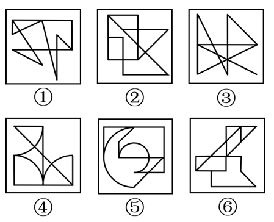

# 数量规律-笔画数（奇点数与一笔画-多笔画）

考点：[[20-考点/判断推理/图形推理/数量规律-笔画数（奇点数与一笔画-多笔画）|图形推理 / 数量规律-笔画数（奇点数与一笔画/多笔画）]]

**问法模型**：六图分组分类、元素组成不同且无属性规律→优先考虑数量规律，数奇点定笔画数分组

## 推理链
1. 第1步：六图元素组成不同，对称、曲直、封闭等属性规律不统一，按'属性不成找数量'转向数量规律
2. 第2步：图①为典型一笔画特征图（多矩形线条交连），图③有明显出头端点，提示考查笔画数
3. 第3步：应用规则——连通图的笔画数=奇点数÷2，奇点指引出奇数条线的点（端点、T字口、部分交叉点）
4. 第4步：逐图数奇点：图①③⑤奇点数均为2，均为一笔画图形
5. 第5步：逐图数奇点：图②④⑥奇点数均为4，均为两笔画图形
6. 第6步：按奇点数2/4分成两类，①③⑤一组、②④⑥一组，对照选项得B

**最快解法**：⚡ 奇点计数法+特征图秒杀：先识别一笔画特征图（图①的'日'字形交连、图③出头端点），再对全图逐点数引出奇数条线的点，奇点2个归一笔画组，奇点4个归两笔画组，直接锁定①③⑤/②④⑥选B

## 易错点
- ⚠ 数奇点时漏数端点和交叉点：引出1条线的端点必是奇点，十字交叉点是偶点不算
- ⚠ 图⑤这类曲线+直线混合图形，易漏数圆弧与直线交接处的奇点而误判笔画数
- ⚠ 先纠结封闭区域数、对称性等属性规律浪费时间，忽略'出头端点'这一笔画数提示信号

## 母题抽象
> 🧩 当分组题六图元素组成不同、无明显属性规律，且出现出头端点、'日/中'字交连等特征图时，用奇点计数法：奇点2个为一笔画、奇点4个为两笔画，按笔画数二分分组

**同类特征**：六个图形分组分类、元素组成不同、无明显属性规律、图形含明显出头端点、一笔画特征图（矩形线条交连）、奇点数2与4两极分化

## 相关题
- [[10-真题/判断推理/图形推理/13504460 数量规律-元素种类数（分组分类）|13504460]]（新疆 2025，相关度3）
- [[10-真题/判断推理/图形推理/10204454 数量规律-部分数（黑白球连通区域数做和）|10204454]]（甘肃 2024，相关度2）
- [[10-真题/判断推理/图形推理/10297050 数量规律-特殊计数（线条穿过小白球的数量）|10297050]]（天津 2025，相关度2）
- [[10-真题/判断推理/图形推理/10297262 数量规律-面的形状种类（封闭面种类数分组）|10297262]]（浙江 2025，相关度2）
- [[10-真题/判断推理/图形推理/10297314 数量规律-交点数（曲直交点）|10297314]]（浙江 2025，相关度2）

---

### 题干

把下面的六个图形分为两类，使每一类图形都有各自的共同特征或规律，分类正确的一项是：

### 选项
- A. ①③④，②⑤⑥
- B. ①③⑤，②④⑥　✅
- C. ①②⑥，③④⑤
- D. ①④⑥，②③⑤

### 官方解析

本题为分组分类题目。元素组成不同，且无明显属性规律，优先考虑数量规律。观察发现，图①为明显一笔画图形，图③中含有明显的出头端点，考虑笔画数。如下图所示，图①③⑤的奇点数都是2，为一笔画图形，图②④⑥的奇点数都是4，为两笔画图形。即图①③⑤为一组，图②④⑥为一组。

故正确答案为B。

### 给定材料
（无）
