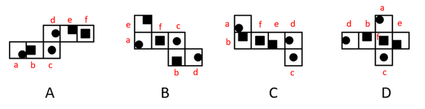
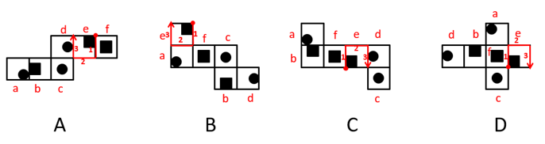

# 空间重构-六面体折叠（画边法比较相邻面找异项）

考点：[[20-考点/判断推理/图形推理/空间重构-六面体折叠（画边法比较相邻面找异项）|图形推理 / 空间重构-六面体折叠（画边法比较相邻面找异项）]]

**问法模型**：四个展开图面图案相同，问'哪项折成的纸盒与其他三个不一样'→ 选定公共特征面作基准，用画边法顺时针标边并比对各边对接面，锁定异项

## 推理链
1. 第1步：四个选项均为同一立方体的表面展开图，六个面完全相同（官方以面a~面f标注），面上以黑块、黑点作定位特征，需找出折叠结果不同的一项
2. 第2步：选取各展开图共同的特征面e作基准面，按官方解析以'面e上挨着黑块的顶点'为统一起点，顺时针为面e的四条边编号1、2、3
3. 第3步：用画边法确定A项折叠后与面e各边对接的面：边1对应面f，边2对应面c，边3对应面d
4. 第4步：同法标定B项：边1对应面f，边2对应面a，边3对应面d
5. 第5步：同法标定C、D项：均为边1对应面f，边2对应面a，边3对应面d，与B项完全一致
6. 第6步：对照可知B、C、D三项面e周围相邻面及顺序均为f、a、d，仅A项边2的对接面为c，相邻关系不同，故A项折成的纸盒与其他三个不一样，答案为A

**最快解法**：⚡ 画边法（公共基准面法）：四个展开图中找到同一特征面e，从'挨着黑块的顶点'起顺时针标边1/2/3，只比对边2的对接面——A项接面c，B/C/D项接面a，直接锁定异项A

## 易错点
- ⚠ 画边起点不统一：必须从同一定位特征（面e挨着黑块的顶点）开始顺时针编号，起点不同则编号错位、比较失效
- ⚠ 只看相邻面集合、忽略绕面顺序：需按边1→边2→边3的顺序逐一比对对接面，顺序不同折叠结果也不同
- ⚠ 被展开图外形差异误导：外形阶梯形/十字形不同不代表折成的盒子一定不同，应先靠面上图案（黑块、黑点）确认同一面，再比邻边对接关系

## 母题抽象
> 🧩 当题干出现'多个展开图折叠后找不同一项'且各图六个面图案相同时，选公共特征面，以其特征顶点（如挨黑块的点）为起点顺时针画边，逐一比对各边对接面，对接面不一致的即为答案

**同类特征**：展开图折叠找异项（选非）、四个展开图六个面图案相同、面以黑块、黑点作定位特征、公共基准面+特征顶点画边、顺时针标边比对对接面、三同一异结构

## 相关题
（暂无）

---

### 题干

下列纸盒的外表面展开图中，哪项折叠成的纸盒和其他三个不一样？

### 选项
- A. A　✅
- B. B
- C. C
- D. D

### 官方解析

将选项展开图标上序号，如下图所示（各选项面都相同，故相同的面用相同字母表示），逐一进行分析。

A项：以面e挨着黑块的点为起点进行顺时针画边（如下图所示），边1对应面f，边2对应面c，边3对应面d；

B项：以面e挨着黑块的点为起点进行顺时针画边（如下图所示），边1对应面f，边2对应面a，边3对应面d；

C项：以面e挨着黑块的点为起点进行顺时针画边（如下图所示），边1对应面f，边2对应面a，边3对应面d；

D项：以面e挨着黑块的点为起点进行顺时针画边（如下图所示），边1对应面f，边2对应面a，边3对应面d。

综上，只有A项与其他三项不同。

本题为选非题，故正确答案为A。

### 给定材料
（无）
