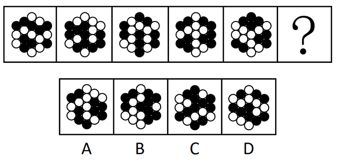

# 数量规律-元素计数（黑白球中黑球个数交替规律）

考点：[[20-考点/判断推理/图形推理/数量规律-元素计数（黑白球中黑球个数交替规律）|图形推理 / 数量规律-元素计数（黑白球中黑球个数交替规律）]]

**问法模型**：问号处填入最合适图形使规律延续 → 元素组成不同且无属性规律时，转向数量规律，对黑白球分组计数找数量序列

## 推理链
1. 第1步：题干五幅图均由黑球和白球堆叠构成，图形组成彼此不同，对称性、曲直性、封闭性等属性均无统一规律
2. 第2步：按'组成不同、属性无规律→优先数量规律'的解题路径，将黑球、白球分开，单独对黑球计数
3. 第3步：依次清点各图黑球个数：图1为9个、图2为10个、图3为9个、图4为10个、图5为9个，呈'9、10'交替循环规律
4. 第4步：按交替规律推得问号处图形应含10个黑球
5. 第5步：逐项清点选项中黑球数量，只有B项黑球数为10个，A、C、D均不满足
6. 第6步：对照规律与选项，确定答案为B

**最快解法**：⚡ 直接数黑球法（排除法）：只数黑球不数白球，得序列9、10、9、10、9→?处需10个黑球；四个选项逐一数黑球，唯B为10个，秒选B

## 易错点
- ⚠ 一见黑白球就先想位置移动或黑白叠加运算，忽略'组成不同且无属性规律'应优先数数量的提示
- ⚠ 黑白混数或只看每幅图总球数，总数无差异导致发现不了规律
- ⚠ 边缘相邻小球数漏/数重，差1个就把干扰项（非10个黑球）误认成正确答案

## 母题抽象
> 🧩 当图形由黑白（两种）小元素构成、组成不同且属性无规律时，对其中一种元素单独计数，验证数量是否呈常数、递增或交替规律，再对照选项排除

**同类特征**：图形由黑球和白球两种元素构成、图形组成不同、属性（对称/曲直/开闭）无统一规律、黑球数量呈9、10交替、问号处求规律延续

## 相关题
- [[10-真题/判断推理/图形推理/19526294 位置规律-平移（十六宫格内外圈分开看）|19526294]]（国考 2026，相关度1）
- [[10-真题/判断推理/图形推理/2015314 数量类-面数量（封闭区域个数分组）|2015314]]（重庆 2016，相关度1）
- [[10-真题/判断推理/图形推理/2021832 数量规律-交点数（分组分类）|2021832]]（吉林 2016，相关度1）
- [[10-真题/判断推理/图形推理/2037764 数量规律-数三角形个数（可重合计数，等差递增）；辅以一笔画属性验证|2037764]]（浙江 2016，相关度1）
- [[10-真题/判断推理/图形推理/2037766 属性规律-对称性（中心对称判定）|2037766]]（浙江 2016，相关度1）

---

### 题干

从所给的四个选项中，选择最合适的一个填入问号处，使之呈现一定的规律性：

### 选项
- A. A
- B. B　✅
- C. C
- D. D

### 官方解析
图形组成不同，且无属性规律，优先考虑数量规律。观察发现图形均由黑球和白球构成，其中黑球的数量分别是9、10、9、10、9，故？处图形应有10个黑球，只有B项满足规律。
故正确答案为B。

### 给定材料
（无）
