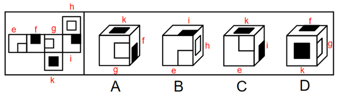

# 空间重构-六面体折叠（公共边法）

考点：[[20-考点/判断推理/图形推理/空间重构-六面体折叠（公共边法）|图形推理 / 空间重构-六面体折叠（公共边法）]]

**问法模型**：“左图是给定纸盒的外表面，下面哪项能由它折叠而成？”→ 给展开图各面标号，用公共边法逐一核对相邻面图案与公共边的位置关系并排除。

## 推理链
1. 第1步：将展开图六个面标号为面e、面f、面g、面h、面i、面k；各面内部含小白块或小黑块，且小块靠近哪条边（是否挨公共边）各不相同，是判定的关键特征。
2. 第2步：采用公共边法：立体图中三个两两相邻的面有公共边，以两图案面的公共边为“铰链”，核对面上小块与公共边“挨着/不挨着”的关系是否与展开图一致。
3. 第3步：A项出现面g、面k和面f，三面图案及小块与公共边的位置关系与展开图一致，保留。
4. 第4步：B项出现面e、面i和面h，其中面e和面h的公共边挨着面e中的小白块，而题干展开图中面e与面h的公共边不挨着面e的小白块，与展开图不一致，排除。
5. 第5步：C项出现面e、面k和面i，其中面e和面i的公共边挨着面e中的小白块，而题干展开图中面e与面i的公共边不挨着面e的小白块，排除。
6. 第6步：D项出现面k、面f和面g，其中面f和面g的公共边没有挨着面g中的小白块，而题干展开图中面f与面g的公共边挨着面g的小白块，排除。
7. 第7步：只有A项与展开图完全一致，故正确答案为A。

**最快解法**：⚡ 公共边法：先给展开图标面序号；对每个选项找两个带图案面的公共边，只核对“小白块/小黑块是否挨着该公共边”这一处细节（B、C查面e与邻面公共边，D查面f与面g公共边），不一致立即排除，剩A当选。

## 易错点
- ⚠ 只看三个面的图案种类是否齐全，忽略图案朝向（小块是否挨公共边）这一细节
- ⚠ 混淆小白块与小黑块，或把“挨着公共边”与“挨着面内其他边”看混
- ⚠ 凭相邻面组合直觉判断，未逐项用公共边/公共点精确定位，导致误选D等形近项

## 母题抽象
> 🧩 当题干给出带小黑块/小白块的六面体展开图并问“哪项能折叠而成”时，给各面标号，用公共边法验证每个选项中相邻两面的公共边是否挨着面上的特征小块，不一致者排除。

**同类特征**：六面体纸盒外表面展开图、问“哪项能由它折叠而成”、多个面内含小黑块/小白块、小块位置贴近面的边、方向敏感、选项为三个相邻面的立体图、适用公共边法/标面法

## 相关题
（暂无）

---

### 题干

左图是给定纸盒的外表面，下面哪项能由它折叠而成？

### 选项
- A. A　✅
- B. B
- C. C
- D. D

### 官方解析

将原展开图标上序号如下图，逐一进行分析。

A项：选项出现了面g、面k和面f，选项与题干展开图一致，当选；

B项：选项出现了面e、面i和面h，面e和面h的公共边挨着面e中的小白块，而题干的面e和面h的公共边没有挨着面e中的小白块，选项与题干展开图不一致，排除；

C项：选项出现了面e、面k和面i，面e和面i的公共边挨着面e中的小白块，而题干的面e和面i的公共边没有挨着面e中的小白块，选项与题干展开图不一致，排除；

D项：选项出现了面k、面f和面g，面f和面g的公共边没有挨着面g中的小白块，而题干中面f和面g的公共边挨着面g中的小白块，选项与题干展开图不一致，排除。

故正确答案为A。

### 给定材料
（无）
