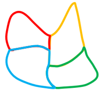

# 平面拼合（仅平移拼合-凹凸消线复原轮廓）

考点：[[20-考点/判断推理/图形推理/平面拼合（仅平移拼合-凹凸消线复原轮廓）|图形推理 / 平面拼合（仅平移拼合-凹凸消线复原轮廓）]]

**问法模型**：四个小图形'只能上下左右平移'拼合成哪一个 → 用凹凸匹配消线法拼出外轮廓，再对照选项排除

## 推理链
1. 第1步：题干限定'只能通过上、下、左、右平移'拼合，即四个图形均不可旋转、翻转，各图形的尖角朝向、凹口朝向在拼合后保持原样
2. 第2步：采用平面拼合的通法'凹凸匹配消线法'——相邻拼接处的公共边必为一凹一凸互补，两两对接后消去公共边，剩余外围轮廓即为目标图形
3. 第3步：观察题干四个图形：图1为上尖下平的竖直尖角块，图2为上平、右下收尖的楔形，图3为左上有小凹、下缘呈波浪的小块，图4为左端圆钝、右侧带内凹缺口的块
4. 第4步：进行对接：图1的下平边与图2的上平边互补对接，图2的斜尖边与图3、图4的凹凸边相接，图4右侧的内凹缺口由其他图形的凸尖填入（对应拼合后消去的内部公共边）
5. 第5步：消去全部公共边后，外围轮廓应呈现：左半部宽大圆弧凸起、右上方一个尖峰、底部平缓微弧的整体特征
6. 第6步：逐项对照：A项轮廓为'左大弧+右上尖峰'，与消线结果吻合；B项顶部出现双峰且右下多出尖角，与题干图形方向特征不符；C项峰位与凹凸分布不匹配；D项尖峰位于左上且右侧缺口未被填补，均排除
7. 第7步：唯一符合消线后外轮廓的为A项，与官方答案一致

**最快解法**：⚡ 凹凸消线法+方向守恒排除：先抓住'不能旋转'这一限制，盯住各图形尖角/凹口的原始朝向；再把互补的凹凸边两两对接并擦去公共边，剩余外轮廓直接与四个选项比对，A的'左大弧+右上尖峰'唯一吻合

## 易错点
- ⚠ 误将小图形旋转或翻转后再拼，改变尖角、凹口方向导致选错
- ⚠ 只关注面积大小相近，忽略凹凸互补消线这一拼合核心规则
- ⚠ 未逐一检查选项轮廓的峰位与凹口是否与题干图形方向对应，误选B（双峰）或D（右侧缺口未补）

## 母题抽象
> 🧩 当题干出现'若干小图形只能平移拼合成一个'时，用凹凸匹配消线法：一凸一凹对接消去公共边，剩余外轮廓对照选项，并全程保持各图形方向不变

**同类特征**：平面拼合、只能上下左右平移、不规则封闭小图形、凹凸互补、消去公共边复原轮廓、四个图形拼一个

## 相关题
- [[10-真题/判断推理/图形推理/16095271 图形推理-平面拼合（平行且等长相消）|16095271]]（江苏 2024，相关度2）
- [[10-真题/判断推理/图形推理/17900982 图形推理-平面拼合（平行且等长相消）|17900982]]（江苏 2024，相关度2）
- [[10-真题/判断推理/图形推理/17900987 平面拼合-曲线图形消边拼合|17900987]]（江苏 2024，相关度2）
- [[10-真题/判断推理/图形推理/2042722 平面拼合（方格面积守恒+仅平移拼合）|2042722]]（江苏 2017，相关度2）
- [[10-真题/判断推理/图形推理/2043624 图形推理-平面拼合（平移拼合·平行等长边对接）|2043624]]（江苏 2017，相关度2）

---

### 题干

下边四个图形中，只有一个是由上边的四个图形拼合（只能通过上、下、左、右平移）而成的，请把它找出来。

### 选项
- A. A　✅
- B. B
- C. C
- D. D

### 官方解析

本题考查平面拼合。消去凹凸匹配的线条后进行组合可得到轮廓图，即为A项。具体拼合方式如下图所示：

故正确答案为A。

### 给定材料
（无）
