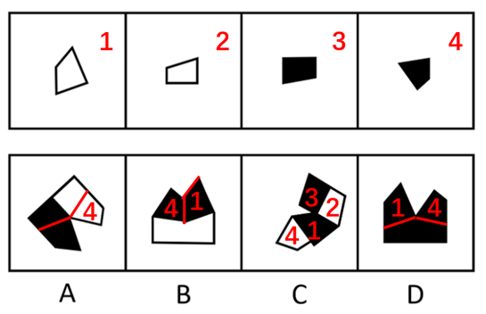

# 图形推理-平面拼合（双面纸片翻面变色规则）

考点：[[20-考点/判断推理/图形推理/图形推理-平面拼合（双面纸片翻面变色规则）|图形推理 / 图形推理-平面拼合（双面纸片翻面变色规则）]]

**问法模型**：题干问'仅有一项能由四张一面黑一面白的纸片拼合（可平移、旋转、翻转）而成' → 采用'翻面变色'验证模型：平移/旋转颜色不变，翻转则黑白互换，逐项核对每个组成纸片的颜色合法性

## 推理链
1. 第1步：提取题干规则——每张纸片一面黑色、另一面白色；平移、旋转不换面故颜色不变，翻转换面故颜色互换。题干中①②以白面（空心轮廓）朝上，翻转后应为黑色；③④以黑面（实心）朝上，翻转后应为白色
2. 第2步：建立验证方法——把每个选项整体拆解为四个纸片，逐片判断该片经历的是平移/旋转还是翻转，再比对该片在选项中呈现的颜色是否与规则相符
3. 第3步：A项中④（实心黑三角形）只做了旋转，颜色应仍为黑色，但选项中该位置呈白色，颜色违法，排除
4. 第4步：B项中①只做了平移，颜色应仍为白色，选项中却呈黑色；且④做了翻转，颜色应为白色，选项中却呈黑色，双重违法，排除
5. 第5步：D项与B项同类错误——①呈黑色（应仍为白色）、④呈黑色（翻转后应为白色），排除
6. 第6步：C项四个纸片经平移/旋转后颜色均未违规（①②保持白面、③④保持黑面），拼合方式成立，当选

**最快解法**：⚡ 颜色规则排除法——先记口诀'①②白朝上翻转变黑，③④黑朝上翻转变白'，对每个选项逐片核对：凡①②未翻转却呈黑色、或③④未翻转却呈白色、或翻转后颜色未互换的，直接排除；C项全部合法，直接锁定

## 易错点
- ⚠ 忽略'每张纸片一面黑一面白'的前提，把纸片颜色当成固定不变，导致无从排除、只看轮廓拼形而误选
- ⚠ 旋转与翻转混淆：把仅发生旋转的纸片误判为翻转（或反之），如A项中④仅旋转仍应为黑色，误判后颜色结论全错
- ⚠ 只验证形状能否拼合、不验证颜色是否合法，凭外形相似误选B或D

## 母题抽象
> 🧩 当题干出现'双面异色纸片，可平移、旋转、翻转拼合'特征时，用'平移旋转保色、翻转换色'规则逐项核对每个组成纸片的颜色，颜色违法者即排除，剩余唯一合法项为答案

**同类特征**：一面黑色另一面白色、可平移、旋转、翻转、平面拼合、翻面颜色互换、仅有一项能拼合、给纸片标序号逐一分析

## 相关题
- [[10-真题/判断推理/图形推理/4651797 平面拼合（平行且等长相消+翻转变色）|4651797]]（江苏 2022，相关度3）
- [[10-真题/判断推理/图形推理/11367783 平面拼合（旋转-翻转变换+翻面变色校验）|11367783]]（江苏 2025，相关度2）
- [[10-真题/判断推理/图形推理/4651714 平面拼合-双面黑白纸片拼合（翻转变色规则）|4651714]]（江苏 2022，相关度2）
- [[10-真题/判断推理/图形推理/3019154 平面拼合（不旋转平移拼合-边线匹配）|3019154]]（广东 2021，相关度1）
- [[10-真题/判断推理/图形推理/4651690 平面拼合（可平移、旋转、翻转+黑白面颜色追踪）|4651690]]（江苏 2022，相关度1）

---

### 题干

上边四张纸片，每张纸片一面是黑色，另一面是白色，下边仅有一项能由其拼合（可以平移、旋转、翻转）而成，请把它找出来。

### 选项
- A. A
- B. B
- C. C　✅
- D. D

### 官方解析

本题考查平面拼合，根据题干可知，纸片平移、旋转，颜色不变；翻转，颜色改变，纸片①和纸片②翻转后为黑色，纸片③和纸片④翻转后为白色。将题干图形标上序号如下图，逐一进行分析。

A项：图4进行了旋转，颜色应仍为黑色，而选项是白色，排除；

B项：图1进行了平移，颜色应仍为白色，而选项是黑色；图4进行了翻转，颜色应为白色，而选项是黑色，排除；

C项：可以由题干图形拼合而成，拼合方式如图所示，当选；

D项：图1进行了平移，颜色应仍为白色，而选项是黑色；图4进行了翻转，颜色应为白色，而选项是黑色，排除。

故正确答案为C。

### 给定材料
（无）
