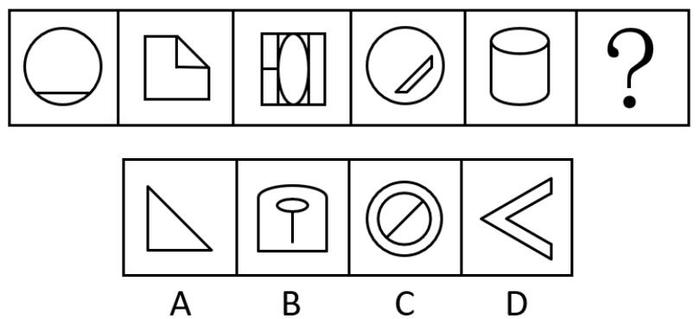

# 属性规律-对称性（对称轴数量+对称轴方向旋转）

考点：[[20-考点/判断推理/图形推理/属性规律-对称性（对称轴数量+对称轴方向旋转）|图形推理 / 属性规律-对称性（对称轴数量+对称轴方向旋转）]]

**问法模型**：问号处填入使整组图形呈现规律 → 元素组成不同时先查属性规律，锁定'对称轴数量一致+方向每步顺时针旋转45°'的移动规律

## 推理链
1. 第1步：题干五图元素组成不同（圆+水平弦、折角纸片、矩形+椭圆、圆+斜杠、圆柱），但均为明显轴对称图形，优先考虑属性规律中的对称性
2. 第2步：逐图确认对称轴数量：五幅图对称轴数量均为1条，故规律应为'轴方向'的变化而非数量变化
3. 第3步：标出各图对称轴方向：图1竖直、图2沿'/'向右上倾斜45°、图3水平、图4沿'\'向左上倾斜135°、图5竖直，恰构成每次顺时针旋转45°的循环序列
4. 第4步：按序列外推，图5竖直轴再顺时针转45°，问号处图形应只有1条'右上-左下'（45°'/'方向）的对称轴
5. 第5步：对照选项：A等腰直角三角形仅1条45°'/'方向对称轴，符合；B竖直轴、D'＜'形水平轴方向不符；C为圆+斜杠+外圆组合，含2条对称轴，数量不符，排除，故选A

**最快解法**：⚡ 对称轴'画箭头外推'法：在每幅图上画出唯一对称轴并标记方向（竖→'/'→横→'\'→竖），看出45°顺时针旋转规律，直接外推问号处为'/'方向轴，排除B（竖）、D（横）、C（双轴），锁定A

## 易错点
- ⚠ C项外圆+斜线组合实际有2条对称轴（沿斜线方向和垂直斜线方向），若只盯着斜线方向不看轴数量会误选C
- ⚠ 图4圆内斜杠易误看成'/'方向，实为'\'方向（135°轴），看错会导致旋转序列判定错乱
- ⚠ 跳过'先数对称轴数量'这一步，直接按方向匹配选项，容易漏掉C这种数量超标的干扰项

## 母题抽象
> 🧩 当题干图形元素组成不同且均含唯一对称轴时，先统一数轴数量，再按'轴方向每次顺/逆时针旋转固定角度（常见45°）'的序列外推问号处轴的方向，逐一排除选项

**同类特征**：元素组成不同、出现圆、等腰形、圆柱等典型轴对称图形、各图对称轴数量均为1、对称轴方向每次顺时针旋转45°、图1与图5均为竖直轴形成呼应提示循环

## 相关题
- [[10-真题/判断推理/图形推理/10204454 数量规律-部分数（黑白球连通区域数做和）|10204454]]（甘肃 2024，相关度1）
- [[10-真题/判断推理/图形推理/10204604 数量规律-线数量（汉字横线数）|10204604]]（辽宁 2024，相关度1）
- [[10-真题/判断推理/图形推理/10297050 数量规律-特殊计数（线条穿过小白球的数量）|10297050]]（天津 2025，相关度1）
- [[10-真题/判断推理/图形推理/10297127 图形间关系-相交图形中不相交边数量（黑白图形相交）|10297127]]（天津 2025，相关度1）
- [[10-真题/判断推理/图形推理/10297148 数量规律-线的细化（端点连线穿过线条数；备选：平行线组数）|10297148]]（天津 2025，相关度1）

---

### 题干

请从所给的四个选项中，选出最恰当的一项填入问号处，使之呈现一定的规律性。

### 选项
- A. A　✅
- B. B
- C. C
- D. D

### 官方解析

元素组成不同，优先考虑属性规律。观察题干图形，出现等腰三角形、等腰梯形等明显轴对称图形，考虑对称性。题干对称轴数量均为1，排除C项。继续观察发现，题干对称轴依次顺时针旋转，则“？”处应该填入对称轴方向为右上-左下的图形，只有A项符合。

故正确答案为A。

### 给定材料
（无）
