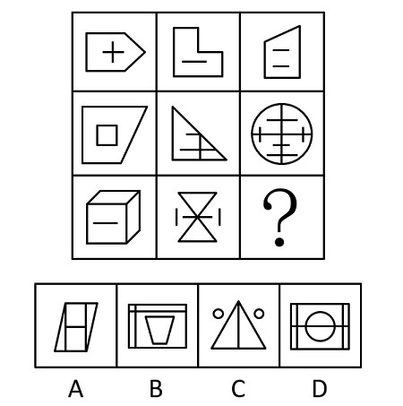

# 数量规律-线数量（横线数与竖线数分开计数并做差运算）

考点：[[20-考点/判断推理/图形推理/数量规律-线数量（横线数与竖线数分开计数并做差运算）|图形推理 / 数量规律-线数量（横线数与竖线数分开计数并做差运算）]]

**问法模型**：‘选出最恰当一项使九宫格呈现规律性’→元素组成不同且属性无规律时转数量规律，图形多边形与单一直线明显则数线，整体无规律时拆分横竖线并对二者做运算找恒定关系

## 推理链
1. 第1步：九宫格图形元素组成不同，对称、曲直等属性规律不明显，且图形中出现'+'、'—'等明显单一直线及L形、立方体等多边形，转向数量规律并优先考虑数线。
2. 第2步：整体数直线总数无规律，但题干图形横线、竖线特征突出，故将直线拆分为横线与竖线分开计数，九宫格优先按横行观察。
3. 第3步：前八个图形横线数依次为3、4、3、4、3、4、4、3，竖线数依次为2、3、2、3、2、3、3、2，两组数列单独看均无规律。
4. 第4步：对横线数与竖线数做运算，发现题干所有图形'横线数−竖线数'恒等于1（如3−2=1、4−3=1）。
5. 第5步：由此确定问号处图形应满足'横线数−竖线数=1'这一恒定关系。
6. 第6步：逐项点数选项的横线与竖线并做差验证，仅A项横线数减竖线数等于1，B、C、D均不符合，故选A。

**最快解法**：⚡ 数量规律口诀‘整体无规律→横竖分开数→单独无规律→做差找恒定’：点数九宫格各行图形横线、竖线数，发现横线−竖线恒为1，再快速点数四个选项横竖线做差，只有A满足，直接锁定。

## 易错点
- ⚠ 只数图形直线总数，发现无规律后放弃，未想到将直线拆分为横线与竖线分开计数
- ⚠ 点数时漏数'+'、'—'等特征明显的内部单一直线，或把斜线误计入横线/竖线导致计数错误
- ⚠ 横竖线两个数列单独无规律时未想到做差/求和运算，或未先按横行观察而错找列规律

## 母题抽象
> 🧩 当九宫格（或分组）图形元素组成不同、属性规律失效且图形由多边形与明显单一直线（如'+'、'—'）构成时，分开数横线数与竖线数；若两个数列单独均无规律，立即对二者做差/求和寻找恒定值，用该恒定关系筛选选项。

**同类特征**：九宫格、元素组成不同且无明显属性规律、图形含单一直线（+、—）与多边形、横线、竖线数量多且直观、横线数−竖线数=1恒定、按行观察数量规律

## 相关题
- [[10-真题/判断推理/图形推理/10204610 样式规律-加减同异（去同存异），九宫格列规律|10204610]]（辽宁 2024，相关度1）
- [[10-真题/判断推理/图形推理/10297349 样式规律-黑白运算|10297349]]（浙江 2025，相关度1）
- [[10-真题/判断推理/图形推理/10297407 样式规律-黑白运算（定义叠加）|10297407]]（四川 2025，相关度1）
- [[10-真题/判断推理/图形推理/10975255 数量规律-元素个数与部分数（黑白球连通堆数）|10975255]]（江苏 2024，相关度1）
- [[10-真题/判断推理/图形推理/11367791 属性类-对称性（对称轴方向与条数、轴对称+中心对称）＋数量类-面数量（九宫格横行复合规律）|11367791]]（江苏 2025，相关度1）

---

### 题干

请从所给的四个选项中，选出最恰当的一项填入问号处，使之呈现出一定的规律性。

### 选项
- A. A　✅
- B. B
- C. C
- D. D

### 官方解析
图形元素组成不同，且无明显属性规律，考虑数量规律。观察发现，题干图形中出现明显单一直线及多边形，优先考虑数直线，发现整体数直线无规律，而题干图形中横线、竖线较多，因此考虑分开数横竖线。九宫格优先横行看，三行图形的横线数依次为3、4、3、4、3、4、4、3，三行图形的竖线数依次为2、3、2、3、2、3、3、2，单看横竖线数无规律，考虑二者做运算。发现题干所有图形的横线数减竖线数均为1，故？处应选择横线数减竖线数等于1的图形，只有A项符合规律。
故正确答案为A。

### 给定材料
（无）
