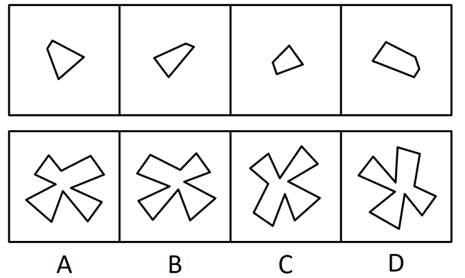
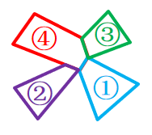

# 平面拼合（平行且等长相消）

考点：[[20-考点/判断推理/图形推理/平面拼合（平行且等长相消）|图形推理 / 平面拼合（平行且等长相消）]]

**问法模型**：题干给出四个小图形、问哪一个可由它们'仅通过上、下、左、右平移'拼合而成 → 用'平行且等长相消'法：拼接处重合边平行等长相互抵消，剩余线段围成的轮廓与选项比对

## 推理链
1. 第1步：题干限定'只能通过上、下、左、右平移'，即四个小图形不能旋转、不能翻转，各边的方向（斜向角度）在拼合前后保持不变
2. 第2步：观察上方四个碎片：前三个为三角形碎片、第四个为多边形碎片，它们拼入整体时必有两两贴合成内部公共边
3. 第3步：按'平行且等长相消'规则，把各碎片中方向相同、长度相等的边两两配对并消去（这些边拼合后成为内部线条，不出现在外轮廓上）
4. 第4步：将消去后剩余的线段按各碎片的相对位置上下左右平移靠拢，剩余边首尾相连围出唯一确定的拼合轮廓
5. 第5步：逐项对照：A、C、D 的外轮廓中存在与剩余线段方向或长度不吻合的边（对应碎片需旋转才能贴合，违反'只能平移'），予以排除
6. 第6步：B 项外轮廓与消去平行等长边后的组合轮廓完全一致，且四个碎片均可不经旋转直接平移归位，故 B 正确

**最快解法**：⚡ 平行且等长相消法：给四个碎片中平行且等长的边两两做标记并'消掉'，剩余线段围成的轮廓即为答案轮廓，与选项比对，只有 B 吻合

## 易错点
- ⚠ 忽略'只能平移'的限制，默认碎片可旋转/翻转，从而误选形状神似但需旋转才能拼成的 C 或 D
- ⚠ 只凭整体轮廓'风车形'相似度粗略匹配，不做边长与方向的严格对照
- ⚠ 相消时漏配一对平行等长边，导致剩余轮廓边数错误而排除正确项

## 母题抽象
> 🧩 当题干出现'多个小图形仅通过平移拼合成一个整体'的特征时，用平行且等长相消法：内部拼接边两两平行等长相消，剩余轮廓逐边对照选项，方向对不上的即为需旋转的干扰项

**同类特征**：四个小图形拼合为一个、只能上、下、左、右平移、三角形与多边形碎片、外轮廓唯一确定、平行且等长相消、四个选项轮廓相似需逐边辨析

## 相关题
- [[10-真题/判断推理/图形推理/5755701 平面拼合（平行且等长相消）|5755701]]（江苏 2023，相关度4）
- [[10-真题/判断推理/图形推理/17058547 平面拼合（平行且等长相消）|17058547]]（选调 2023，相关度3）
- [[10-真题/判断推理/图形推理/17900828 平面拼合（平行且等长相消）|17900828]]（江苏 2024，相关度3）
- [[10-真题/判断推理/图形推理/1791636 平面拼合（平行且等长相消）|1791636]]（江苏 2016，相关度3）
- [[10-真题/判断推理/图形推理/1791816 平面拼合（平行且等长相消）|1791816]]（江苏 2016，相关度3）

---

### 题干

下边四个图形中，只有一个是由上边的四个图形拼合（只能通过上、下、左、右平移）而成的，请把它找出来。

### 选项
- A. A
- B. B　✅
- C. C
- D. D

### 官方解析

本题考察平面拼合，可采用平行且等长相消的方式解题。消去平行且等长的线段后进行组合即可得到轮廓图，即为B项。平行且等长相消的方式如下图所示：

故正确答案为B。

### 给定材料
（无）
