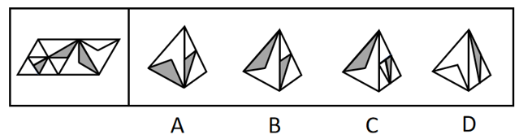
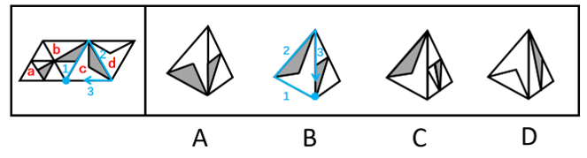

# 空间重构-四面体折叠（公共边法-画边法）

考点：[[20-考点/判断推理/图形推理/空间重构-四面体折叠（公共边法-画边法）|图形推理 / 空间重构-四面体折叠（公共边法/画边法）]]

**问法模型**：给出多面体外表面展开图，问右边哪一项能由它折叠而成 → 先锁定每个立体选项由哪两个相邻面构成，再用画边法比对边序、用公共边与面内图案特征点的重合关系逐一排除

## 推理链
1. 第1步：将展开图标号a、b、c、d四个三角形面，各面内部含阴影小三角形等特征图案，四个立体选项均由其中两个相邻面拼合呈现
2. 第2步：所用规则为相邻面拼合规律——折叠后公共边两侧的面内图案相对位置保持不变
3. 第3步：A项由面b和面c构成，公共边与两面内部图案的相对位置和展开图完全一致，保留
4. 第4步：B项由面b和面c构成，以面c中空白顶点为起点画边编号（蓝线），展开图中边1邻接面b，而选项中边3才邻接面b，边序不符，排除
5. 第5步：C项由面a和面c构成，展开图中两面公共边恰与面a内部阴影小三角形的顶点重合，选项中公共边与该顶点不重合（绿线），排除
6. 第6步：D项由面b和面d构成，展开图中公共边与面d内部三角形的一条边重合，选项中公共边与该边不重合（红线），排除
7. 第7步：仅A项与展开图折叠结果一致，故正确答案为A

**最快解法**：⚡ 画边法＋公共边特征点比对：先判定每个选项由哪两个面构成，再从特征明显的顶点（如面c空白顶点）起画边编号比对邻接面；也可直接观察公共边是否与面内阴影三角形的顶点/边重合，快速排除B、C、D

## 易错点
- ⚠ 只看两面图案形状吻合就判定正确，忽略公共边与面内阴影图案的相对位置（C、D项正是此类陷阱）
- ⚠ 画边法起点选错或绕行方向画反，导致边序比对出错
- ⚠ 四面体四个面为相似三角形，误把相邻关系看成相对关系或搞反镜像方向

## 母题抽象
> 🧩 当展开图为含图案的三角形面（四面体）且选项仅呈现两相邻面的立体图时，用'定面—画边—验公共边与图案特征点是否重合'三步法逐一排除

**同类特征**：多面体外表面展开图、四个三角形面构成的四面体、面内阴影小三角形图案、相邻面公共边、画边法定边序、特征顶点/边重合判断

## 相关题
- [[10-真题/判断推理/图形推理/16593173 空间重构-展开图折叠（相邻面公共边特征）|16593173]]（海南 2024，相关度1）
- [[10-真题/判断推理/图形推理/1791642 空间重构-四面体折叠（相邻面公共边法）|1791642]]（江苏 2016，相关度1）
- [[10-真题/判断推理/图形推理/2367943 空间重构-四面体折纸盒（相邻面公共边法）|2367943]]（江苏 2019，相关度1）
- [[10-真题/判断推理/图形推理/2719391 空间重构-六面体展开图（相邻面公共边法）|2719391]]（国考 2021，相关度1）
- [[10-真题/判断推理/图形推理/4651729 空间重构-多面体展开图折叠（相邻面公共边与特征点定位）|4651729]]（江苏 2022，相关度1）

---

### 题干

左边给定的是多面体的外表面，右边哪一项能由它折叠而成？

### 选项
- A. A　✅
- B. B
- C. C
- D. D

### 官方解析

将题干展开图标上序号，如下图所示，逐一进行分析。

A项：选项由面b和面c构成，选项与题干展开图一致，当选；

B项：选项由面b和面c构成，以面c中空白顶点为起点进行画边（如上图蓝线所示），展开图中边1对应面b，选项中边3对应面b，选项与题干展开图不一致，排除；

C项：选项由面a和面c构成，展开图中，二者的公共边与面a内部阴影小三角形的顶点重合，选项中不重合（如下图绿线所示），选项与题干展开图不一致，排除；

D项：选项由面b和面d构成，展开图中，二者的公共边与面d内部三角形的边重合，选项中不重合（如下图红线所示），选项与题干展开图不一致，排除。

故正确答案为A。

### 给定材料
（无）
