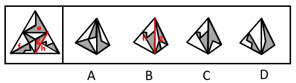
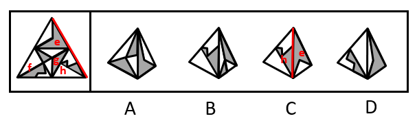

# 空间折叠-四面体折叠（相邻面公共边及公共点特征）

考点：[[20-考点/判断推理/图形推理/空间折叠-四面体折叠（相邻面公共边及公共点特征）|图形推理 / 空间折叠-四面体折叠（相邻面公共边及公共点特征）]]

**问法模型**：左边四面体展开图折叠后哪一项正确 → 用相邻面'公共边两侧图案对应'逐项排除

## 推理链
1. 第1步：展开图为四个三角形面组成的四面体展开图（标号e、f、g、h），面内有线条与阴影（灰色）图案，面e含灰色顶点（蓝点）这一特征定位点
2. 第2步：四面体折叠采用'公共边法'——折叠后相邻两面的公共边，其两侧所挨的半边图案（灰色/空白）必须与展开图一致
3. 第3步：A项由面e和面g构成，展开图中e、g的公共边挨着面g的空白半边，而选项中该公共边挨着面g的灰色半边，图案对应不符，排除
4. 第4步：B项由面g和面h构成，展开图中g、h的公共边挨着面g的灰色半边，而选项中该公共边挨着面g的空白半边，图案对应不符，排除
5. 第5步：D项由面e和面f构成，以面e的灰色顶点（蓝点）为起点顺时针画边编号，展开图中边2与面f的长线相交于点1（边2与边3的交点），而选项中边2与面f的长线不相交于点1，交点定位不符，排除
6. 第6步：C项由面e和面h构成，公共边两侧的阴影/空白分布及线条走向与展开图完全一致，当选

**最快解法**：⚡ 公共边法逐项排除：先辨认每个选项由哪两个面构成，锁定公共边后比对公共边两侧的灰色/空白半边（A、B直接排除），D项需从面e灰色顶点顺时针画边验证线条交点，C项对应无误故选C

## 易错点
- ⚠ 四面体折叠时公共边两侧图案方向易看反：展开图折叠有翻转，须以折叠后视角判断公共边挨着灰色还是空白半边
- ⚠ 只看面内线条形状相似就下结论，忽略公共边及公共点处的图案对应关系（如A、B项外形与正确项接近）
- ⚠ D项需从特征顶点（灰色顶点/蓝点）顺时针给边编号定位交点，直接凭肉眼比线条走向极易误判

## 母题抽象
> 🧩 当题干出现四面体（大三角形分四小面）展开图折叠时，用'公共边两侧图案对应'法快速排除，涉及线条交点时以特征顶点为起点顺时针画边编号验证

**同类特征**：四面体展开图（三角形面）、面内含线条与阴影图案、相邻面公共边两侧图案对应、灰色顶点（蓝点）作定位起点、选项两两相邻面组合辨析、问'哪一项能由它折叠而成'

## 相关题
- [[10-真题/判断推理/图形推理/1805286 空间重构-立体折叠（五棱柱展开图，相邻面黑白关系排除）|1805286]]（上海 2016，相关度1）
- [[10-真题/判断推理/图形推理/2042116 空间重构-四面体折叠（相邻面公共边+箭头法）|2042116]]（江苏 2017，相关度1）
- [[10-真题/判断推理/图形推理/2043634 空间重构-六面体折叠（相对面排除＋时针法＋公共点法）|2043634]]（江苏 2017，相关度1）
- [[10-真题/判断推理/图形推理/2133640 空间重构-六面体折叠（特征边定位+相邻关系验证）|2133640]]（国考 2018，相关度1）
- [[10-真题/判断推理/图形推理/2172154 空间重构-六面体折纸盒（相对面排除＋公共点法）|2172154]]（广州市考 2018，相关度1）

---

### 题干

左边给定的是纸盒外表面的展开图，右边哪一项能由它折叠而成？请把它找出来。

### 选项
- A. A
- B. B
- C. C　✅
- D. D

### 官方解析

将原展开图标上序号，如下图所示，逐一进行分析。

A项：选项由面e和面g构成，展开图中面e与面g的公共边挨着面g的空白面，而选项中面e与面g的公共边半边挨着面g的灰色面，选项与题干展开图不一致，排除；

B项：选项由面g和面h构成，展开图中面g和面h的公共边挨着面g的灰色面，而选项中面g和面h的公共边挨着面g的空白面，选项与题干展开图不一致，排除；

C项：选项由面e和面h构成，选项与题干展开图一致，当选；

D项：选项由面e和面f构成，以面e的灰色顶点（蓝点）为起点顺时针画边，展开图中边2与面f中的长线相交于点1（边2与边3的交点），而选项中边2与面f中的长线不相交于点1（边2与边3的交点），选项与题干展开图不一致，排除。

故正确答案为C。

### 给定材料
（无）
