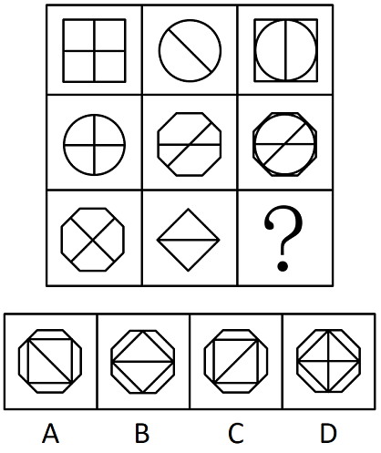

# 样式规律-旋转+求异（去同存异复合规律）

考点：[[20-考点/判断推理/图形推理/样式规律-旋转+求异（去同存异复合规律）|图形推理 / 样式规律-旋转+求异（去同存异复合规律）]]

**问法模型**：九宫格问号处填图形使之呈现规律性 → 元素相似且相同线条重复出现，按行考虑'图2先旋转再与图1去同存异'的复合样式规律

## 推理链
1. 第1步：九宫格各行图形元素相似，外框与内部线条重复出现（方形、圆形、八边形、对角线反复出现），优先考虑样式规律中的加减同异，按行观察
2. 第2步：第一行图1为'正方形+横竖十字线'，图2为'圆+对角线\'，图3为'外正方形+内切圆+竖线'；将图2逆时针旋转45°，圆不变、对角线'\'变为水平横线'
3. 第3步：旋转后的图2与图1去同存异：横线两图均有被消去，保留'正方形+竖线+圆'，恰等于图3，规律初步成立
4. 第4步：第二行验证：图2'八边形+横线+对角线'逆时针旋转45°后，与图1'圆+十字'叠加去同存异，共有线条相消，剩余'圆+八边形+横线+对角线'，与图3一致，规律确认
5. 第5步：第三行应用规律：图1为'八边形+双对角线（X形）'，图2为'菱形+水平中线'
6. 第6步：图2逆时针旋转45°：菱形转为正放的正方形，水平中线转为'/'向对角线；再与图1去同存异，'/'对角线两图共有被消去，保留'八边形+正方形+\'向单对角线'
7. 第7步：对照选项，只有A项为'八边形内含正方形及\'向单对角线'，B项多出多余斜线、C项斜线方向不符、D项为圆形十字，故选A

**最快解法**：⚡ 去同存异+旋转口诀：九宫格按行看，图2整体逆时针转45°后与图1叠画去同存异；第三行抓住'菱形转正方形、横线转斜线，与图1的X形相消一根斜线'，直接锁定A

## 易错点
- ⚠ 忽略图2需先逆时针旋转45°，直接对图1、图2求异，发现无对应选项而误选
- ⚠ 旋转角度/方向判断错误：将对角线误转成竖线或把菱形转向搞反，导致斜线方向不符误选C
- ⚠ 漏看第三行图2中的水平中线，旋转后未与图1相消'/'对角线，误选保留双斜线的B

## 母题抽象
> 🧩 当九宫格图形元素相似、相同线条重复出现时，按行验证'图2先逆时针旋转（常为45°/90°）再与图1去同存异'的复合规律，前两行确认后套用于第三行选答案

**同类特征**：九宫格按行规律、元素组成相似、相同线条重复出现、加减同异（去同存异）、图2旋转45°、内外嵌套线条相消

## 相关题
- [[10-真题/判断推理/图形推理/12019768 样式规律-加减同异（求同）与位置旋转的复合规律|12019768]]（浙江 2026，相关度2）
- [[10-真题/判断推理/图形推理/14403686 样式规律-黑白叠加（重叠为白、非重叠为黑）|14403686]]（山东 2025，相关度2）
- [[10-真题/判断推理/图形推理/16070178 样式规律-加减同异（翻转+去同存异）|16070178]]（重庆 2026，相关度2）
- [[10-真题/判断推理/图形推理/17056529 样式规律-求同求异（分元素：直线求同、小圆圈求异）|17056529]]（上海 2026，相关度2）
- [[10-真题/判断推理/图形推理/17058551 样式规律-加减同异（多图相加-叠加）|17058551]]（选调 2023，相关度2）

---

### 题干

请从所给的四个选项中，选出最恰当的一项填入问号处，使之呈现出一定的规律性：

### 选项
- A. A　✅
- B. B
- C. C
- D. D

### 官方解析

元素组成相似，优先考虑样式规律，且相同线条重复出现，因此考虑样式规律中的加减同异。九宫格优先按行看，观察发现，第一行中，图2逆时针旋转，再与图1求异得到图3。经验证，第二行也满足此规律。因此第三行应用此规律，图2逆时针旋转，再与图1求异，得到A项图形。

故正确答案为A。

### 给定材料
（无）
