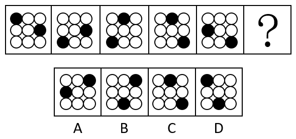
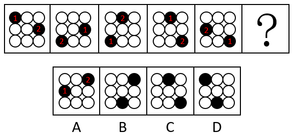

# 位置规律-平移（外圈顺时针循环移动，双元素同速同向）

考点：[[20-考点/判断推理/图形推理/位置规律-平移（外圈顺时针循环移动，双元素同速同向）|图形推理 / 位置规律-平移（外圈顺时针循环移动，双元素同速同向）]]

**问法模型**：问号处填入图形使之呈现规律性 → 元素组成相同，优先考虑位置规律，对黑球逐一追踪移动轨迹

## 推理链
1. 第1步：题干五幅图均为3×3九宫圆圈，元素组成完全相同，只有两个黑球位置在变，锁定位置规律
2. 第2步：将外圈8个圆顺时针编号（左上1、上中2、右上3、右中4、右下5、下中6、左下7、左中8），黑球始终在外圈循环，不经过中心
3. 第3步：图1黑球在1号（左上）和4号（右中），各顺时针移3格应到4号和7号，与图2（右中、左下）完全吻合
4. 第4步：继续验证：图2→图3移至7号和2号（左下、上中）✓，图3→图4移至2号和5号（上中、右下）✓，图4→图5移至5号和8号（右下、左中）✓，规律成立：两黑球每次各顺时针移3格
5. 第5步：由图5黑球位于5号（右下）和8号（左中），再各顺时针移3格，应到8号（左中）和3号（右上）
6. 第6步：对照选项，只有A项黑球位于右上角和左中，与推导位置一致，故选A

**最快解法**：⚡ 外圈编号法+恒定步长验证：外圈8格顺时针编号，发现两黑球每次同步顺时针走3格，从图5直接再走3格得左中+右上，秒选A

## 易错点
- ⚠ 把黑球移动按9格直线平移处理，未识别出是外圈8格循环，导致步长对不上
- ⚠ 只盯一个黑球追踪，忽略两球同速同向移动，误判另一球落点
- ⚠ 方向看反：若按逆时针验证步长会错位，得出B或D等干扰项

## 母题抽象
> 🧩 当图形元素组成相同、仅小元素（黑球/黑块）在九宫格外圈变位时，给外圈顺时针编号并验证每幅图间移动格数是否恒定，再用该步长外推一格即为答案

**同类特征**：元素组成相同、3×3九宫圆圈底、两个黑球、黑球仅在外圈变化、逐图等步长移动、问号处求下一状态

## 相关题
- [[10-真题/判断推理/图形推理/19591592 位置规律-平移（内外圈分组移动）|19591592]]（选调 2025，相关度2）
- [[10-真题/判断推理/图形推理/2295526 图形推理-位置规律（平移-内外圈分块追踪）|2295526]]（上海 2019，相关度2）
- [[10-真题/判断推理/图形推理/4651708 位置规律-平移（外圈循环平移+元素重合）|4651708]]（江苏 2022，相关度2）
- [[10-真题/判断推理/图形推理/2172768 位置规律（旋转-翻转）|2172768]]（海南 2021，相关度1）
- [[10-真题/判断推理/图形推理/10204458 位置规律-平移（特征交点沿内圈循环平移）|10204458]]（甘肃 2024，相关度1）

---

### 题干

请从所给的四个选项中，选出最恰当的一项填入问号处，使之呈现一定的规律性。

### 选项
- A. A　✅
- B. B
- C. C
- D. D

### 官方解析

元素组成相同，优先考虑位置规律。观察发现，题干图形中的两个黑球每次分别顺时针移动3格，如下图所示：

故正确答案为A。

### 给定材料
（无）
