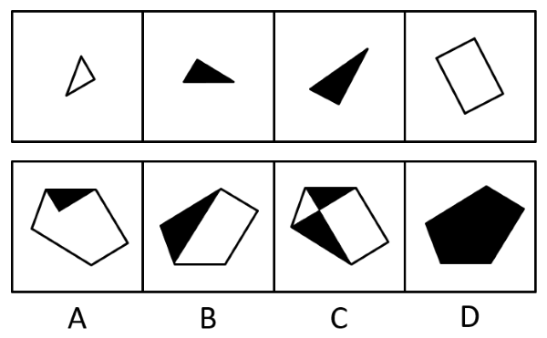

# 平面拼合（平行且等长相消+翻转变色）

考点：[[20-考点/判断推理/图形推理/平面拼合（平行且等长相消+翻转变色）|图形推理 / 平面拼合（平行且等长相消+翻转变色）]]

**问法模型**：题干问'仅有一项能由四张纸片拼合（可平移、旋转、翻转）而成'→ 采用平面拼合模型：先按'翻转即黑白面互换'确定各片朝向颜色，再沿平行且等长的公共边相消拼轮廓，对照选项颜色与形状

## 推理链
1. 第1步：提取题干要素——四张纸片分别为①小白色三角形、②小黑色三角形、③大黑色三角形、④白色平行四边形，且每张'一面是黑色，另一面是白色'，允许平移、旋转、翻转
2. 第2步：确定规则——拼合时相邻拼块沿'平行且等长'的边对接，公共边在图形内部相消，剩余外部轮廓即为选项；同时'翻转'会使纸片黑白面互换，故①④翻转后可由白面变为黑面
3. 第3步：观察选项颜色分布——A为白底+顶部黑三角、B为白底+左侧黑三角、C为黑白相间的四块三角形、D为全黑五边形
4. 第4步：按官方解析将①和④翻转，四片全呈黑面；将②③两黑三角与翻转后的①、④沿平行且等长的边两两相消，内部公共边全部消去，外部轮廓合为一个完整黑色五边形
5. 第5步：逐项对照——A、B、C内部均保留白色区域，意味着相应拼块须以白面朝上，但其形状/边长关系又要求翻转（翻后应变黑），颜色与拼合关系矛盾，排除
6. 第6步：D项全黑且轮廓与四片相消后的外边界一致，无内部残留线段和白区，故仅D能由四张纸片拼合而成

**最快解法**：⚡ 平行且等长相消法：先把①、④翻转使四片全变黑面，再沿平行且等长的公共边两两相消拼合，内部不残留任何白区，直接锁定全黑五边形D

## 易错点
- ⚠ 忽略'翻转即黑白面互换'的颜色约束，只看轮廓相似而误选含白区的A、B或C
- ⚠ 相消时看错平行且等长的对应边（把不平行或不等长的边当作公共边），导致拼合关系错位
- ⚠ 漏掉某片需翻转才能拼入，误以为该片保持原白面朝上即可，与选项颜色矛盾仍强行匹配

## 母题抽象
> 🧩 当题干出现'每张纸片一面黑一面白、可平移旋转翻转拼合'的特征时，先用颜色约束（翻转换色）确定各片朝向，再用平行且等长相消法拼轮廓，最后验证选项内部颜色与外轮廓同时吻合

**同类特征**：一面是黑色另一面是白色、可平移、旋转、翻转、仅有一项能拼合、三角形与平行四边形纸片、平行且等长相消、平面拼合

## 相关题
- [[10-真题/判断推理/图形推理/4651698 图形推理-平面拼合（双面纸片翻面变色规则）|4651698]]（江苏 2022，相关度3）
- [[10-真题/判断推理/图形推理/10975247 图形推理-平面拼合（平行且等长相消法）|10975247]]（江苏 2024，相关度2）
- [[10-真题/判断推理/图形推理/11367796 平面拼合-平行且等长相消|11367796]]（江苏 2025，相关度2）
- [[10-真题/判断推理/图形推理/12304870 图形推理-平面拼合（平行且等长相消法）|12304870]]（江苏 2024，相关度2）
- [[10-真题/判断推理/图形推理/12536406 图形推理-平面拼合（平行且等长相消）|12536406]]（四川 2024，相关度2）

---

### 题干

上边四张纸片，每张纸片一面是黑色，另一面是白色，下边仅有一项能由其拼合（可以平移、旋转、翻转）而成，请把它找出来。

### 选项
- A. A
- B. B
- C. C
- D. D　✅

### 官方解析

本题考查平面拼合，可采用平行且等长相消的方式解题。将图①和图④翻转后，消去平行且等长的线段后进行组合可得到轮廓图，即为D项。平行且等长相消的方式如下图所示：

故正确答案为D。

### 给定材料
（无）
