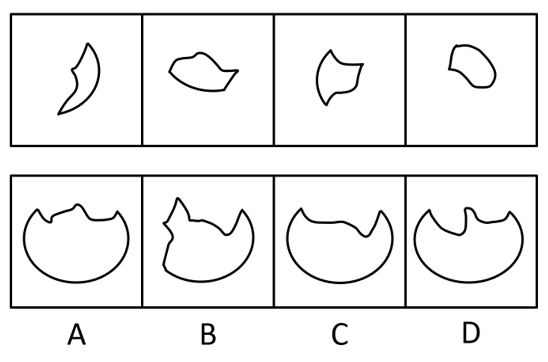
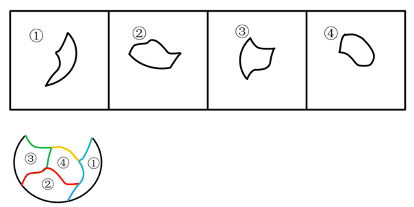

# 平面拼合（凹凸匹配消线法）

考点：[[20-考点/判断推理/图形推理/平面拼合（凹凸匹配消线法）|图形推理 / 平面拼合（凹凸匹配消线法）]]

**问法模型**：四个小块限定'只能平移'拼合成一个图形 → 凹凸匹配消线拼合法：相邻公共边凹凸咬合后消去，剩余外轮廓即为答案

## 推理链
1. 第1步：题干限定'只能通过上、下、左、右平移'，即四个小块不可旋转、不可翻转，只能改变相对位置进行拼合
2. 第2步：平面拼合规则——相邻两块的公共边凹凸互相咬合并消去，未被消去的边构成最终外轮廓
3. 第3步：识别四个小块的凹凸特征：图1为月牙形（一凸一凹弧），图2含锯齿状凸边，图3下端带内凹缺口，图4为近椭圆形小块
4. 第4步：将图3的凹口与图1/图4的凸弧咬合、图2的锯齿凹凸边与相邻块的对应凹边匹配，四块拼成近似圆形的整体
5. 第5步：消去全部内部公共边后，外轮廓主体为圆弧，仅在顶部保留一处缺口
6. 第6步：对照选项逐项排除——A顶部呈多凹口的波浪形、B左侧多出尖角凸起、D顶部缺口呈深V形，均与消线后的轮廓不符；只有C的缺口数量、位置与形状和拼合结果一致，故选C

**最快解法**：⚡ 凹凸匹配消线法（拼合法）：先看整体轮廓与缺口——四个选项主体轮廓相近，快速对比顶部缺口的数量、位置与形状（A多口、B带尖角、D深V口），拼合后仅留一处缺口且缺口边缘由原块外边构成，与C吻合

## 易错点
- ⚠ 忽略'只能平移'的限制，擅自旋转或翻转拼块导致凹凸边方向错配
- ⚠ 只比较选项外轮廓大小，不逐条消去公共边，被相似轮廓干扰
- ⚠ C与D仅顶部缺口形状不同，未细辨缺口深度与边缘走向而误选D

## 母题抽象
> 🧩 当题干出现'几个图形拼合且只能平移'的特征时，用凹凸匹配消线法：先锁定每块的凹凸边，咬合消去公共边后，验证剩余外轮廓（尤其缺口数量与形状）与选项是否一致

**同类特征**：平面拼合、只能上下左右平移（不可旋转翻转）、四个不规则小块、凹凸边咬合、消去公共边找外轮廓、选项轮廓相近靠缺口辨析

## 相关题
- [[10-真题/判断推理/图形推理/3019154 平面拼合（不旋转平移拼合-边线匹配）|3019154]]（广东 2021，相关度1）
- [[10-真题/判断推理/图形推理/10975247 图形推理-平面拼合（平行且等长相消法）|10975247]]（江苏 2024，相关度1）
- [[10-真题/判断推理/图形推理/10975248 平面拼合（分割重组-三角形拼合）|10975248]]（江苏 2024，相关度1）
- [[10-真题/判断推理/图形推理/11367796 平面拼合-平行且等长相消|11367796]]（江苏 2025，相关度1）
- [[10-真题/判断推理/图形推理/12304870 图形推理-平面拼合（平行且等长相消法）|12304870]]（江苏 2024，相关度1）

---

### 题干

下边四个图形中，只有一个是由上边的四个图形拼合（只能通过上、下、左、右平移）而成的，请把它找出来。

### 选项
- A. A
- B. B
- C. C　✅
- D. D

### 官方解析

本题考查平面拼合。消去凹凸匹配的线条后进行组合可得到轮廓图，即为C项。具体拼合方式如下图所示：

故正确答案为C。

### 给定材料
（无）
