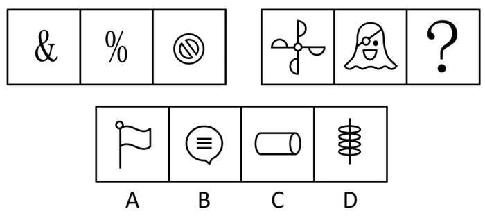

# 数量规律-数曲线（曲线数等差递增-递减）

考点：[[20-考点/判断推理/图形推理/数量规律-数曲线（曲线数等差递增-递减）|图形推理 / 数量规律-数曲线（曲线数等差递增/递减）]]

**问法模型**：两组图对比、选择最合适图形填入问号处 → 元素组成不同且无属性规律、图形均含曲线时，优先数曲线数量，找两组各自的递变规律并延续

## 推理链
1. 第1步：两组图元素组成不同，属性（对称、开闭等）无统一明显规律，但题干各图（&、%、⊘、风车、幽灵）均含曲线且出现单一曲线，锁定'数曲线'考点
2. 第2步：数第一组曲线数：'&'=1、'%'=2、'⊘'=3，呈1、2、3递增规律，两组图应各自呈等差递变
3. 第3步：数第二组曲线数：风车图=5、幽灵图=4，呈递减趋势，故？处图形曲线数应为3
4. 第4步：逐项数选项曲线：A旗子=3条曲线（旗面上下两条波浪线+杆顶小圆圈）；B气泡=1条；C圆柱=2条；D弹簧状图形曲线数大于3
5. 第5步：仅A项曲线数为3，延续第二组5、4、3的递减规律，故选A
6. 第6步（备检）：对称性思路（不对称→中心对称→轴+中心对称）指向D，但题干并非每图都具备对称性，且两组对称类型出现顺序不一致，严谨性低于曲线数规律，官方采信思路一

**最快解法**：⚡ 数曲线+递变口诀：先判'元素组成不同+均含曲线'→数出第一组1、2、3递增，第二组5、4递减→锁定？=3条曲线→快速扫选项：A旗子恰为3条曲线（两条波浪线+小圆圈），B=1、C=2、D>3，直选A

## 易错点
- ⚠ 只看第一组递增而忽略第二组是反向递减（两组各自成等差，方向可相反）
- ⚠ 被'对称性思路'带偏误选D——该思路虽也能唯一确定，但出现顺序杂乱、严谨性不足
- ⚠ 数曲线时漏数小圆圈、波浪边等小曲线，或把旗杆、气泡内横线、圆柱轮廓直边等直线误计为曲线

## 母题抽象
> 🧩 当两组图形元素组成不同、属性规律不明显且每幅图都含曲线（尤其出现单一曲线）时，用'数曲线'法，验证两组曲线数是否各自构成递增/递减等差序列，选满足延续数字的选项

**同类特征**：元素组成不同、无明显属性规律、所有图形均含曲线、出现单一曲线、两组图对比求问号、数量呈递增/递减

## 相关题
- [[10-真题/判断推理/图形推理/2385136 数量规律-线数量（曲线与直线分开数）|2385136]]（深圳市考 2019，相关度3）
- [[10-真题/判断推理/图形推理/5518369 数量规律-数曲线（曲线条数递增）|5518369]]（湖北 2021，相关度3）
- [[10-真题/判断推理/图形推理/10204454 数量规律-部分数（黑白球连通区域数做和）|10204454]]（甘肃 2024，相关度2）
- [[10-真题/判断推理/图形推理/10297050 数量规律-特殊计数（线条穿过小白球的数量）|10297050]]（天津 2025，相关度2）
- [[10-真题/判断推理/图形推理/10297262 数量规律-面的形状种类（封闭面种类数分组）|10297262]]（浙江 2025，相关度2）

---

### 题干

从所给的四个选项中，选择最合适的一个填入问号处，使之呈现一定的规律性：

### 选项
- A. A　✅
- B. B
- C. C
- D. D

### 官方解析
解题思路一：图形元素组成不同，且无明显属性规律。观察发现，题干图形都存在曲线，且有单一曲线出现，优先考虑数曲线；第一组图形的曲线数依次为1、2、3，曲线数依次递增；第二组图的曲线数依次为5、4、？，曲线数依次递减，故？处应选择曲线数为3的图形，只有A项符合规律。
故正确答案为A。
解题思路二：图形元素组成不同，优先考虑属性规律。观察发现，第一组图形图1为不对称图形、图2为中心对称图形、图3为轴+中心对称图形，第二组图形图1为中心对称图形，图2为不对称图形，故？处应选择轴+中心对称的图形，只有D项符合规律。
故正确答案为D。
注：思路一和思路二均可以选出唯一答案，但首先，从整体图形特征来看，题干和选项的每幅图都有曲线，考查曲线的概率更大，而题干并不是所有图形都具备对称性，对称考法不是很严谨。其次，思路二考虑对称时，两组图不同对称性出现的顺序是乱的，而看曲线数时，两组图都是依次变化，依次递增、依次递减，思路一相比思路二更为严谨，因此粉笔更倾向于选A。

### 给定材料
（无）

<!-- CODEX-ANSWER-REVIEW:BEGIN -->
### 本次独立复核

**复核状态：** `resolved`（答案与解析已核定）

**计分答案：** A（可计分）

**复核解析：**

【编辑版】第一组三图曲线数为1、2、3递增；第二组已给5、4，依次递减，缺项应有3条曲线，只有A符合。原题另按对称类型可推出D；编辑题干指定曲线数量规律。

**修订题干：**

从所给的四个选项中，选择最合适的一个填入问号处，使之呈现一定的规律性：

**【编者修订条件】** 【编辑版】只按曲线数递变补图：第一组1、2、3递增，第二组5、4、3递减。

**相关信息：**

图形数量—曲线数量；对称性和曲线数可能同时变化，需依据题目明确的统计口径。

**题源依据：** [固定版本原题](https://github.com/Mentat-Uran/kaogongzhentizhengliu/blob/84ab93d4b64b61d897bece8a1c0a5bab06b4feb2/10-%E7%9C%9F%E9%A2%98/%E5%88%A4%E6%96%AD%E6%8E%A8%E7%90%86/%E5%9B%BE%E5%BD%A2%E6%8E%A8%E7%90%86/4651897%20%E6%95%B0%E9%87%8F%E8%A7%84%E5%BE%8B-%E6%95%B0%E6%9B%B2%E7%BA%BF%EF%BC%88%E6%9B%B2%E7%BA%BF%E6%95%B0%E7%AD%89%E5%B7%AE%E9%80%92%E5%A2%9E-%E9%80%92%E5%87%8F%EF%BC%89.md)；固定内容 commit `84ab93d4b64b61d897bece8a1c0a5bab06b4feb2`，Markdown blob `f44d20e2f8b2333759de84de525e5ae50c7ee6c5`。
<!-- CODEX-ANSWER-REVIEW:END -->
