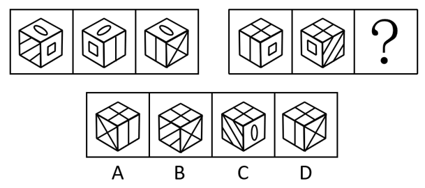

# 位置规律-立体图形旋转（六面体绕竖直轴顺时针旋转）

考点：[[20-考点/判断推理/图形推理/位置规律-立体图形旋转（六面体绕竖直轴顺时针旋转）|图形推理 / 位置规律-立体图形旋转（六面体绕竖直轴顺时针旋转）]]

**问法模型**：两组立体图形'？'处填入最合适的一项 → 先在第一组归纳位置旋转规律，再代入第二组逐幅验证并推出问号图形

## 推理链
1. 第1步：第一组三幅图顶面均为椭圆面，顶面图案始终不变，说明六面体只是在水平面内绕竖直轴整体旋转，而非翻转
2. 第2步：对比第一组图1与图2：图1左面为斜线面、右面为方框面，图2左面变为方框面、右面变为空白面，即'右侧面转到左侧面'，对应顶视顺时针旋转90°
3. 第3步：用图2→图3验证规律：图2左面的方框面转离视野，右面的空白面转到左面（图3左面确为空白），同时后侧新的一面（X线面）转到右面，规律成立
4. 第4步：将规律应用到第二组：图1顶面为田字面、左面空白、右面方框，图2顶面仍为田字面、左面变为方框面（=图1右面）、右面变为斜线面，与第一组'顺时针旋转90°'规律完全一致
5. 第5步：故'？'处图形应由图2再顺时针旋转90°：顶面仍为田字面，左面应为图2的右面即斜线面
6. 第6步：逐项对照：A左面为X线面、C右面出现椭圆面（面本身不对）、D左面为空白面，均不符；只有B左面为斜线面，故选B

**最快解法**：⚡ 相邻面转动追踪法：第一组确认'右面→左面'的顺时针轮换后，第二组'？'处直接取图2的右面（斜线面）转到左面、顶面田字面不动，锁定左面为斜线面的B

## 易错点
- ⚠ 把'沿水平方向顺时针旋转'误解为绕水平轴翻转，误以为顶面会变，实际三幅图顶面图案（椭圆/田字）始终不变
- ⚠ 只验证'？'处顶面是田字面就匆忙选择，忽略左侧面必须是图2的右面（斜线面），易误选左面为空白面的D
- ⚠ 混淆平行斜线面与X交叉线面，A与B的辨析点正在于此，需看清左面线条是平行斜线还是交叉线

## 母题抽象
> 🧩 当两组立体图形的顶面图案在各幅图中保持不变时，优先考虑绕竖直轴顺/逆时针旋转90°；用'某个侧面转到相邻侧面'追踪面的轮换顺序，再以'顶面特征+左面（或右面）特征'双要点锁定选项

**同类特征**：两组图、每组三个六面体、同一立方体呈现不同角度、顶面图案（椭圆/田字）在三幅图中不变、侧面为方框面、斜线面、空白面等特征面轮换、问'？'处使之呈现规律性

## 相关题
（暂无）

---

### 题干

从所给的四个选项中，选择最合适的一个填入问号处，使之呈现一定的规律性：

### 选项
- A. A
- B. B　✅
- C. C
- D. D

### 官方解析

两组图形优先观察第一组，均为同一个六面体，图1整体沿水平方向顺时针旋转得到图2，图2整体沿水平方向顺时针旋转得到图3。第二组图形应用此规律，验证图1到图2，满足此规律，因此“？”处图形应由图2整体沿水平方向顺时针旋转得到，即顶面为田字面，左面为斜线面。

故正确答案为B。

### 给定材料
（无）
