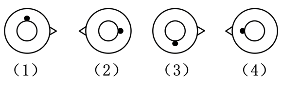
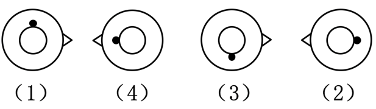

# 图形推理-位置规律（旋转-交替出现）

考点：[[20-考点/判断推理/图形推理/图形推理-位置规律（旋转-交替出现）|图形推理 / 图形推理-位置规律（旋转/交替出现）]]

**问法模型**：问'共有几种排列能使四图之间存在逻辑关系' → 以（1）为首位枚举全部排列，逐一代入验证小元素是否满足统一的位置变化规律（枚举计数型位置规律题）

## 推理链
1. 第1步：四图元素组成相同（大圆、小圆、小黑点、短折线），优先考虑位置规律；提取黑点位置：（1）上、（2）右、（3）下、（4）左，短折线侧别：（1）右、（2）左、（3）右、（4）左
2. 第2步：所用方法为枚举验证：固定（1）在首位，（2）（3）（4）共3!＝6种排列，逐一对两个元素分别检验'黑点绕小圆连续旋转90°'与'折线左右交替出现'两条规律
3. 第3步：排列（1）（2）（3）（4）：黑点 上→右→下→左，顺时针每次转90°，折线 右、左、右、左 交替，两规律均成立
4. 第4步：排列（1）（4）（3）（2）：黑点 上→左→下→右，逆时针每次转90°，折线 右、左、右、左 交替，两规律亦成立
5. 第5步：其余四种排列（1）（2）（4）（3）、（1）（3）（2）（4）、（1）（3）（4）（2）、（1）（4）（2）（3）：黑点轨迹出现跳跃（非连续旋转），且折线出现'右右'或'左左'相邻，两规律均被破坏
6. 第6步：统计成立排列共2种，与选项B'有两种排列'对照，结论一致

**最快解法**：⚡ 枚举法+双元素口诀：固定首位（1）后，黑点位置'上右下左'只允许两条链——顺时针链（2）（3）（4）与逆时针链（4）（3）（2），再快速核对这两条链中折线是否'右左交替'（均满足），其余4种链直接排除，秒得2种

## 易错点
- ⚠ 只验证小黑点旋转规律而忽略短折线'右左右左'交替这一第二重规律，可能误判其余排列
- ⚠ 思维定式只找顺时针规律，漏掉逆时针排列（1）（4）（3）（2），误选A
- ⚠ 把6种排列逐一完整硬验证导致费时，未先用黑点位置序列快速筛选候选链

## 母题抽象
> 🧩 当一组图形'元素组成相同、仅小元素方位不同'且问'几种排列能使图形呈规律'时，先抄录每个小元素的位置序列，再以'连续旋转（顺/逆时针）+另一元素交替出现'为标准枚举验证并计数

**同类特征**：元素组成相同、小黑点绕小圆旋转、短折线左右交替、（1）图固定最左、问有几种排列、排列组合×位置规律复合

## 相关题
- [[10-真题/判断推理/图形推理/2172768 位置规律（旋转-翻转）|2172768]]（海南 2021，相关度1）
- [[10-真题/判断推理/图形推理/10204458 位置规律-平移（特征交点沿内圈循环平移）|10204458]]（甘肃 2024，相关度1）
- [[10-真题/判断推理/图形推理/10204614 图形推理-位置规律（旋转+翻转交替循环）|10204614]]（黑龙江 2024，相关度1）
- [[10-真题/判断推理/图形推理/10297399 位置规律—平移（多黑块分组循环平移）|10297399]]（四川 2025，相关度1）
- [[10-真题/判断推理/图形推理/11226892 位置规律-九宫格小元素沿固定循环链移动|11226892]]（上海 2025，相关度1）

---

### 题干

把（1）图放在最左边，（2）（3）（4）图放在后面，共有6种排列，其中<u>        </u>能使四图之间存在逻辑关系。

### 选项
- A. 只有一种排列
- B. 有两种排列　✅
- C. 有三种排列
- D. 有四种排列

### 官方解析

题干每幅图均由大圆形、小圆形、小黑点和短折线组成，元素组成相同，优先考虑位置规律。根据题干要求，把（1）图放在最左边，（2）（3）（4）图放在后面，共有6种排列顺序。当排列顺序为（1）（2）（3）（4）时，小黑点绕着小圆形每次顺时针旋转，短折线按照在大圆形的右侧、左侧、右侧、左侧的顺序交替出现，四图之间存在逻辑关系。

当排列顺序为（1）（4）（3）（2）时，小黑点绕着小圆形每次逆时针旋转，短折线按照在大圆形的右侧、左侧、右侧、左侧的顺序交替出现，四图之间存在逻辑关系。

当排列顺序为（1）（2）（4）（3）、（1）（3）（2）（4）、（1）（3）（4）（2）或（1）（4）（2）（3）时，小黑点和短折线的位置均不存在逻辑关系。故共有两种排列能使四图之间存在逻辑关系。

故正确答案为B。

### 给定材料
（无）
