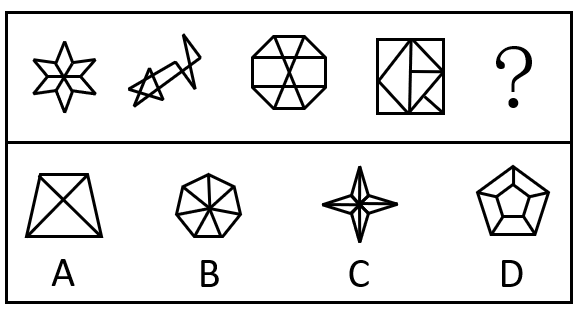

# 数量规律-面数量（对称数列补位）

考点：[[20-考点/判断推理/图形推理/数量规律-面数量（对称数列补位）|图形推理 / 数量规律-面数量（对称数列补位）]]

**问法模型**：问'符合所给图形变化规律'→ 元素组成不同且图形被线条明显分割时，优先数面数量，数列呈对称结构则对称补位定答案。

## 推理链
1. 第1步：题干五幅图元素组成不同，且每幅图都被线条明显分割出多个封闭区域，优先考虑数量规律中的面数量。
2. 第2步：逐一数面：图1六角星内部被分成6个面，图2两图形交叠形成8个面，图3八边形内嵌交叉线分成10个面，图4正方形被分割成8个面。
3. 第3步：面数量数列为6、8、10、8、?，以10为峰值两侧呈8对称，属对称数列，故？处应补回6个面。
4. 第4步：数选项面数量：A梯形含交叉线为4个面，B七边形放射分割为7个面左右，C四角星仅1个封闭区域，D五边形内嵌小五边形及连线共6个面。
5. 第5步：只有D项面数量为6，与对称数列补位结果一致，故选D。

**最快解法**：⚡ 数面法+对称数列口诀：快速数出题干面数为6、8、10、8，见'小-大-回落'即按对称补位取6，再扫一眼选项面数，仅D为6直接锁定。

## 易错点
- ⚠ 误用属性规律：按'轴+中心对称与非对称交替'会推出C项，与官方答案D冲突，本题对称交替规律不作定答案依据
- ⚠ 数面时漏数交叠、内嵌线条切出的小封闭区域，如图2交叠处、图3中心交叉处易少数
- ⚠ 误按递增/递减数列猜测？处面数应超过10，从而错选B类多面图形

## 母题抽象
> 🧩 当题干图形元素组成不同且被线条明显分割成多个封闭区域时，优先数面数量；若数列呈'小-中-大-中-？'对称形态，按对称补位确定？处数值，再对照选项面数排除。

**同类特征**：元素组成不同、图形被明显分割、封闭区域清晰可数、面数量呈对称数列(6,8,10,8,?)、第五幅为问号待填、选项面数互不相同

## 相关题
- [[10-真题/判断推理/图形推理/2633371 数量规律-数角（交点处分角计数）|2633371]]（选调 2016，相关度2）
- [[10-真题/判断推理/图形推理/4767961 属性规律（竖轴对称）+数量规律（面数量等差递增）复合考点|4767961]]（四川 2017，相关度2）
- [[10-真题/判断推理/图形推理/4767997 数量规律-面数量（框内交点数、笔画数均可替代，属多规律收敛题）|4767997]]（四川 2017，相关度2）
- [[10-真题/判断推理/图形推理/5102354 数量规律-面数量（封闭区域数）分组|5102354]]（浙江 2022，相关度2）
- [[10-真题/判断推理/图形推理/10204454 数量规律-部分数（黑白球连通区域数做和）|10204454]]（甘肃 2024，相关度1）

---

### 题干

下列选项中，符合所给图形变化规律的是：

### 选项
- A. A
- B. B
- C. C
- D. D　✅

### 官方解析
解法一：元素组成不同，可以考虑数量规律。观察发现，题干图形明显被分割，可以考虑面数量。题干图形的面数量依次为6、8、10、8、？，可以得出根据题干图3左右两边图形面数量对称，故？处图形的面数量应为6，只有D项满足规律。
故正确答案为D。
解法二：元素组成不同，可以考虑属性规律。观察发现，题干图形依次为轴+中心对称图形、非对称图形、轴+中心对称图形、非对称图形、？，可以得出题干图形为轴+中心对称图形与非对称图形交替出现，故？处图形应为轴+中心对称图形，只有C项满足规律。
故正确答案为C。
注：本题这两种解题规律都不常规，上海考生简单了解基本解题思路即可，其他省份考生无需作为备考重点。

### 给定材料
（无）

> [!warning] 疑点（官方解析可能有误，待人工复核）
> 官方解析解法二按'轴+中心对称图形与非对称图形交替'推出C项，与官方正确答案D相矛盾；官方虽注明两种规律均不常规并最终以面数量规律定D，但对称交替规律在题干图形上同样可观察成立，说明本题规律不唯一，备考时以面数量对称数列（D）为准。

<!-- CODEX-ANSWER-REVIEW:BEGIN -->
### 本次独立复核

**复核状态：** `resolved`（答案与解析已核定）

**计分答案：** D（可计分）

**复核解析：**

【编辑版】封闭面数依次为6、8、10、8、？，呈关于第三幅图对称的数列，缺项应回到6面。只有D有6个封闭面。原图另可按轴/中心对称交替得到C，编辑题干限定面数对称序列。

**修订题干：**

下列选项中，符合所给图形变化规律的是：

**【编者修订条件】** 【编辑版】仅按封闭面数6、8、10、8、6的对称数列补图。

**相关信息：**

数量规律—封闭面计数与对称数列；数面时只计由线条完全围成的封闭区域。

**题源依据：** [固定版本原题](https://github.com/Mentat-Uran/kaogongzhentizhengliu/blob/84ab93d4b64b61d897bece8a1c0a5bab06b4feb2/10-%E7%9C%9F%E9%A2%98/%E5%88%A4%E6%96%AD%E6%8E%A8%E7%90%86/%E5%9B%BE%E5%BD%A2%E6%8E%A8%E7%90%86/4651997%20%E6%95%B0%E9%87%8F%E8%A7%84%E5%BE%8B-%E9%9D%A2%E6%95%B0%E9%87%8F%EF%BC%88%E5%AF%B9%E7%A7%B0%E6%95%B0%E5%88%97%E8%A1%A5%E4%BD%8D%EF%BC%89.md)；固定内容 commit `84ab93d4b64b61d897bece8a1c0a5bab06b4feb2`，Markdown blob `e5ba67f61341464ceb60380687f4be0809e6fc39`。
<!-- CODEX-ANSWER-REVIEW:END -->
