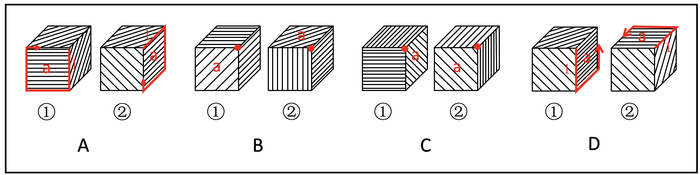

# 立体图形-立方体旋转（公共点-时针画边法比对相邻面线条方向）

考点：[[20-考点/判断推理/图形推理/立体图形-立方体旋转（公共点-时针画边法比对相邻面线条方向）|图形推理 / 立体图形-立方体旋转（公共点/时针画边法比对相邻面线条方向）]]

**问法模型**：问'立方体①肯定能转成立方体②'→以三面公共顶点为基准画边（时针法），逐一比对两图三个面上线条的方向关系

## 推理链
1. 第1步：两图均同时可见顶面、正面、右面三个相邻面，每个面上都带有方向性线条（横线、竖线或斜线），需判定①能否经旋转得到②
2. 第2步：采用公共点画边法：给可见面标号（如面a），以三个可见面的公共顶点为起点，沿面a按顺时针或逆时针方向画边，检查所画边与面内线条是垂直还是平行、斜线是否指向公共点
3. 第3步：A项按顺时针画边，①中边1与面a内线条垂直，②中边1与面a内线条平行，垂直/平行关系不一致，三面相对位置不同，排除
4. 第4步：B项中①面a内的斜线指向三个面的公共点，而②面a内的斜线不指向公共点，指向关系改变，排除
5. 第5步：C项同样是①斜线指向公共点、②不指向公共点，三面相对位置不同，排除
6. 第6步：D项按逆时针画边，①中边1与面a内线条垂直，②中边1也与面a内线条垂直，三个面相同且相对位置一致，①肯定能转成②，当选

**最快解法**：⚡ 公共点画边法（时针法）：先锁定三个可见面的公共顶点，在面a内沿同一时针方向画边，只需比对'边与面内线条垂直还是平行'以及'斜线是否指向公共点'这两点，全部一致的即为可旋转得到的选项

## 易错点
- ⚠ 只看三个面的图案种类相同（都有横线/竖线/斜线面）就判定可转出，忽略线条方向随旋转发生垂直⇄平行、指向⇄不指向的改变
- ⚠ 把斜线'指向公共点'看错为指向公共边或对面角，导致B、C项误判
- ⚠ 两次画边的时针方向（顺/逆）不统一，比对基准错乱而错选A

## 母题抽象
> 🧩 当题干给出两个'三面可见且各面带方向性线条'的立方体问能否旋转得到时，以三面公共顶点为起点画边（时针法），验证边与面内线条的垂直/平行关系及斜线是否指向公共点，完全一致的才可选

**同类特征**：立方体①转成立方体②、三个相邻面同时可见、公共点（三面交顶点）、面内线条方向（横/竖/斜）、垂直与平行关系、斜线是否指向公共点

## 相关题
（暂无）

---

### 题干

下列选项中立方体①肯定能转成立方体②的是：

### 选项
- A. A
- B. B
- C. C
- D. D　✅

### 官方解析

将每个面标上序号，如下图所示，逐一分析选项。

A项：以三个面的公共点为起点，在面a内沿顺时针方向画边，立方体①中边1与面a内的线条垂直，立方体②中边1与面a内的线条平行，立方体①和立方体②中的三个面相对位置不同，因此立方体①不一定能转成立方体②，排除；

B项：立方体①中面a内的斜线指向三个面的公共点，而立方体②中面a内的斜线不指向三个面的公共点，立方体①和立方体②中的三个面相对位置不同，因此立方体①不一定能转成立方体②，排除；

C项：立方体①中面a内的斜线指向三个面的公共点，而立方体②中面a内的斜线不指向三个面的公共点，立方体①和立方体②中的三个面相对位置不同，因此立方体①不一定能转成立方体②，排除；

D项：以三个面的公共点为起点，在面a内沿逆时针方向画边，立方体①中边1与面a内的线条垂直，立方体②中边1也与面a内的线条垂直，因此立方体①和立方体②中的三个面相同，且相对位置也没有问题，立方体①肯定能转成立方体②，当选。

故正确答案为D。

### 给定材料
（无）
