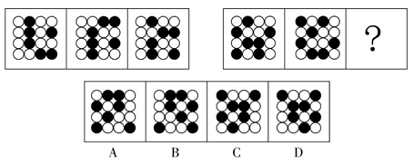

# 位置规律-平移（黑白球逐行循环下移）

考点：[[20-考点/判断推理/图形推理/位置规律-平移（黑白球逐行循环下移）|图形推理 / 位置规律-平移（黑白球逐行循环下移）]]

**问法模型**：'两套图形具有相似性也存在差异，选最适合取代问号的图形' → 两两相邻比较找位置变化规律（黑球整体循环下移），再将规律续推一格得到问号图形

## 推理链
1. 第1步：两组图形均为4×4黑白球阵列，逐幅观察黑球个数不变、只有位置变化，提示考位置规律而非数量或样式规律
2. 第2步：两两相邻比较第一组：图1中每一行黑球整体向下平移一行（循环走）得到图2，图2中每一行黑球再整体下移一行（循环走）得到图3
3. 第3步：用同一规律验证第二组图1→图2，各行黑球同样满足'循环下移一行'，规律成立
4. 第4步：将规律续推一格：第二组图2的每一行黑球再整体向下平移一行（最下行循环回到最上行），即为问号处图形
5. 第5步：逐项对照：A项各行黑球位置恰为第二组图2循环下移一行后的结果，B、C、D均有某行黑球错位或未按循环方向移动
6. 第6步：故选A，其既延续第一组规律（最大相似性），又因第二组自身黑球分布而表现出第二套特征

**最快解法**：⚡ 图形规律口诀'黑白球数量不变看移动+循环走'：直接把第二组第二幅图每一行黑球向下挪一行（最下行的黑球挪回最上行），所得图形即A

## 易错点
- ⚠ 把规律误判为黑球个数增减或图形旋转/翻转，忽略'逐行整体平移'
- ⚠ 忘记'循环走'，即最下行的黑球应移到最上行
- ⚠ 对照选项时把'下移'看反成'上移'，或逐行对位时看错行序

## 母题抽象
> 🧩 当题干出现多幅规格相同的黑白球（黑白格）阵列且黑球数量不变时，先两两相邻比较找位置变化，若为整体平移则按循环方向续推下一幅即可锁定答案

**同类特征**：两套图形相似且有差异、4×4黑白球阵列、黑球个数不变仅位置变、相邻图形两两比较、循环平移

## 相关题
- [[10-真题/判断推理/图形推理/10297399 位置规律—平移（多黑块分组循环平移）|10297399]]（四川 2025，相关度1）
- [[10-真题/判断推理/图形推理/2136998 数量规律-点数量（曲直交点）|2136998]]（北京 2018，相关度1）
- [[10-真题/判断推理/图形推理/5797387 图形推理-位置规律（循环平移）|5797387]]（浙江 2023，相关度1）

---

### 题干

每道题包含两套图形和可供选择的4个图形。这两套图形具有某种相似性，也存在某种差异。要求你从四个选项中选择最适合取代问号的一个。正确的答案应不仅使两套图形表现出最大的相似性，而且使第二套图形也表现出自己的特征。

### 选项
- A. A　✅
- B. B
- C. C
- D. D

### 官方解析
第一组图形两两相邻比较可以发现，第一幅图中每一行黑球整体往下平移一行得到第二幅图（循环走），第二幅图中每一行黑球整体往下平移一行得到第三幅图（循环走）。第二组图形运用此规律，只有A项符合。
故正确答案为A。

### 给定材料
（无）
