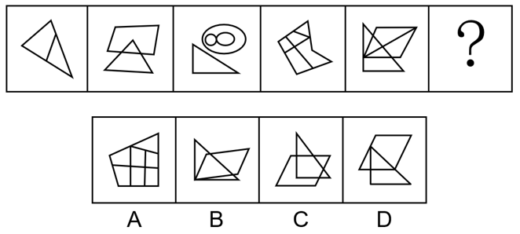

# 数量规律-面数量（封闭区域数等差递增）

考点：[[20-考点/判断推理/图形推理/数量规律-面数量（封闭区域数等差递增）|图形推理 / 数量规律-面数量（封闭区域数等差递增）]]

**问法模型**：'选择最合适的一个填入问号处，使之呈现一定的规律性' → 元素组成不同且无属性规律时，优先数面数量，按数列规律外推问号处图形

## 推理链
1. 第1步：题干六幅图（含问号）元素组成不同，对称、曲直、开闭等属性均无明显统一规律，转向数量规律
2. 第2步：观察发现题干图形均被线条分割、窟窿（封闭区域）明显，锁定'面数量'这一数量考点
3. 第3步：逐图数面：图1三角形被一条线段分割成2个面；图2四边形与三角形相交形成3个面；图3直角三角形加大椭圆内含两个小圆共4个面；图4不规则多边形被内部线段分割成5个面；图5多个三角形交叉重叠形成6个面
4. 第4步：面数量依次为2、3、4、5、6，构成公差为1的等差数列，故问号处应选择有7个面的图形
5. 第5步：逐项数选项面数量：A项五边形被横竖线条分割恰好为7个面；B、C、D项封闭区域数均不为7
6. 第6步：只有A项符合'7个面'的规律要求，故选A

**最快解法**：⚡ 数面法+排除法：快速数出题干五幅图面数为2、3、4、5、6，确认等差递增后，直接数选项封闭区域数，A项7个面立即锁定答案，无需细看其他规律

## 易错点
- ⚠ 图3出现椭圆和圆等曲线图形，易被曲直规律带偏而漏考数量规律
- ⚠ 图4、图5图形交叉重叠，数面时易漏数线条交叉新围出的封闭区域
- ⚠ 选项B、D内部线条多、视觉复杂，粗看易误判面数量，需逐格细数再排除

## 母题抽象
> 🧩 当图形元素组成不同、属性规律（对称/曲直/开闭）均不成立，且图形被分割、窟窿明显时，优先数面数量；若面数构成等差数列，按公差外推问号处面数并逐一验证选项

**同类特征**：元素组成不同、无明显属性规律、图形被线条分割、窟窿/封闭区域明显、面数量依次递增、问号处求数列下一项

## 相关题
- [[10-真题/判断推理/图形推理/2376468 数量规律-面数量（封闭区域数等差递增）|2376468]]（重庆 2019，相关度4）
- [[10-真题/判断推理/图形推理/2402399 数量规律-面数量（封闭区域数等差递增）|2402399]]（重庆 2018，相关度4）
- [[10-真题/判断推理/图形推理/2247206 数量规律-面数量（封闭区域数等差递增）|2247206]]（新疆 2018，相关度3）
- [[10-真题/判断推理/图形推理/2578703 数量规律-面数量（封闭区域个数）|2578703]]（湖南 2020，相关度3）
- [[10-真题/判断推理/图形推理/10204454 数量规律-部分数（黑白球连通区域数做和）|10204454]]（甘肃 2024，相关度2）

---

### 题干

从所给的四个选项中，选择最合适的一个填入问号处，使之呈现一定的规律性：

### 选项
- A. A　✅
- B. B
- C. C
- D. D

### 官方解析
元素组成不同，且无明显属性规律，优先考虑数量规律。观察发现，题干图形被分割、窟窿明显，考虑面数量。题干图形面数量依次为：2、3、4、5、6、？，故“？”处应该选择有7个面的图形，观察选项，只有A项符合。
故正确答案为A。

### 给定材料
（无）
