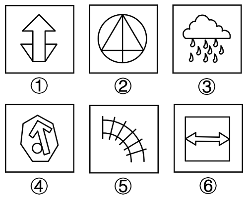

# 属性规律-对称性（轴对称与否分组）

考点：[[20-考点/判断推理/图形推理/属性规律-对称性（轴对称与否分组）|图形推理 / 属性规律-对称性（轴对称与否分组）]]

**问法模型**：六个图形分为两类使每类有各自规律 → 元素组成不同时优先考虑属性规律（对称性）分组

## 推理链
1. 第1步：题干要求将①~⑥六个图形分成两类，元素组成各不相同，排除位置、样式类规律
2. 第2步：逐图观察属性特征：图①为带底座的向上箭头，含明显等腰三角形元素；图②为圆内接三角形加中线，含等腰三角形；图⑥为正方形内双向箭头，均为规整对称造型
3. 第3步：确定①②⑥均关于竖直中线轴对称，是对称图形；图③（云朵加雨滴）、图④（不规则多边形内含歪斜箭头和圆）、图⑤（弧形网格）整体均不对称
4. 第4步：按'对称/不对称'二分：①②⑥一组，③④⑤一组
5. 第5步：对照选项，B项'①②⑥，③④⑤'与该分组一致，故选B

**最快解法**：⚡ 对称性排除法：发现图①②⑥均含等腰元素/箭头类规整造型，直接按'有竖直对称轴vs无对称轴'二分，锁定①②⑥一组即选B

## 易错点
- ⚠ 图⑤为扇形放射网格，易误以为沿角平分线对称而错判为对称图形，实际线条间距不规则、无对称轴
- ⚠ 图④内部含圆形和箭头，易被内部规则小元素干扰，忽略外部轮廓不规则、整体不对称
- ⚠ 图③雨滴排列看似有行列规律，易误当作位置规律题或误判为对称，实际云朵与雨滴整体不对称

## 母题抽象
> 🧩 当分组分类题元素组成不同，且部分图形含等腰三角形、箭头、圆形等明显等腰元素时，优先按'轴对称图形 vs 非对称图形'分组验证

**同类特征**：元素组成不同、分组分类（六图分两类）、等腰元素明显、箭头类规整图形、轴对称、属性规律优先

## 相关题
- [[10-真题/判断推理/图形推理/2444750 图形推理-属性规律（轴对称-黑白区域分别看对称性）|2444750]]（四川 2019，相关度4）
- [[10-真题/判断推理/图形推理/5510023 属性规律-对称性（轴对称与否分组）|5510023]]（江西 2023，相关度4）
- [[10-真题/判断推理/图形推理/2633394 图形推理-属性规律（轴对称）+ 位置关系（曲线是否经过原点）|2633394]]（选调 2016，相关度3）
- [[10-真题/判断推理/图形推理/11367775 属性规律-对称性（对称轴数量等差递减）|11367775]]（江苏 2025，相关度2）
- [[10-真题/判断推理/图形推理/11367791 属性类-对称性（对称轴方向与条数、轴对称+中心对称）＋数量类-面数量（九宫格横行复合规律）|11367791]]（江苏 2025，相关度2）

---

### 题干

将下列六个图形分为两类，使每一类图形都有各自的特征或规律，分类正确的是：

### 选项
- A. ①④⑤，②③⑥
- B. ①②⑥，③④⑤　✅
- C. ①⑤⑥，②③④
- D. ①②③，④⑤⑥

### 官方解析
本题为分组分类题目。元素组成不同，优先考虑属性规律。观察发现，图①②⑥均存在明显的等腰元素，故考虑对称性。图①②⑥为对称图形，图③④⑤不是对称图形，即图①②⑥为一组，图③④⑤为一组。
故正确答案为B。

### 给定材料
（无）
