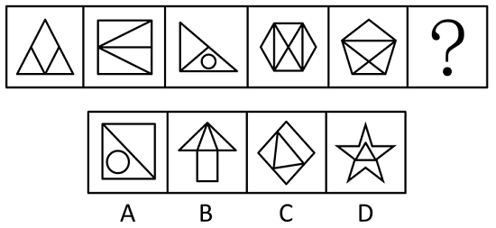

# 数量规律-面数量与外框直线数的对应关系

考点：[[20-考点/判断推理/图形推理/数量规律-面数量与外框直线数的对应关系|图形推理 / 数量规律-面数量与外框直线数的对应关系]]

**问法模型**：问号处填入最合适图形使之呈现规律性 → 元素组成不同且无属性规律时数数量，单一数量（面数）无规律时寻找'面数量=外框边数'的复合对应规律

## 推理链
1. 第1步：题干五图元素组成不同，观察对称、曲直、开闭等属性无统一规律，按'属性不行数数量'优先考虑数量规律
2. 第2步：五图封闭区域均明显，优先数面，面数量依次为3、4、3、6、5，单独看无等差、常数或周期规律
3. 第3步：继续观察共性，五图均由一个多边形外框加内部线条构成，数外框直线数依次为3（三角形）、4（四边形）、3（三角形）、6（六边形）、5（五边形）
4. 第4步：对比两组数字发现规律——每幅图的面数量=外框直线数量，故问号处图形需满足'面数=外框边数'
5. 第5步：逐项验证：A项外框为四边形（4条边）但面数为3（对角线分出2个三角形+1个圆），不符；B项外框为三角形与矩形拼接的复合轮廓且面数为2，不符；C项外框为菱形（4条边），内部三角形将图形分割为4个面，4=4符合；D项外框为星形（10条边），面数与外框边数不相等，不符
6. 第6步：只有C项满足'面数量=外框直线数量'，故选C

**最快解法**：⚡ 复合数量法（数面+数外框边）：先快速数出面数为3、4、3、6、5发现无规律，立即转数各图外框边数，发现两组数字完全一致，锁定规律'面数=外框边数'；扫一眼选项：A是4边3面排除，B外框不是单一多边形排除，D星形外框边数远大于面数排除，C菱形4边恰有4面，秒选C

## 易错点
- ⚠ 只数出面数3、4、3、6、5无规律后放弃数量规律，误转向对称/样式规律而错选
- ⚠ 数面时漏数或重数：如图3右侧三角形内的小三角形与圆、图4六边形内交叉线分割出的多个小面
- ⚠ 数外框边数时把内部线条误计入，或对B项'三角形+矩形'拼接的复合外框按单一多边形误数边数

## 母题抽象
> 🧩 当题干图形均含明显封闭区域、且单独数面/数线无规律时，观察图形是否都由'单一多边形外框+内部线条'构成，验证'面数量=外框边数（或两者运算关系）'这一复合数量规律，再逐项比对

**同类特征**：封闭区域明显、每图有单一多边形外框、面数量序列3、4、3、6、5无直接规律、外框边数序列与面数完全对应、内部线条将外框分割成面、数量规律中的复合对应关系

## 相关题
- [[10-真题/判断推理/图形推理/12019817 数量规律-面的细化（面的形状：所有面均为四边形）|12019817]]（浙江 2026，相关度1）
- [[10-真题/判断推理/图形推理/12561860 数量规律-面数量与属性规律-对称轴数量的复合对应规律|12561860]]（浙江 2024，相关度1）
- [[10-真题/判断推理/图形推理/17058596 图形推理-数量规律-面数量（封闭区域数·常数规律）|17058596]]（选调 2023，相关度1）
- [[10-真题/判断推理/图形推理/19889518 数量规律-数面（封闭区域数）及行内加减运算|19889518]]（上海 2021，相关度1）
- [[10-真题/判断推理/图形推理/2136754 数量规律-面数量相同时看面的形状特征（是否存在完全相同的面）|2136754]]（河南 2017，相关度1）

---

### 题干

从所给的四个选项中，选择最合适的一个填入问号处，使之呈现一定的规律性：

### 选项
- A. A
- B. B
- C. C　✅
- D. D

### 官方解析
元素组成不同，且无明显属性规律，优先考虑数量规律。观察发现，题干图形封闭区域明显，优先考虑数面，题干图形的面数量依次为3、4、3、6、5、？，单独数面无规律；继续观察发现，题干图形的外框均为多边形，考虑数外框直线数，外框直线数依次为3、4、3、6、5、？，规律为面数量=外框直线数量，只有C项符合此规律。
故正确答案为C。

### 给定材料
（无）
