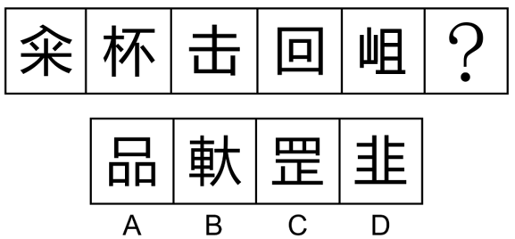

# 数量规律-线数量（汉字横线数与竖线数相等且依次递增）

考点：[[20-考点/判断推理/图形推理/数量规律-线数量（汉字横线数与竖线数相等且依次递增）|图形推理 / 数量规律-线数量（汉字横线数与竖线数相等且依次递增）]]

**问法模型**：‘选择最合适的一个填入问号处使之呈现规律性’的一条式汉字题 → 元素组成不同且属性无规律时，按'笔画→面→横线/竖线数量'逐层细化计数找规律

## 推理链
1. 第1步：题干为一条式6格汉字图形（首字、杯、击、回、末字、?），元素组成不同，对称、曲直等属性规律不明显，优先考虑数量规律
2. 第2步：先试汉字常观数量考点，题干汉字较简单且'回'存在窟窿面，但笔画数和面数量均无规律，排除这两条路径
3. 第3步：观察发现'回'字存在明显的横线和竖线，题干其他汉字（如'杯''击'）也具备相同特点，转向分别数横线和竖线
4. 第4步：依官方计数，题干横线数依次为1、2、3、4、5，竖线数依次为1、2、3、4、5，即每个汉字横线数与竖线数相等，且逐格递增
5. 第5步：故问号处汉字应满足'横线数=竖线数'（延续递增则为6横6竖）
6. 第6步：逐项验证：A'品'由三个'口'组成，每口2横2竖，共6横6竖，相等且延续递增规律；B、C、D横线数与竖线数不相等（如'韭'横多竖少）
7. 第7步：与选项对照，只有A项符合规律，故正确答案为A

**最快解法**：⚡ 横竖线分计法+排除：先数题干各字横线、竖线数量得'1-5递增且横=竖'规律，再验选项——A'品'=3个口=6横6竖直接命中，B/C/D横竖不等秒排除

## 易错点
- ⚠ 只数总线条数或笔画数，未将线条细分为'横线'和'竖线'两类，错过'横竖相等'规律
- ⚠ 数'回''品'等含框汉字时漏数内层线条（回应为4横4竖，品每口2横2竖）
- ⚠ 对'击''山'等含折笔（如凵）的字拆分横竖段时数错，或受'窟窿面'干扰误走面数量路径

## 母题抽象
> 🧩 当题干为汉字一条式、元素组成不同且笔画数与面数量均无规律时，若汉字存在明显横竖笔画，则改数'横线数'与'竖线数'，常考'横竖数量相等/同步递增'规律，用横竖分计验证选项

**同类特征**：汉字一条式图形、元素组成不同且无明显属性规律、笔画数无规律、含'回'类带封闭面（窟窿）的汉字、横线与竖线特征明显、横线数、竖线数均为1-5递增且两两相等

## 相关题
- [[10-真题/判断推理/图形推理/14403697 图形推理-数量规律（外框边数与内部元素个数作差恒定分组）|14403697]]（山东 2025，相关度1）
- [[10-真题/判断推理/图形推理/16070043 数量规律-灰色多边形边数与白色面数量的差值运算分组|16070043]]（贵州 2026，相关度1）
- [[10-真题/判断推理/图形推理/16070177 数量规律-部分数（黑白块分堆-同色连通区域数）|16070177]]（重庆 2026，相关度1）
- [[10-真题/判断推理/图形推理/2423328 图形推理-数量规律（内部线条与外框角端点相接个数）|2423328]]（甘肃 2019，相关度1）
- [[10-真题/判断推理/图形推理/2448487 数量规律-曲直交点数与曲线数的倍数运算关系|2448487]]（国考 2020，相关度1）

---

### 题干

从所给的四个选项中，选择最合适的一个填入问号处，使之呈现一定的规律性：

### 选项
- A. A　✅
- B. B
- C. C
- D. D

### 官方解析
元素组成不同，且无明显属性规律，优先考虑数量规律。题干汉字比较简单且存在窟窿面，但笔画数和面数量均无规律。观察题干发现，“回”字存在明显的横线和竖线，题干其他汉字也具备相同特点，优先考虑横线和竖线的数量。题干图形横线数依次为：1、2、3、4、5，竖线数依次为1、2、3、4、5，即横线和竖线的数量相等，只有A项符合。
故正确答案为A。

### 给定材料
（无）
