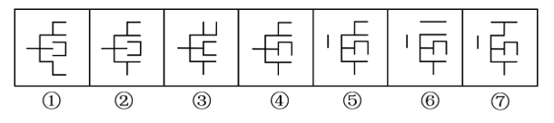
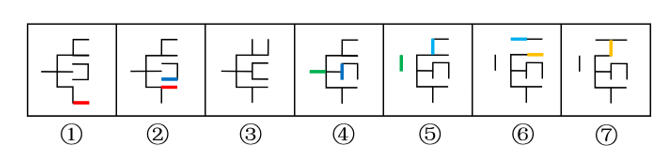

# 图形推理-位置规律（线条移动·相邻比较）

考点：[[20-考点/判断推理/图形推理/图形推理-位置规律（线条移动·相邻比较）|图形推理 / 图形推理-位置规律（线条移动·相邻比较）]]

**问法模型**：问'去掉哪一个后剩余图形呈现规律'→采用相邻比较法，逐对比较线条位置变化，找出破坏递变链条的那一幅图。

## 推理链
1. 第1步：七个图形元素组成相同，均由一横一竖主干加若干短横、短竖线条构成，线条总数一致，优先考虑位置（移动）规律而非数量规律。
2. 第2步：针对'去掉一个'的问法，采用相邻比较法：假设某图被去掉，检验剩余图形两两之间是否只差一处变化。
3. 第3步：逐对比较①→②、②→④、④→⑤、⑤→⑥、⑥→⑦（⑤起左侧出现独立'丨'短竖线，亦由前图线条移动而来），每对相邻图形均只有一根线条位置改变。
4. 第4步：单独检验图③：③右上方出现带双竖笔画的'凵'形结构，与②、④的差异均超过一根线条，无法嵌入'每次移动一根'的链条。
5. 第5步：去掉③后，①→②→④→⑤→⑥→⑦构成'后一幅图在前一幅图的基础上移动一根线条'的连续递变规律。
6. 第6步：对照选项，③对应A项，故正确答案为A。

**最快解法**：⚡ 相邻比较法（移动计数）：从左往右两两对比线条位置，数每对图形间'被移动的线条数'，发现其余相邻图均只移动一根，唯独③与前、后图都相差一根以上，去掉③链条即连通，选A。

## 易错点
- ⚠ 只盯着单个图形数线条数量，把规律误判为数量类，忽略'线条总数不变、位置在动'的移动特征。
- ⚠ 未按'去掉后重新连续'的链条验证①②④⑤⑥⑦，而是把①—⑦全部强行两两比较，导致找不到统一规律。
- ⚠ 被⑤⑥⑦左侧独立的'丨'短竖线干扰，误认为这几幅图元素组成与其他图不同而放弃位置规律。

## 母题抽象
> 🧩 当题干出现'去掉哪一个后剩余图形呈现规律'且各图元素组成相同（线条数一致）时，用相邻比较法逐对数'移动线条数'，剔除破坏'每次只移动一根/一处'递变链条的那一幅。

**同类特征**：元素组成相同、线条总数一致、问'去掉哪一个'、位置移动规律、七图连续排列、需相邻比较

## 相关题
- [[10-真题/判断推理/图形推理/5797387 图形推理-位置规律（循环平移）|5797387]]（浙江 2023，相关度2）
- [[10-真题/判断推理/图形推理/2172768 位置规律（旋转-翻转）|2172768]]（海南 2021，相关度1）
- [[10-真题/判断推理/图形推理/10204458 位置规律-平移（特征交点沿内圈循环平移）|10204458]]（甘肃 2024，相关度1）
- [[10-真题/判断推理/图形推理/10204614 图形推理-位置规律（旋转+翻转交替循环）|10204614]]（黑龙江 2024，相关度1）
- [[10-真题/判断推理/图形推理/10297399 位置规律—平移（多黑块分组循环平移）|10297399]]（四川 2025，相关度1）

---

### 题干

以下七个图形去掉哪一个后，剩下的图形能呈现一定的规律性？

### 选项
- A. ③　✅
- B. ④
- C. ⑤
- D. ⑥

### 官方解析

元素组成相同，优先考虑位置规律。通过相邻比较发现，此题的规律为：后一幅图在前一幅图的基础上移动一根线条，应去掉图③。

故正确答案为A。

### 给定材料
（无）
