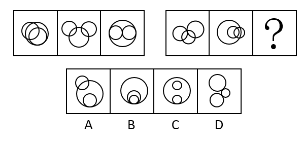

# 图形间关系（相交-相切-相离的位置关系）

考点：[[20-考点/判断推理/图形推理/图形间关系（相交-相切-相离的位置关系）|图形推理 / 图形间关系（相交/相切/相离的位置关系）]]

**问法模型**：两组图'填入？使之呈现一定规律性'→ 元素组成不同且属性数量无规律时，优先枚举每个图形内部元素间的位置关系，两组图逐位对应找规律

## 推理链
1. 第1步：两组图元素组成不同，属性、数量均无规律，但每个图形均由3个圆构成→优先考虑图形间关系
2. 第2步：将每个图形的3个圆两两配对（共3对关系），逐一判定每对为相交、相切还是相离
3. 第3步：第一组规律：图1两两关系为相交、相切、相交；图2（米奇形）为相交、相交、相离；图3（大圆含两小圆）为相切、相切、相切
4. 第4步：第二组按位对应：图1为相交、相切、相交，图2为相交、相交、相离，与第一组前两图完全一致
5. 第5步：故？处应与第一组图3对应，即3个圆两两相切（内切同样计为相切）
6. 第6步：逐项验证：A中存在相交，C为相切+相切+相离（两小圆之间相离），D中存在相离，只有B三个圆同点内切、两两相切，故选B

**最快解法**：⚡ 图形间关系枚举法：对每个图形的3个圆快速写出3对关系（交/切/离），第一组序列为'交切交→交交离→切切切'，第二组已现'交切交→交交离'，故？=切切切；排除含'相交'的A、含'相离'的C和D，锁定B

## 易错点
- ⚠ 默认相切只能是外切，忽略三圆嵌套、同一点内切也算'两两相切'，从而漏选B
- ⚠ 粗看'有相切'就选C，未数清C中两个小圆之间是相离，3对关系并非全为相切
- ⚠ 元素组成不同时误往对称性、数量类方向找规律，忽略'多个同类元素→先看图形间关系'的解题优先级

## 母题抽象
> 🧩 当每个图形由多个同类小元素（如3个圆）构成且属性、数量无规律时，按两两配对枚举位置关系（相交/相切/相离），两组图逐位对应，？处补齐对应位置的关系组合

**同类特征**：两组图逐位对应、每个图形均由3个圆构成、属性数量无规律、图形间位置关系、相交/相切/相离、问号处补齐规律

## 相关题
- [[10-真题/判断推理/图形推理/2049952 图形共性-特定元素存在（每图均含三角形）|2049952]]（新疆 2017，相关度1）
- [[10-真题/判断推理/图形推理/2185073 特殊规律-图形组合方式（两个相同小图形相交）|2185073]]（广东 2018，相关度1）
- [[10-真题/判断推理/图形推理/4004575 图形推理-位置规律（指向性元素-箭头指向逆时针旋转90°）|4004575]]（新疆 2021，相关度1）
- [[10-真题/判断推理/图形推理/5484010 图形间关系（相离-相切-相交的位置递变规律）|5484010]]（北京 2023，相关度1）

---

### 题干

从所给的四个选项中，选择最合适的一个填入问号处，使之呈现一定的规律性：

### 选项
- A. A
- B. B　✅
- C. C
- D. D

### 官方解析
元素组成不同，属性、数量均无规律，考虑特殊规律。观察发现，每个图形均由3个圆构成，优先考虑图形间关系。第一组图形，图1两两之间分别为相交、相切、相交，图2两两之间分别为相交、相交、相离，图3两两之间分别为相切、相切、相切。第二组图应用此规律，图1两两之间分别为相交、相切、相交，图2两两之间分别为相交、相交、相离，？处应为3个图形两两相切，只有B项符合。
故正确答案为B。

### 给定材料
（无）
