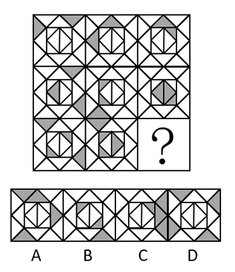

# 数量规律（黑色三角形个数逐行递增2-3-4）+ 关系规律（三角形间位置关系：相离-相交于点-相交于线）

考点：[[20-考点/判断推理/图形推理/数量规律（黑色三角形个数逐行递增2-3-4）+ 关系规律（三角形间位置关系：相离-相交于点-相交于线）|图形推理 / 数量规律（黑色三角形个数逐行递增2/3/4）+ 关系规律（三角形间位置关系：相离/相交于点/相交于线）]]

**问法模型**：九宫格'问号处填入最合适图形呈现规律性'→ 横向分行先数特征小元素数量定档，数量排不出唯一答案时再叠加元素间位置关系作二级辨析

## 推理链
1. 第1步：九宫格每幅图均由网格中嵌入若干黑色三角形构成，所有图都含同种小元素，优先考虑黑色三角形的数量规律
2. 第2步：九宫格优先横向看：第一行每幅图黑色三角形均为2个，第二行每幅图均为3个，呈'行内恒定、逐行加1'的阶梯规律
3. 第3步：第三行前两幅图黑色三角形均为4个，故？处图形也应有4个黑色三角形，数量上排除B项
4. 第4步：数量排不出唯一答案，进行二级辨析：第一行三幅图中黑色三角形的关系依次为相离、相交于点、相交于线
5. 第5步：第二行验证成立（同样依次为相离、相交于点、相交于线），规律确认为行内三图关系递进
6. 第6步：第三行前两幅图关系为相离、相交于点，应用规律，？处应选黑色三角形相交于线（共用一条边）的图形，对照选项只有C项符合

**最快解法**：⚡ 数量+关系双规律排除法：先横向数黑色三角形个数，发现2/3/4逐行递增，？处需4个、排除B；再看每行第三幅图黑色三角形均'相交于线'，直接锁定C

## 易错点
- ⚠ 只数数量不辨关系：数量为4的可能不止一个方向可排，A、C、D中数量相同的图靠数量无法唯一确定，必须做位置关系二级辨析
- ⚠ 混淆'相交于点'与'相交于线'：需看清两个黑色三角形是仅顶点相触还是共用一条边，看错则误选点相交的图
- ⚠ 观察顺序错误：不优先横向分行而竖列或整体乱看，找不到'行内数量恒定、逐行加1'的阶梯规律

## 母题抽象
> 🧩 当九宫格每幅图都含同一种特征小元素（如黑色三角形）时，先横向数该元素数量（常呈行内恒定或等差递增），若数量排除后仍剩多项，再看元素间的位置关系（相离/相交于点/相交于线）作二级辨析定答案

**同类特征**：九宫格、每幅图均含黑色三角形、数量行内恒定、逐行递增2→3→4、元素位置关系三态：相离/相交于点/相交于线、数量规律+关系规律双重验证、排除法锁定唯一答案

## 相关题
- [[10-真题/判断推理/图形推理/10204610 样式规律-加减同异（去同存异），九宫格列规律|10204610]]（辽宁 2024，相关度1）
- [[10-真题/判断推理/图形推理/10297349 样式规律-黑白运算|10297349]]（浙江 2025，相关度1）
- [[10-真题/判断推理/图形推理/10297407 样式规律-黑白运算（定义叠加）|10297407]]（四川 2025，相关度1）
- [[10-真题/判断推理/图形推理/10975255 数量规律-元素个数与部分数（黑白球连通堆数）|10975255]]（江苏 2024，相关度1）
- [[10-真题/判断推理/图形推理/11367791 属性类-对称性（对称轴方向与条数、轴对称+中心对称）＋数量类-面数量（九宫格横行复合规律）|11367791]]（江苏 2025，相关度1）

---

### 题干

从所给的四个选项中，选择最合适的一个填入问号处，使之呈现一定的规律性：

### 选项
- A. A
- B. B
- C. C　✅
- D. D

### 官方解析
题干图形中均出现了若干黑色三角形，优先考虑黑色三角形的数量。九宫格优先横向看，第一行每幅图形的黑色三角形数量均为2，第二行每幅图形的黑色三角形数量均为3，第三行每幅图形的黑色三角形数量均为4，排除B项；继续观察发现，第一行每幅图形中，黑色三角形之间的关系分别是相离、相交于点、相交于线，第二行经验证符合此规律，第三行应用此规律，故？处应选择黑色三角形之间的关系为相交于线的图形，只有C项符合。
故正确答案为C。

### 给定材料
（无）
