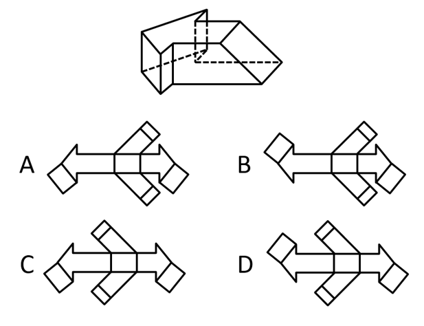
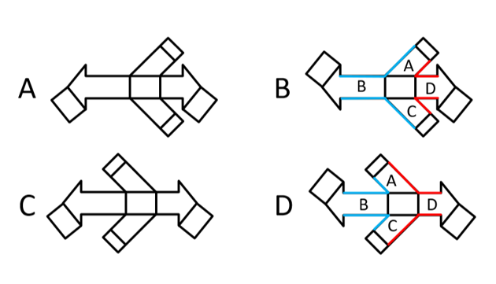

# 空间重构-立体图形外表面展开图（相邻面公共边验证）

考点：[[20-考点/判断推理/图形推理/空间重构-立体图形外表面展开图（相邻面公共边验证）|图形推理 / 空间重构-立体图形外表面展开图（相邻面公共边验证）]]

**问法模型**：问'哪一项是给定立体图形的外表面展开图' → 空间重构模型：先对比选项差异点排除，再用公共边等长/重合验证折叠可行性

## 推理链
1. 第1步：题干立体图形为带缺口（凹槽）的多面体，由大矩形面、左右两个窄矩形面及斜向伸出的小矩形面拼接而成，各面形状相同但相邻关系固定
2. 第2步：观察四个选项展开图，差异集中在两处：①左侧矩形面与右侧矩形面的相对位置；②上下两侧斜向小矩形面的摆放位置
3. 第3步：先看位置关系——立体图中左、右两个矩形面应分别位于主体两侧错开的位置；A、C两项中左侧矩形与右侧结构处于同一侧，折叠后无法还原立体图形的凹凸结构，排除A、C
4. 第4步：对B、D两项进行精细验证，在展开图中标出面A、面B、面C、面D，逐一检查相邻面的公共边
5. 第5步：B项中面A与面B、面C与面B、面A与面D、面C与面D的公共边等长且完全重合，折叠后各面严丝合缝，可还原题干立体图形
6. 第6步：D项中上述四组公共边不等长、无法完全重合，折叠后会出现错缝，排除D项，故正确答案为B

**最快解法**：⚡ 排除法＋公共边法：第一步找选项间最大差异点（左侧矩形与右侧矩形是否同侧），同侧者折叠必错，速排A、C；第二步在B、D中标注相邻面A/B/C/D，比较公共边是否等长且完全重合，B项重合、D项错缝，选B

## 易错点
- ⚠ 只核对面的形状与数量是否一致，忽略左右两个矩形面的相对位置（同侧/异侧），误选A或C
- ⚠ B、D外形极为相似，忽略公共边长度是否相等这一细节，凭感觉误选D
- ⚠ 未将展开图中斜向小矩形面与立体图中缺口位置对应，折叠方向想象错误

## 母题抽象
> 🧩 当题干给出立体图形要求选择其外表面展开图时，先对比选项差异点用'排除法'排除位置明显错误项，再用'公共边等长且完全重合'验证剩余项的相邻面拼接，重合者即为答案

**同类特征**：外表面展开图、空间重构、矩形面拼接、公共边等长、面相对位置差异、折叠还原验证

## 相关题
- [[10-真题/判断推理/图形推理/11367779 空间重构-六面体折叠（相对面排除＋公共边特征验证）|11367779]]（江苏 2025，相关度1）
- [[10-真题/判断推理/图形推理/16069767 空间重构-组合体表面展开图（公共边法·黑白颜色匹配）|16069767]]（河南 2026，相关度1）
- [[10-真题/判断推理/图形推理/16095261 空间重构-六面体折叠（特征面字母朝向定位）|16095261]]（江苏 2024，相关度1）
- [[10-真题/判断推理/图形推理/16593126 空间重构-外表面展开图（面数量+特征面相邻关系排除）|16593126]]（青海 2024，相关度1）
- [[10-真题/判断推理/图形推理/1791642 空间重构-四面体折叠（相邻面公共边法）|1791642]]（江苏 2016，相关度1）

---

### 题干

下面哪一项是给定立体图形的外表面展开图？

### 选项
- A. A
- B. B　✅
- C. C
- D. D

### 官方解析

本题为空间重构题。观察选项，主要区别在于左侧的矩形和上下两侧的图形位置不同。

如果左侧的矩形和右侧的矩形都在同一侧，则立体图形无法拼合，排除A、C两项；

再次观察题干立体图形，对比B、D两项，如下图所示，B项中面A与面B、面C与面B、面A与面D、面C与面D的公共边等长且完全重合，而D项中面A与面B、面C与面B、面A与面D、面C与面D的公共边并不等长，无法完全重合，排除D项。

故正确答案为B。

### 给定材料
（无）
