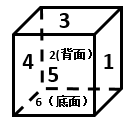

# 空间重构-六面体相对面关系与排除法（多视角同一立方体）

考点：[[20-考点/判断推理/图形推理/空间重构-六面体相对面关系与排除法（多视角同一立方体）|图形推理 / 空间重构-六面体相对面关系与排除法（多视角同一立方体）]]

**问法模型**：题干给出同一立方体的三个不同视角，问哪个选项也是该立方体 → 先统一视角推出三组相对面，再用'相对面不能同时相邻出现'逐项排除

## 推理链
1. 第1步：从图一提取相邻信息：顶面3、正面5、右面1两两相邻；图二：顶面3、正面2、右面4两两相邻；图三：顶面4、正面6、右面5两两相邻
2. 第2步：统一视角重建六面：固定顶面为面3，则正面为面5、右侧面为面1，进而推出背面为面2、左侧面为面4、底面为面6
3. 第3步：得出三组相对面：面3-面6、面1-面4、面5-面2；规则：同一立方体中相对面不可能在任一视角中相邻同时出现
4. 第4步：A项同时出现面1与面4且相邻，与'1-4相对'矛盾，排除
5. 第5步：B项同时出现面1与面4且相邻，同样矛盾，排除
6. 第6步：D项同时出现面3与面6且相邻，与'3-6相对'矛盾，排除
7. 第7步：C项为顶2、前3、右1，三面两两不相对；对照重建结果（顶3时后2、右1，将2翻转到顶面后恰为顶2、前3、右1），空间位置一致，当选

**最快解法**：⚡ 相对面排除法：统一视角（顶面固定为3）快速定出三组相对面3-6、1-4、5-2，扫四个选项，凡相对面同框相邻的直接排除，唯一不撞相对面的C即答案

## 易错点
- ⚠ 只核对数字是否出现、忽视'相对面不能同时相邻出现'这一铁律
- ⚠ 三个图视角不统一时凭空旋转想象，易把相邻关系记错，应先固定一个面重建六面
- ⚠ 排除后未对剩余选项验证相邻面的空间指向（本题C还需确认顶2前3右1与重建一致）

## 母题抽象
> 🧩 当题干出现'同一立方体的多个视角图+数字标记'时，先固定一个面统一视角推出三组相对面，再用'相对面不能同时可见'排除选项，锁定唯一一致项

**同类特征**：同一立方体三个视角、表面标数字、求一致的立体图、相对面不能同时出现、统一视角重建六面、排除法选唯一

## 相关题
- [[10-真题/判断推理/图形推理/12019707 空间折叠（六面体折纸盒）——相对面排除＋公共边画边法-公共点引线法|12019707]]（广东 2026，相关度1）
- [[10-真题/判断推理/图形推理/12561915 空间重构-六面体折叠（相对面排除+公共点法）|12561915]]（浙江 2024，相关度1）
- [[10-真题/判断推理/图形推理/16070182 空间重构-六面体展开图折叠（相对面排除＋相邻面数字方向验证）|16070182]]（湖北 2026，相关度1）
- [[10-真题/判断推理/图形推理/1746880 空间重构-六面体折叠（相对面排除+画边法）|1746880]]（国考 2016，相关度1）
- [[10-真题/判断推理/图形推理/1791826 空间重构-六面体折叠（公共点法+相对面排除）|1791826]]（江苏 2016，相关度1）

---

### 题干

如图所给的3个立方体为同一立方体，若不考虑立方体表面数字的大小、方向，下列选项中，最有可能是该立方体的是（    ）。

### 选项
- A. A
- B. B
- C. C　✅
- D. D

### 官方解析

第一步：分析题干中六面体。

根据图一可知，面3、面1、面5相邻；根据图二可知，面2、面3、面4相邻；根据图三可知，面4、面5、面6相邻；若均按照顶面为面3来看，可知正面为面5，右侧面为面1时，后面为面2、左侧面应为面4、底面应为面6（如下透视图所示），故可知面3与面6为相对面、面1与面4为相对面、面5与面2为相对面。

第二步：逐一分析选项。

A项：选项中面1与面4为相邻面，题干二者是相对面，相对面不能同时出现，选项与题干不一致，排除；

B项：选项中面1与面4为相邻面，题干二者是相对面，相对面不能同时出现，选项与题干不一致，排除；

C项：选项与题干一致，当选；

D项：选项中面3与面6为相邻面，题干二者是相对面，相对面不能同时出现，选项与题干不一致，排除。

故正确答案为C。

### 给定材料
（无）
