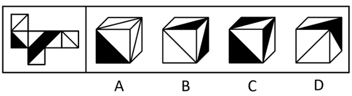

# 空间重构-立方体展开图折叠（相对面排除+公共边特征）

考点：[[20-考点/判断推理/图形推理/空间重构-立方体展开图折叠（相对面排除+公共边特征）|图形推理 / 空间重构-立方体展开图折叠（相对面排除+公共边特征）]]

**问法模型**：给出立方体平面展开图问折叠后'最可能是'哪个立体图 → 空间重构模型：先标号找三组相对面排除，再用相邻面公共边挨着的图案（黑/白三角形）逐一验证

## 推理链
1. 第1步：给展开图六面标号a—f，确定三组相对面：a与f、e与c、b与d，折叠后相对面不能同时出现在立体图中
2. 第2步：立体图三个可见面必须两两相邻，即每组相对面中各取一个，据此锁定每个选项可见面的组合
3. 第3步：A项必含面a和面e，故f、c不出现，正面只能是面b或面d：展开图中面b与面e的公共边挨着面b的黑三角形、面a与面d的公共边挨着面d的黑三角形，而选项中这两条公共边均未挨着黑三角形，排除A
4. 第4步：B项上面与右面为b、c、d、f中的两面且b、d不同时出现：b—c（或d—f）公共边在展开图中挨着双方的白三角形，c—d、c—f、b—f公共边均挨着双方的黑三角形，而选项上面与右面的公共边挨着'一面白三角形+一面黑三角形'，排除B
5. 第5步：C项三面为b、c、f（或c、d、f）：展开图中面c与面f的公共边挨着双方的黑三角形，而选项中任意两个面的公共边都挨着白三角形，排除C
6. 第6步：D项由面a、面c与面d（或面b、面e与面f）构成，不含相对面，且各公共边黑/白三角形特征与展开图一致，当选D

**最快解法**：⚡ 相对面排除＋公共边'黑白特征'法：先排除出现相对面（a—f、b—d、c—e）的组合，再对剩余选项逐条检查公共边挨着的是黑三角形还是白三角形，与展开图不一致立即排除，剩下即为答案

## 易错点
- ⚠ 只用相对面排除后不再验证公共边，易误选不含相对面的A项（A虽面组合合法但公共边黑白特征不符）
- ⚠ 公共边法使用时把'挨着黑三角形'与'挨着白三角形'看混，尤其同一面黑、白三角形分别挨不同公共边
- ⚠ 选项立方体摆放角度旋转后，误把公共边对应关系看错行列/方向

## 母题抽象
> 🧩 当题干出现'立方体展开图+各面带黑/白三角形等方向性图案'时，先标号找三组相对面排除，再对剩余选项用'公共边挨着的图案颜色特征'逐面验证，特征全符者当选

**同类特征**：立方体平面展开图、各面含黑白三角形方向性图案、相对面不能同时出现、公共边挨着图案特征、问'最可能是'哪个立体图、四个选项为不同折叠/摆放的立方体

## 相关题
- [[10-真题/判断推理/图形推理/12019707 空间折叠（六面体折纸盒）——相对面排除＋公共边画边法-公共点引线法|12019707]]（广东 2026，相关度1）
- [[10-真题/判断推理/图形推理/12561915 空间重构-六面体折叠（相对面排除+公共点法）|12561915]]（浙江 2024，相关度1）
- [[10-真题/判断推理/图形推理/16070182 空间重构-六面体展开图折叠（相对面排除＋相邻面数字方向验证）|16070182]]（湖北 2026，相关度1）
- [[10-真题/判断推理/图形推理/1746880 空间重构-六面体折叠（相对面排除+画边法）|1746880]]（国考 2016，相关度1）
- [[10-真题/判断推理/图形推理/1791826 空间重构-六面体折叠（公共点法+相对面排除）|1791826]]（江苏 2016，相关度1）

---

### 题干

如图是某立方体的平面展开图，则该立方体最可能是：

### 选项
- A. A
- B. B
- C. C
- D. D　✅

### 官方解析

将题干展开图标上序号如下图所示，逐一进行分析。

A项：选项一定包含面a和面e，由于面a和面f为相对面，面e和面c为相对面，相对面不能同时出现，面f和面c一定不可能出现，故选项的正面为面b或面d。若选项的正面为面b，在题干展开图中，面b和面e的公共边挨着面b中的黑色三角形，但在选项中，面b和面e的公共边没有挨着面b中的黑色三角形；若选项的正面为面d，在题干展开图中，面a和面d的公共边挨着面d中的黑色三角形，但在选项中，面a和面d的公共边没有挨着面d中的黑色三角形，选项与题干展开图不一致，排除；

B项：选项的上面和右面为面b、面c、面d或面f中的两个面，且面b和面d为相对面不能同时出现。若该项为面b和面c（或面d和面f），题干二者的公共边均与各自面内白色三角形挨着；若该项为面c和面d（或面c和面f、或面b和面f），题干二者的公共边均与各自面内黑色三角形挨着。而选项中的上面和右面的公共边与一个面内的白色三角形和另外一个面内的黑色三角形挨着，选项与题干展开图不一致，排除；

C项：选项中的面为面b、面c、面d或面f中的三个面，且面b和面d为相对面不能同时出现。则选项是面b、面c和面f（或是面c、面d和面f），在题干展开图中，面c和面f的公共边均与各自面内黑色三角形挨着，但在选项中，任意两个面的公共边都挨着一个白色三角形，选项与题干展开图不一致，排除；

D项：选项由面a、面c与面d（或面b、面e和面f）构成，与题干展开图一致，当选。

故正确答案为D。

### 给定材料
（无）
