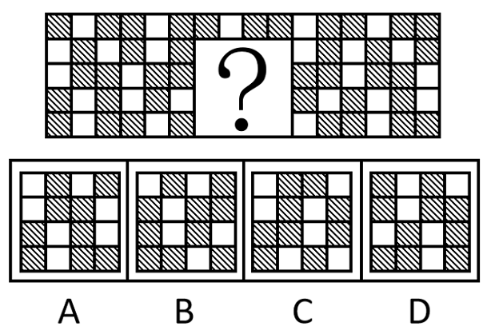
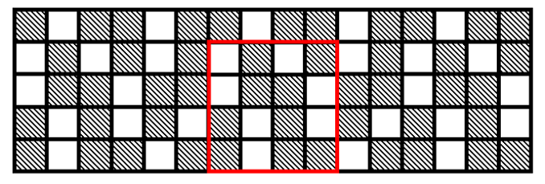

# 图形推理-黑白块排列规律（按行循环-周期）

考点：[[20-考点/判断推理/图形推理/图形推理-黑白块排列规律（按行循环-周期）|图形推理 / 图形推理-黑白块排列规律（按行循环/周期）]]

**问法模型**：问'最符合所给图形规律'且图形为黑白块网格中间缺一块（问号处）→ 逐行提炼黑白块的循环周期，延拓补全空缺后比对选项

## 推理链
1. 第1步：题干为一个黑白（阴影/白）块大网格，正中间空缺一个3×3区域（问号处），四个选项均为3×3黑白块，属于补全型题目
2. 第2步：按官方解析思路'观察黑块与白块的相对位置关系，每一行都有各自的规律'，逐行读出各行的循环排列单元
3. 第3步：第一行为'黑、白、黑'循环，第二行为'白、黑'循环，第三行为'白、黑、黑'循环，第四行为'黑、白'循环，第五行为'黑、白、黑'循环
4. 第4步：把各行周期向问号所在的空缺3列延拓，推出问号处第2~4行每行应有的黑白排列
5. 第5步：逐项对照A、B、C、D中3×3块的每行黑白排布，只有A项的排列与各行循环规律的延续完全一致
6. 第6步：故最符合规律的是A项

**最快解法**：⚡ 逐行周期法：每行只看黑白相间的最小循环单元（黑黑白/白黑/白黑黑/黑白/黑白黑），将周期延拓到问号所在的3列写出应填黑白序，直接与选项比对，无需数总量

## 易错点
- ⚠ 只关注整图黑块数量或整体对称性，忽略官方规律核心是'每一行各自成循环'
- ⚠ 循环单元的起点或周期读错（如把'白、黑、黑'误读成'黑、白、黑'），导致补全结果错位
- ⚠ 问号空缺位于第2~4行，易误从第1行起推或看错空缺对应的列位置，造成选项误判

## 母题抽象
> 🧩 当图形为黑白块网格且某处缺块（问号/空白框）时，按行（或列）找出黑白块的循环周期，将周期延拓补全空缺位置，再与选项逐一比对

**同类特征**：黑白块（阴影/白）网格、中间3×3空缺问号、每行独立循环周期规律、四个选项均为3×3黑白块、补全型设问

## 相关题
（暂无）

---

### 题干

下列选项中最符合所给图形规律的是（    ）。

### 选项
- A. A　✅
- B. B
- C. C
- D. D

### 官方解析

出现黑白块，观察黑块与白块的相对位置关系，每一行都有各自的规律。第一行黑白块排列规律为黑、白、黑循环排列；第二行黑白块排列规律为白、黑循环排列；第三行黑白块排列规律为白、黑、黑循环排列；第四行黑白块排列规律为黑、白循环排列；第五行黑白块排列规律为黑、白、黑循环排列，只有A项符合。

故正确答案为A。

### 给定材料
（无）
