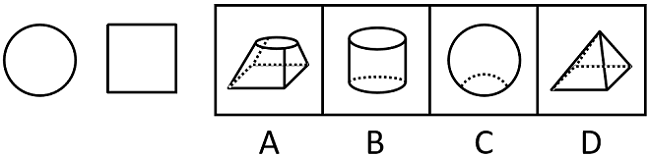

# 三视图-立体图形视图还原

考点：[[20-考点/判断推理/图形推理/三视图-立体图形视图还原|图形推理 / 三视图-立体图形视图还原]]

**问法模型**：给出某立体图形两个角度的视图（圆形+正方形）→ 对四个选项逐一做多方向正投影想象验证，排除法锁定唯一匹配项

## 推理链
1. 第1步：题干给出'某两个角度的视图'为一个圆形和一个正方形，即该立体从某两个方向正投影须分别得到纯圆形和正方形
2. 第2步：采用多方向投影验证法，对每个选项从上、下、左、右等方向想象其正投影形状
3. 第3步：A项（方形底、圆形顶的台体）：从下往上看得正方形，但俯视为方形轮廓内含圆形，任何角度都得不到单独的圆形视图，排除
4. 第4步：B项（圆柱）：从上往下看得圆形；从左往右看为矩形，图中圆柱高与底面直径相当，投影为正方形，两个视图均满足
5. 第5步：C项（球体）：俯视虽得圆形，但球体任意方向投影均为圆形，得不到正方形，排除
6. 第6步：D项（棱锥类）：从下往上看得正方形，但任何方向均投影不出纯圆形，排除
7. 第7步：综上，只有B能同时产生'圆形'与'正方形'两个视图，故正确答案为B

**最快解法**：⚡ 特征排除法：先抓'圆形视图'这一强特征——只有含旋转曲面的立体（圆柱、球、圆锥、圆台）才能投出纯圆，A俯视是'方包圆'非纯圆、D为棱锥，排除A、D；再抓'正方形视图'——球的任意方向投影均为圆，排除C；仅剩B（圆柱：俯视=圆，侧视=正方形），当选

## 易错点
- ⚠ 误把A项俯视图当成纯圆形，忽略方形底座外轮廓在俯视中仍可见（得到的是方形内切圆，不是单独圆形）
- ⚠ 忽视圆柱侧视图本质是矩形，只有当高等于底面直径（图中比例相当）时才是正方形
- ⚠ 想当然认为球体C'换个角度能看出方形'，实际球体任意方向投影均为圆形

## 母题抽象
> 🧩 当题干出现'给出立体图形的两个视图求该立体最可能是什么'特征时，用多方向正投影逐项验证法：先以特征形状（纯圆→回转体、正方形→柱体/方形底）快速排除，再对剩余项逐一验证各角度投影是否恰为题干两个视图

**同类特征**：两个角度的视图、圆形与正方形、立体图形匹配、三视图还原、空间想象、最可能是什么

## 相关题
- [[10-真题/判断推理/图形推理/4673129 三视图（立体图形的视图还原与择优）|4673129]]（广东 2022，相关度1）
- [[10-真题/判断推理/图形推理/5510242 图形推理-空间重构（立体图形旋转-同一物体判断）|5510242]]（广东 2023，相关度1）

---

### 题干

如图是一物体某两个角度的视图，则该物体最可能是（    ）。

### 选项
- A. A
- B. B　✅
- C. C
- D. D

### 官方解析
本题考查三视图，逐一分析选项。
A项：从下往上看，可以看到正方形，但无法看到圆形，排除；
B项：从上往下看，可以看到圆形，从左往右看，可以看到正方形，当选；
C项：从上往下看，可以看到圆形，但无法看到正方形，排除；
D项：从下往上看，可以看到正方形，但无法看到圆形，排除。
故正确答案为B。

### 给定材料
（无）
