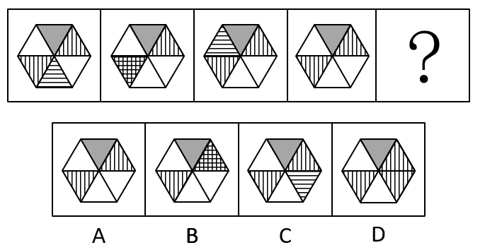
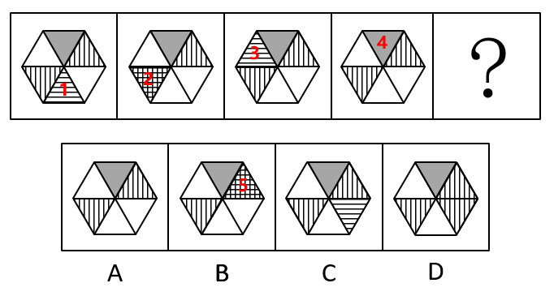

# 位置规律-图案顺时针移动（含遮挡与叠加）

考点：[[20-考点/判断推理/图形推理/位置规律-图案顺时针移动（含遮挡与叠加）|图形推理 / 位置规律-图案顺时针移动（含遮挡与叠加）]]

**问法模型**：题干为'五图+问号'的元素组成相同系列 → 优先考虑位置规律，锁定逐图换位的小图案并外推其下一步位置

## 推理链
1. 第1步：六边形被均分为6个三角形扇区，五幅图元素组成相同（灰色扇区、竖线、斜线、横线图案反复出现），按'元素组成相同优先看位置'切入
2. 第2步：对比图1→图2→图3，灰色扇区始终在正上方、竖线始终在左下，均未移动；而横线图案依次位于'正下方（图1）→左下方（图2，与竖线叠加呈网格状）→左上方（图3）'，即每次顺时针移动一格
3. 第3步：按顺时针每格步长外推，图4时横线应到达正上方，恰被灰色扇区遮挡故不可见，与图4中看不到横线的事实吻合，规律成立
4. 第4步：问号处横线应继续顺时针移动一格至'右上方'扇区，该扇区原有斜线，二者叠加应呈现复合纹理
5. 第5步：逐项对照——A项与图4完全相同（右上无变化）、C项横线回到正下方、D项右下方多出竖线，均不符；仅B项右上角呈现叠加后的复合图案，当选

**最快解法**：⚡ 追踪法+排除法：只盯'横线三角形'，从图1到图3确认其'下→左下→左上'的顺时针移一格路径，推出图4被灰色遮挡、问号处到达右上，直接锁定B

## 易错点
- ⚠ 只观察灰色、竖线等不动元素，误判图形无变化而选与图4相同的A
- ⚠ 忽略'阴影被灰色扇区遮挡'的隐含情形，因图4看不到横线而误以为移动规律中断、转找数量等其他规律
- ⚠ 忽略图案叠加：横线移入已有竖线的扇区呈网格（图2），移到右上与斜线叠加后形态改变，若机械寻找'纯横线'扇区易误选C

## 母题抽象
> 🧩 当系列图形元素组成相同且某一小图案位置逐图变化时，逐图标记该图案所在扇区，按顺/逆时针固定步长外推到问号处，并同步考虑被遮挡或与原有图案叠加后的变形形态

**同类特征**：六边形分割为6个三角形扇区、元素组成相同、灰色扇区位置不动、横线图案逐图换位、图2出现网格状叠加、图4横线不可见（被遮挡）

## 相关题
- [[10-真题/判断推理/图形推理/2172768 位置规律（旋转-翻转）|2172768]]（海南 2021，相关度1）
- [[10-真题/判断推理/图形推理/10204458 位置规律-平移（特征交点沿内圈循环平移）|10204458]]（甘肃 2024，相关度1）
- [[10-真题/判断推理/图形推理/10204614 图形推理-位置规律（旋转+翻转交替循环）|10204614]]（黑龙江 2024，相关度1）
- [[10-真题/判断推理/图形推理/10297399 位置规律—平移（多黑块分组循环平移）|10297399]]（四川 2025，相关度1）
- [[10-真题/判断推理/图形推理/11226892 位置规律-九宫格小元素沿固定循环链移动|11226892]]（上海 2025，相关度1）

---

### 题干

从所给的四个选项中，选择最合适的一个填入问号处，使之呈现一定的规律性：

### 选项
- A. A
- B. B　✅
- C. C
- D. D

### 官方解析

元素组成相同，优先考虑位置规律。观察发现，内部阴影为横线的三角形，依次顺时针移动一格（移动到图4时，阴影被灰色区域遮挡），因此？处应移动到右上角，如下图所示，对应B项。

故正确答案为B。

### 给定材料
（无）
