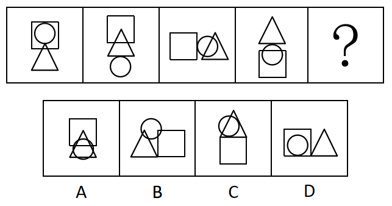
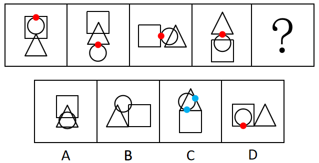

# 图形推理-数量规律-切点数（圆与方块-三角形的相切关系）

考点：[[20-考点/判断推理/图形推理/图形推理-数量规律-切点数（圆与方块-三角形的相切关系）|图形推理 / 图形推理-数量规律-切点数（圆与方块/三角形的相切关系）]]

**问法模型**：问'最符合所给图形规律'→ 元素组成相同但无位置规律，转向数量规律；题干存在明显圆相切图形特征，优先数切点数

## 推理链
1. 第1步：观察题干4幅图与问号，每幅图均由'方块、圆、三角形'三个相同元素组成，仅位置排布不同；检验平移/旋转/翻转无一致规律，属于'元素组成相同、无位置规律'的典型特征
2. 第2步：扫描数量特征，发现每幅图中圆均与其他图形（方块或三角形）存在明显相切，且圆交替地与方块和三角形相切，锁定'切点数'这一数量考点
3. 第3步：逐图核对切点数，官方解析确认题干四幅图形切点数均为1，即规律为'切点数=1'，问号处图形切点数也应为1
4. 第4步：逐项验证选项：A、B两项图中圆与三角形/矩形均为相交关系、无切点，排除；C项存在2个切点，排除
5. 第5步：只有D项（方块内嵌圆且相切、旁置三角形）切点数为1，符合规律，故选D

**最快解法**：⚡ 图形规律口诀'组成相同找数量、明显相切数切点'：题干四图切点数均为1，直接扫选项找'圆与方块/三角形相切'特征——A、B无切点，C有2个切点，D有1个切点，秒选D

## 易错点
- ⚠ 惯性去数交点数、线段数或封闭区域数，忽略'圆相切'这一更醒目的图形特征及切点数考点
- ⚠ 被'交点数均为10→选B'（解析二）带偏：当两种数量规律并存时，应选择贯穿全部图形、且圆与方块/三角形交替相切的整体一致性更强的切点规律
- ⚠ 切点数数错：C项是2个切点而非1个，需逐个分辨'相切'关系与其他点线相交关系的区别

## 母题抽象
> 🧩 当图形元素组成相同但无位置规律，且图形中出现圆与其他图形相切的醒目特征时，优先数切点数，验证其在全组图中恒定或交替的规律

**同类特征**：元素组成相同（每幅图含方块、圆、三角形）、无平移/旋转/翻转等位置规律、每幅图均有圆与方块或三角形相切、圆与方块、三角形交替相切、切点数恒为1

## 相关题
- [[10-真题/判断推理/图形推理/16593132 数量规律-点数量（切点数）|16593132]]（甘肃 2024，相关度1）
- [[10-真题/判断推理/图形推理/2719385 数量规律-交点数（曲直交点→切点数的二级递进计数）|2719385]]（国考 2021，相关度1）

---

### 题干

下列选项中最符合所给图形规律的是（    ）。

### 选项
- A. A
- B. B
- C. C
- D. D　✅

### 官方解析

元素组成相同，但无明显位置规律，考虑数量规律。观察发现，题干每幅图形均存在明显的圆相切，优先考虑切点数。题干图形切点数均为1，故问号处图形的切点数也应为1。A、B两项中没有切点，C项有2个切点（如图），只有D项有1个切点。

故正确答案为D。

解析二：元素组成相同，但无明显位置规律，考虑数量规律。观察发现，题干每幅图形线条交叉明显，故考虑交点数。题干图形交点数均为10，故问号处图形的交点数也应为10，只有B项符合。

故正确答案为B。

本题为争议题，但根据题干的图形特征可知，每幅图均存在相切，且圆分别与方块和三角形交替相切，且切点数均为1，考查切点数的概率更大，故粉笔更倾向于本题目的答案为D。

### 给定材料
（无）

> [!note] 复核版本状态
> 原题不可计分（underdetermined；来源记录的答案键/竞争项：D、B）；仅当前明确标注的编辑版按答案D计分。
> 详细原题疑点、修订题面、解析和证据见下方独立复核记录。

<!-- CODEX-ANSWER-REVIEW:BEGIN -->
### 本次独立复核

**复核结论：** `resolved`（答案与解析已核定）

**原题计分状态：** 不计分（`underdetermined`：原题证据不足以唯一判定）。来源中记录的答案键/竞争项：D、B；这些记录不代表原题已核准答案。

**当前计分版本：** 明确标注的编辑版；未列出的题干、材料或选项沿用固定题源。答案不回填为原题答案。

**计分答案：** D（可计分）

**复核解析：**

按编辑版定义检查下方选项：A、B无切点，C有2个，D有1个，故选D。原序列可按交点数等其他规律解释，本答案只对应明确限定切点数的编辑版。

**修订题干：**

【编者修订版，非原题复原】只比较下方A—D图。圆与其他图形轮廓在一点相接而不穿越彼此时计作1个切点；交叉点不计。请选择圆与其他轮廓恰有1个切点的选项。

**相关信息：**

图形推理—圆与多边形轮廓的切点计数；切点与相交穿越分开计数。

**核对依据与来源边界：**

- 固定题源：[原题文件](https://github.com/Mentat-Uran/kaogongzhentizhengliu/blob/84ab93d4b64b61d897bece8a1c0a5bab06b4feb2/10-%E7%9C%9F%E9%A2%98/%E5%88%A4%E6%96%AD%E6%8E%A8%E7%90%86/%E5%9B%BE%E5%BD%A2%E6%8E%A8%E7%90%86/4673229%20%E5%9B%BE%E5%BD%A2%E6%8E%A8%E7%90%86-%E6%95%B0%E9%87%8F%E8%A7%84%E5%BE%8B-%E5%88%87%E7%82%B9%E6%95%B0%EF%BC%88%E5%9C%86%E4%B8%8E%E6%96%B9%E5%9D%97-%E4%B8%89%E8%A7%92%E5%BD%A2%E7%9A%84%E7%9B%B8%E5%88%87%E5%85%B3%E7%B3%BB%EF%BC%89.md)；内容版本 `84ab93d4b64b61d897bece8a1c0a5bab06b4feb2`，源 Markdown blob `e1f38b76b85e8044d96020f23a93ac86fb0c12e7`.
- 固定题图/公式图：`90-图片/题目图/17e232534ae2322.png`, `90-图片/题目图/17e23246bd43368.png`.

<!-- CODEX-ANSWER-REVIEW:END -->
