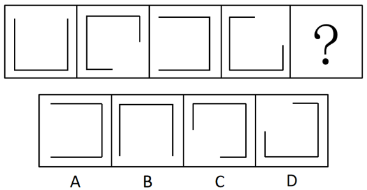

# 图形推理-位置规律（线条沿方形路径顺时针平移，步长为1.5个边长）

考点：[[20-考点/判断推理/图形推理/图形推理-位置规律（线条沿方形路径顺时针平移，步长为1.5个边长）|图形推理 / 图形推理-位置规律（线条沿方形路径顺时针平移，步长为1.5个边长）]]

**问法模型**：五幅图元素组成相同、问'填入问号处使之呈现规律'→优先考虑位置变化，将折线端点标定在方形路径上，量化每幅图之间的平移步长后外推问号处图形

## 推理链
1. 第1步：题干五格（含问号）元素组成完全相同，均为一条三段折线沿内接方形路径分布，优先考虑位置规律而非样式规律
2. 第2步：给图1定位——折线覆盖右边、下边、左边三段，缺口（开口）位于上边
3. 第3步：对比图1与图2，折线端点不在角上而是停在边中间，说明是沿方形路径的'平移'而非整体旋转；缺口由上边顺时针移动1.5个边长，转到右边下半段+下边左半段的位置，与图2中右侧线变短、下方线只剩右半段吻合
4. 第4步：验证图2→图3、图3→图4，缺口依次顺时针移动1.5个边长：图3缺口在左边，图4缺口跨右上角（上边右半段+右边上半段），步长恒定，规律成立
5. 第5步：将图4折线再顺时针平移1.5个边长，缺口由右上角转到下边，问号处折线应覆盖左边、上边、右边三段，下边开口
6. 第6步：逐项对照——A项缺口在左边（是图3的形态），C项缺口偏左侧，D项缺口在左上区域，只有B项下边开口（线在左、上、右），与推导完全一致，故选B

**最快解法**：⚡ 缺口追踪法：只盯缺口位置，图1缺口在上边，缺口每次沿方形路径顺时针平移1.5个边长，依次为上边→右下→左边→右上→下边，问号处开口应朝下（缺下边），秒选B

## 易错点
- ⚠ 把规律误判为整体旋转90°，忽略线条端点停在边中间、是沿路径'平移'而非旋转，易误选A或D
- ⚠ 步长量化错误：误以为是每次移动1个边长或半个边长，推出错误的问号处图形
- ⚠ 只数线段数量（每幅图都是三段）就排除，未追踪缺口的精确落点，无法区分B与C、D的细微差别

## 母题抽象
> 🧩 当一组图形元素组成相同、线条沿闭合路径（方形/环形）分布且逐图变位时，将线条端点标在路径上，找出每次平移的步长（可为1.5个边长这类非整数步长），按步长外推问号处缺口位置再对照选项

**同类特征**：元素组成相同、折线沿方形路径分布、端点停在边中间（非角点）、缺口/开口位置逐图变化、顺时针平移、步长1.5个边长

## 相关题
- [[10-真题/判断推理/图形推理/4652034 位置规律（平移步数+内外位置交替）|4652034]]（上海 2022，相关度2）
- [[10-真题/判断推理/图形推理/2172768 位置规律（旋转-翻转）|2172768]]（海南 2021，相关度1）
- [[10-真题/判断推理/图形推理/10204458 位置规律-平移（特征交点沿内圈循环平移）|10204458]]（甘肃 2024，相关度1）
- [[10-真题/判断推理/图形推理/10204614 图形推理-位置规律（旋转+翻转交替循环）|10204614]]（黑龙江 2024，相关度1）
- [[10-真题/判断推理/图形推理/10297399 位置规律—平移（多黑块分组循环平移）|10297399]]（四川 2025，相关度1）

---

### 题干

从所给四个选项中，选择最合适的一个填入问号处，使之呈现一定的规律：

### 选项
- A. A
- B. B　✅
- C. C
- D. D

### 官方解析

元素组成相同，优先考虑位置关系。观察发现，线条在以正方形为路径按顺时针方向平移，且每次平移1.5个正方形边长，故？处图形线条的位置如下图所示，对应B项。

故正确答案为B。

### 给定材料
（无）
