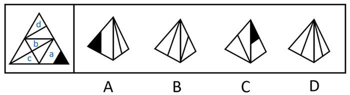
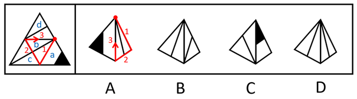
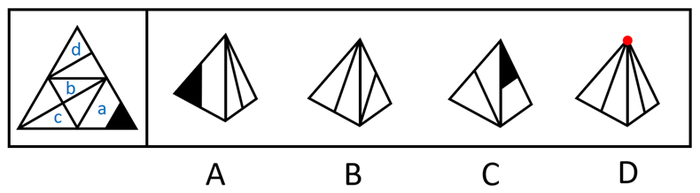

# 空间重构-四面体展开图折叠（画边法-公共边相邻判定）

考点：[[20-考点/判断推理/图形推理/空间重构-四面体展开图折叠（画边法-公共边相邻判定）|图形推理 / 空间重构-四面体展开图折叠（画边法/公共边相邻判定）]]

**问法模型**：给出四面体展开图，问右边哪一项能由它折叠而成 → 用画边法（以线条与顶点/边的交点为起点顺时针描边）逐项比对相邻面及交点位置排错

## 推理链
1. 第1步：题干左侧为大三角形分割成四个小三角形面（标号为面a、b、c、d），面a含白色梯形与黑色三角形，面b、面c、面d内含线条图案
2. 第2步：四面体四个面折叠后两两相邻，不能用六面体'相对面排除法'，须逐一比对相邻面及公共边上线条交点位置
3. 第3步：A项左面为面a，右面挨着面a中白色梯形的长底边，故右面为面b；以面b中线条与面顶点的交点为起点顺时针画边，题干中边1挨着面a，而选项中边3挨着面a，相邻关系不一致，排除A
4. 第4步：B项包含面c和面d，两面图案及相邻公共边与展开图一致，保留
5. 第5步：C项右面为面a，以面a中黑色三角形与面顶点的交点为起点顺时针画边，题干中边3挨着面d且与面d内线条相交于边3的中点，选项中边3虽挨着左侧面但不相交于边3中点，排除C
6. 第6步：D项两面为面b、面c或面d，选项左右两面内线条相交于面的顶点位置，而展开图中仅面c与面b内线条相交且不在顶点位置，排除D
7. 第7步：综上仅B项与展开图折叠结果一致，故正确答案为B

**最快解法**：⚡ 画边法+特征面定位：先用黑色三角形、白色梯形锁定面a（秒看A、C），从线条与顶点交点为起点顺时针给面的四条边编号，比对相邻边编号即排除A、C；再用'面内线条是否交于顶点'直接排除D，锁定B

## 易错点
- ⚠ 只核对相邻面是谁，忽略公共边上线条交点位置（顶点还是边中点）这一细节（C项即栽在'中点'上）
- ⚠ 画边时起点或方向不一致，把题干的边1与选项的边3误当作同一条边（A项错位陷阱）
- ⚠ 四面体四个面两两相邻，误套用六面体'相对面排除法'导致无法下手或误判

## 母题抽象
> 🧩 当题干出现三角形（四面体）展开图且各面带线条、阴影等特征图案时，用画边法：以图案与顶点/边的交点为起点顺时针描边编号，逐项验证相邻面与交点位置，排除不一致项

**同类特征**：四面体展开图（大三角形分四个小三角形面）、问'哪一项能由它折叠而成'、面内含线条与黑色三角形阴影、线条与顶点或边中点相交、选项为锥体立体图、需比对相邻面公共边关系

## 相关题
- [[10-真题/判断推理/图形推理/1805286 空间重构-立体折叠（五棱柱展开图，相邻面黑白关系排除）|1805286]]（上海 2016，相关度1）
- [[10-真题/判断推理/图形推理/2042116 空间重构-四面体折叠（相邻面公共边+箭头法）|2042116]]（江苏 2017，相关度1）
- [[10-真题/判断推理/图形推理/2043634 空间重构-六面体折叠（相对面排除＋时针法＋公共点法）|2043634]]（江苏 2017，相关度1）
- [[10-真题/判断推理/图形推理/2133640 空间重构-六面体折叠（特征边定位+相邻关系验证）|2133640]]（国考 2018，相关度1）
- [[10-真题/判断推理/图形推理/2172154 空间重构-六面体折纸盒（相对面排除＋公共点法）|2172154]]（广州市考 2018，相关度1）

---

### 题干

左边给定的是纸盒外表的展开图，右边哪一项能由它折叠而成？

### 选项
- A. A
- B. B　✅
- C. C
- D. D

### 官方解析

将题干展开图标上序号，如下图所示，逐一分析选项。

A项：选项的左侧面是面a，右侧面挨着面a中白色梯形的长底边，因此右侧面是面b。如下图所示，分别在题干和选项中，以面b中的线条与面顶点的交点为起点，绕着面b顺时针画边。在题干中，边1挨着面a，但在选项中，边3挨着面a，选项与题干不一致，排除；

B项：选项包含面c和面d，选项与题干一致，当选；

C项：选项的右侧面是面a，如下图所示，分别在题干和选项中，以面a中黑色三角形与面顶点的交点为起点，绕着面a顺时针画边。在题干中，边3挨着面d，且与面d内线条相交于边3的中点，在选项中，边3挨着左侧面，但不与左侧面内线条相交于边3的中点，选项与题干不一致，排除；

D项：选项中的两个面是面b、面c或面d，如下图所示，选项左侧面和右侧面内的线条相交，且相交于面顶点的位置，在题干的面b、面c或面d中，面内线条相交的只有面c和面b，但并不相交于面的顶点位置，选项和题干不一致，排除。

故正确答案为B。

### 给定材料
（无）
