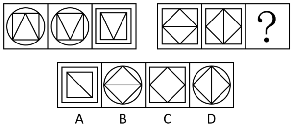

# 样式规律-外框与内部图形分离变化（框不变内变→内不变框变）

考点：[[20-考点/判断推理/图形推理/样式规律-外框与内部图形分离变化（框不变内变→内不变框变）|图形推理 / 样式规律-外框与内部图形分离变化（框不变内变→内不变框变）]]

**问法模型**：两组图类比填问号 → 拆分图形为'外框层+内部层'，从前一组归纳两层交替变化规律，套用到后一组

## 推理链
1. 第1步：第一组图1、图2外框均为圆形，内部均为'正方形内嵌三角形'，三角形由朝上变朝下，即外框不变、内部图形位置/方向变化
2. 第2步：第一组图2、图3内部均为朝下的三角形保持不变，外框由圆形变为双重正方形，即内部不变、外框变化
3. 第3步：第二组图1、图2外框均为正方形，内部均为'菱形+中线'，中线由横向变纵向，复现'外框不变、内部图形位置变化'
4. 第4步：按规律，第二组图2与图3应'内部图形不变'（保持菱形加竖线）、'外框变化'（正方形换为其他外框）
5. 第5步：逐项对照——A外框为双重方形且内部变为带对角线的小方形（内部变了，排除）；B外框为圆但内部菱形中线仍为横线（内部与图2不一致，排除）；C外框仍为正方形且无竖线（外框未变、内部也变，排除）；D外框为圆形、内部为菱形加竖线（内部不变、外框变化）
6. 第6步：只有D完全满足'内不变、框变'，故选D

**最快解法**：⚡ 内外分层拆解法：第一组规律为'框不变内变→内不变框变'；第二组图1→图2已完成'框不变内变（横线变竖线）'，故问号处须内部与图2完全一致（菱形+竖线）且外框改变，直接锁定D（圆外框+菱形竖线）

## 易错点
- ⚠ 只盯着外框或只盯着内部单一元素看，漏掉'外框与内部分层交替变化'的复合规律
- ⚠ B项外框正确具有迷惑性，但其中线是横线，内部图形未与图2保持一致，易误选
- ⚠ 第一组图3外框变为双重方形，易误判'外框变化无规律'而放弃该规律另找样式/数量规律

## 母题抽象
> 🧩 当两组类比图形呈现'外框相同而内部元素变、随后内部相同而外框变'的交替特征时，用内外分层拆解法，验证后一组是否延续同一交替节奏并保持变化侧元素完全一致

**同类特征**：两组图类比填问号、外框与内部图形可明显分层、第一组框不变内变、第一组内不变框变、内部三角形朝向翻转、菱形中线横变竖

## 相关题
- [[10-真题/判断推理/图形推理/2402407 数量规律-面数量与内部直线数（两级复合数数）|2402407]]（重庆 2018，相关度1）

---

### 题干

从所给四个选项中，选择最合适的一个填入问号处，使之呈现一定规律性：

### 选项
- A. A
- B. B
- C. C
- D. D　✅

### 官方解析
观察题干图形，发现图1和图2的外框不变，内部图形位置变化，图2与图3的内部图形不变，外框变化。第二组图应用此规律，图1和图2的外框不变，内部图形位置变化，图2与图3的内部图形不变，外框变化，只有D符合该规律。
故正确答案为D。

### 给定材料
（无）
