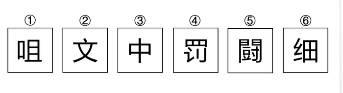

# 数量规律-面数量（汉字封闭区域数，奇偶分组）

考点：[[20-考点/判断推理/图形推理/数量规律-面数量（汉字封闭区域数，奇偶分组）|图形推理 / 数量规律-面数量（汉字封闭区域数，奇偶分组）]]


> [!warning] 原题计分状态：不计分（题源转录错误；来源答案记录：C、A）。当前仅对文末明确标注的编辑版答案计分。

**问法模型**：“六个图形分为两类、每类各有共同特征”的分组分类问法 → 元素组成不同先排属性、再数数量，找到能将六图二分的规律（本题：面数量的奇偶性）

## 推理链
1. 第1步：题干六图均为汉字（咀、文、中、罚、鬬、细），元素组成不同，对称、开闭等属性规律不明显，考虑数量规律
2. 第2步：汉字中多处笔画围成封闭空间（①的“口”、④的“罒”、⑥的“田”等），锁定“面数量”考点
3. 第3步：逐字数面：①咀＝口(1)＋且(3)＝4个；②计1个；③中＝竖笔把“口”内部分隔成2个；④罚＝“罒”外框加内部两竖共3个；⑤计5个；⑥细＝“田”4个，面数序列为4、1、2、3、5、4
4. 第4步：六图面数互不相同，按“面数相等/递增”无法直接分组，对数量做二级加工——按奇偶性二分
5. 第5步：①③⑥面数为4、2、4，均为偶数；②④⑤面数为1、3、5，均为奇数，分组成立
6. 第6步：对照选项，C项“①③⑥，②④⑤”与该分组完全一致，故选C

**最快解法**：⚡ 汉字＋封闭区域 → “数面看奇偶”：快速数出各字面数为4、1、2、3、5、4，数值杂乱立即转奇偶二分——①③⑥全偶、②④⑤全奇，对应C项

## 易错点
- ⚠ 漏数部件内部的封闭区域：如“中”被竖笔分成2个面、“且”含3个面、“罒”含3个面，只数明显“口”字会数错
- ⚠ 数出面数各不相同时误以为无数量规律而放弃，未想到奇偶性等对数量的二级加工
- ⚠ 先入为主去数笔画数、部件数或看左右/上下结构，在汉字题上浪费时间

## 母题抽象
> 🧩 当题干出现汉字且笔画围成封闭空间时，先数每个字的封闭区域（面）数量；若面数互不相等，改用奇偶性二分，再对照选项验证

**同类特征**：图形全部由汉字组成、存在封闭区域（口/田/罒等）、元素组成不同、无明显属性规律、面数量呈奇偶分布、六图分组分类

## 相关题
- [[10-真题/判断推理/图形推理/18643670 数量规律-点数量（圆与直线的切点数）|18643670]]（天津 2026，相关度3）
- [[10-真题/判断推理/图形推理/19283874 数量规律-一笔画（笔画数-奇点计数）|19283874]]（国考 2025，相关度3）
- [[10-真题/判断推理/图形推理/5893637 数量规律-笔画数（一笔画与多笔画，奇点计数）|5893637]]（国考 2024，相关度3）
- [[10-真题/判断推理/图形推理/10204454 数量规律-部分数（黑白球连通区域数做和）|10204454]]（甘肃 2024，相关度2）
- [[10-真题/判断推理/图形推理/10297050 数量规律-特殊计数（线条穿过小白球的数量）|10297050]]（天津 2025，相关度2）

---

### 题干
<p>把下面六个图形分为两类，使每一个图形都有各自共同特征或规律，分类最合理的一项是：</p><p></p>

### 选项
- A. ①②③，④⑤⑥
- B. ①④⑤，②③⑥
- C. ①③⑥，②④⑤　✅
- D. ①④⑥，②③⑤

### 官方解析
本题为分组分类题目。元素组成不同，且无明显属性规律，考虑数量规律。观察发现，题干图形均由汉字组成，且存在封闭区域，考虑面数量，但整体数面无法分组。再次观察发现，题干图形面数量依次为4、1、2、3、5、4，图①③⑥面数量为偶数个，图②④⑤面数量为奇数个，故图①③⑥为一组，图②④⑤为一组。
故正确答案为C。

### 给定材料
（无）

> [!note] 复核版本状态
> 原题不可计分（transcription_error；来源记录的答案键/竞争项：C、A）；仅当前明确标注的编辑版按答案A计分。
> 详细原题疑点、修订题面、解析和证据见下方独立复核记录。

<!-- CODEX-ANSWER-REVIEW:BEGIN -->
### 本次独立复核

**复核结论：** `resolved`

**原题计分状态：** 不计分（`transcription_error`：题源转录错误；来源记录：C、A）。来源键仅作为记录，不替代复核。

**原题疑点与处理：**

固定题图②为“文”，标准计面为0，与原解析将②计为1并选C冲突；按图中字形实际计数为4、0、2、3、5、4，偶数组①②③⑥、奇数组④⑤，原A-D均未提供该分组。原题 transcription error / 无匹配选项，不计分。修订版重列选项后可按A计分。

**当前计分版本：** 明确标注的编辑版；答案不回填为原题答案。

**计分答案：** A

**修订题干：**

【编辑修复版，非原题复原】图中②为“文”，按实际字形计封闭区域数（②为0）。仅按六个汉字封闭区域数的奇偶性分成两类，选择分类正确的一项。


**修订/采用选项：**

A. ①②③⑥，④⑤
B. ①④⑤，②③⑥
C. ①③⑥，②④⑤
D. ①④⑥，②③⑤

**复核解析：**

按固定题图的实际字形计封闭区域：①“咀”4个，②“文”0个，③“中”2个，④“罚”3个，⑤“闯”5个，⑥“细”4个。偶数为①②③⑥，奇数为④⑤，唯一对应修订选项A。固定原选项全为3/3分组，没有一项对应图示真实奇偶分组；原官方C把②按1个面计，与图中文字不符。编辑版据实重列选项，不沿用错误计数。

**相关信息：**

图形推理—封闭区域数量奇偶分类；按实际字形计数，不把开放字形“文”虚构为带“口”部的字。原题因题图、解析计数及选项分组冲突不计分；修订版重列选项后计A。

**核对依据与来源边界：**

- 固定题源：[原题文件](https://github.com/Mentat-Uran/kaogongzhentizhengliu/blob/84ab93d4b64b61d897bece8a1c0a5bab06b4feb2/10-%E7%9C%9F%E9%A2%98/%E5%88%A4%E6%96%AD%E6%8E%A8%E7%90%86/%E5%9B%BE%E5%BD%A2%E6%8E%A8%E7%90%86/4675394%20%E6%95%B0%E9%87%8F%E8%A7%84%E5%BE%8B-%E9%9D%A2%E6%95%B0%E9%87%8F%EF%BC%88%E6%B1%89%E5%AD%97%E5%B0%81%E9%97%AD%E5%8C%BA%E5%9F%9F%E6%95%B0%EF%BC%8C%E5%A5%87%E5%81%B6%E5%88%86%E7%BB%84%EF%BC%89.md)；commit `84ab93d4b64b61d897bece8a1c0a5bab06b4feb2`，源 Markdown blob `494b286f717821e5f83878e8c37fd6733783982f`，文件大小 4648 字节。
- 固定题图/公式图：`90-图片/题目图/17e3292cebb6243.png`.

**逐题证据：**

```json
{
  "fixedSourceImage": "90-图片/题目图/17e3292cebb6243.png",
  "basis": "逐字按固定题图计数：咀4、文0、中2、罚3、闯5、细4；偶数集合①②③⑥，奇数集合④⑤。原始选项无对应分组，因此编辑版重列选项A后唯一。",
  "originalKeyConflict": "固定解析及官方键C把②计为1面；实际图形为“文”，无封闭区域。"
}
```
- 原题来源答案记录：`C, A`；只作来源元数据，不作为本次结论。

<!-- CODEX-ANSWER-REVIEW:END -->
