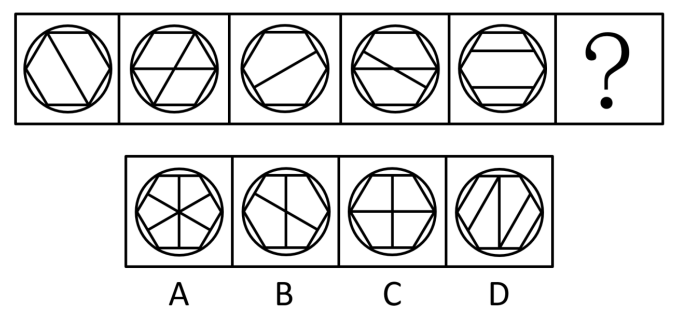

# 数量规律-交点数（等差递增）

考点：[[20-考点/判断推理/图形推理/数量规律-交点数（等差递增）|图形推理 / 数量规律-交点数（等差递增）]]

**问法模型**：‘根据图形规律，填入问号处最合适的一项’（五图+问号的规律推理）→ 元素组成不同且属性无规律时，转数量规律，本题数交点个数找等差

## 推理链
1. 第1步：观察题干五图，均为‘外圆+内接六边形+内部线条’构图，但内部线条方向与位置各不相同，元素组成不同
2. 第2步：检查对称、曲直、封闭等属性规律，各图无统一属性特征，故排除属性规律
3. 第3步：题干图形线条交叉明显（第二、四图内部线条相互交叉），转向数量规律，锁定交点数
4. 第4步：依序清点题干五图交点数：6、7、8、9、10，构成公差为1的等差递增数列
5. 第5步：按等差规律推出，问号处图形交点数应为10+1=11
6. 第6步：逐项清点选项交点数，A、C、D均不为11，只有B项交点数为11，故选B

**最快解法**：⚡ 数交点法——先快数题干五图交点得6、7、8、9、10，确认等差递增后，问号处需11个交点；直接逐项数选项交点，锁定B项

## 易错点
- ⚠ 五图均含圆和六边形，外观框架相同，易误判为‘元素组成相同’而去找位置或样式规律
- ⚠ 交点计数口径不统一：圆与六边形顶点相切处、内部线条端点落在六边形顶点上的重合处易漏数或多数，导致数列错乱
- ⚠ B与C构图接近（均为六边形加十字类交叉线条），数错交点易误选C

## 母题抽象
> 🧩 当图形元素组成不同、无明显属性规律且线条交叉明显时，用数交点法清点各图交点数；若呈等差数列，按公差推出问号处数值，再对照选项找相同交点数者

**同类特征**：图形元素组成不同、线条交叉明显、外圆内接六边形框架、交点数6/7/8/9/10等差递增、属性规律排除后转向数量规律

## 相关题
- [[10-真题/判断推理/图形推理/2262871 数量规律-交点数（等差递增）|2262871]]（选调 2016，相关度2）
- [[10-真题/判断推理/图形推理/2391876 数量规律-交点数（等差递增）|2391876]]（黑龙江 2016，相关度2）
- [[10-真题/判断推理/图形推理/2615983 数量规律-交点数（等差递增）|2615983]]（云南 2020，相关度2）
- [[10-真题/判断推理/图形推理/12100996 图形推理-对称性（单条对称轴方向交替）+数量规律（交点数等差递增）|12100996]]（江苏 2025，相关度1）
- [[10-真题/判断推理/图形推理/12561847 数量规律-交点数（等差数列）|12561847]]（浙江 2024，相关度1）

---

### 题干

根据图形规律，填入问号处最合适的一项是：

### 选项
- A. A
- B. B　✅
- C. C
- D. D

### 官方解析
图形元素组成不同，且无明显属性规律，考虑数量规律。观察发现，图形线条交叉明显，考虑交点数。题干图形的交点数分别为6、7、8、9、10、？，因此？处图形的交点数应为11，只有B项符合规律。
故正确答案为B。

### 给定材料
（无）
