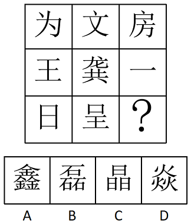

# 汉字字形规律（笔顺首笔按行一致）

考点：[[20-考点/判断推理/图形推理/汉字字形规律（笔顺首笔按行一致）|图形推理 / 汉字字形规律（笔顺首笔按行一致）]]

**问法模型**：九宫格汉字'填入问号处最合适的一项'→ 元素组成不同时优先横行归纳共性规律（首笔特征），再逐项排除

## 推理链
1. 第1步：九个汉字元素组成不同、笔画数无统一规律，按九宫格规则优先横向观察
2. 第2步：看第一行'为、文、房'的首笔，三字起笔均为'丶'（点）
3. 第3步：验证第二行'王、龚、一'，三字起笔均为'一'（横），规律成立
4. 第4步：第三行'日、呈'起笔均为'丨'（竖），归纳出规律：每行汉字首笔相同，问号处应为首笔'丨'的汉字
5. 第5步：逐项核对首笔：A'鑫'（金字旁起笔'丿'）、B'磊'（石字起笔'一'）、D'焱'（火字起笔'丶'）、C'晶'（左侧'日'起笔'丨'）
6. 第6步：只有C项首笔为'丨'，与第三行规律一致，故选C

**最快解法**：⚡ 首笔判定法+排除法：横行看每行第一个字的首笔（丶→一→丨），直接核对四个选项首笔——A鑫丿、B磊一、D焱丶，唯一首笔为丨的只有C晶，秒选

## 易错点
- ⚠ 四个选项鑫、磊、晶、焱均为品字形结构，若按'结构叠加/相同部件'找规律会陷入僵局，需转向笔顺特征
- ⚠ 笔顺记忆出错：误以为'晶'起笔为'一'或'日'首两笔连写，导致排除C
- ⚠ 忽略横向规律去竖列找规律，竖列首笔无统一特征，浪费考场时间

## 母题抽象
> 🧩 当九宫格汉字各不相同、笔画数与结构均无规律时，按行观察笔顺首笔（或首笔起笔类型），每行共性一致时选项按首笔排除即可

**同类特征**：九宫格汉字题、元素组成不同、笔画数无规律、每行首笔一致（丶/一/丨分行）、选项均为品字形干扰、横向观察优先

## 相关题
- [[10-真题/判断推理/图形推理/10204454 数量规律-部分数（黑白球连通区域数做和）|10204454]]（甘肃 2024，相关度1）
- [[10-真题/判断推理/图形推理/10204604 数量规律-线数量（汉字横线数）|10204604]]（辽宁 2024，相关度1）
- [[10-真题/判断推理/图形推理/10297050 数量规律-特殊计数（线条穿过小白球的数量）|10297050]]（天津 2025，相关度1）
- [[10-真题/判断推理/图形推理/10297127 图形间关系-相交图形中不相交边数量（黑白图形相交）|10297127]]（天津 2025，相关度1）
- [[10-真题/判断推理/图形推理/10297148 数量规律-线的细化（端点连线穿过线条数；备选：平行线组数）|10297148]]（天津 2025，相关度1）

---

### 题干

根据图形规律，填入问号处最合适的一项是：

### 选项
- A. A
- B. B
- C. C　✅
- D. D

### 官方解析
元素组成不同，九宫格优先横向看，观察发现，第一行汉字的第一笔均为“丶”，第二行汉字的第一笔均为“一”，第三行前两个汉字的第一笔均为“丨”，则问号处应选择第一笔为“丨”的汉字，只有C项符合。
故正确答案为C。

### 给定材料
（无）
