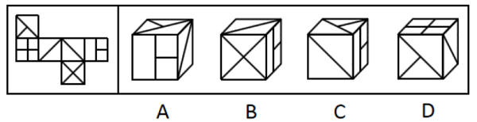

# 空间重构-六面体折纸盒（相对面排除+公共边-公共点定位）

考点：[[20-考点/判断推理/图形推理/空间重构-六面体折纸盒（相对面排除+公共边-公共点定位）|图形推理 / 空间重构-六面体折纸盒（相对面排除+公共边/公共点定位）]]

**问法模型**：『左边给定纸盒外表面，下列哪一项能由它折叠而成』→ 先标号找三组相对面排除，再对剩余选项用公共边法/公共点法核对特征图案的相对位置

## 推理链
1. 第1步：给展开图六个面标号a~f，依据『相隔一个面/Z字两端为相对面』确定三组相对面：面a—面d、面c—面e、面b—面f，相对面不能同时出现
2. 第2步：A项前面是面e，其相对面面c未出现，故右面必为面d；改用公共边法核对
3. 第3步：A项中面e与面d的公共边挨着面e的两个小正方形，而展开图中面e与面d的公共边没有挨着两个小正方形，位置不一致，排除
4. 第4步：B项前面是面f、右面是面e；选项中面f挨着面e大长方形的长边，而展开图中面f并没有挨着大长方形长边，排除
5. 第5步：C项由面b、面d、面e构成，三面两两相邻，特征图案与公共边相对位置均与展开图一致，当选
6. 第6步：D项前面是面b、上面是面a，面a的相对面面d不出现，故右面为面c；用公共点法核对：选项中三面公共点引出的1条直线由面c发出，而展开图中由面b发出，排除

**最快解法**：⚡ 

## 易错点
- ⚠ 相对面判断失误：面a—面d、面c—面e两组相对面若看错，会把A、D项误判为可行
- ⚠ 公共边看错侧：A项需比对公共边是否挨着面e的两个小正方形，折叠后方位变化易看错
- ⚠ 公共点引线归属看错：D项同一直线由面c还是面b发出易混淆，需回到展开图确认

## 母题抽象
> 🧩 当题干给出六面体展开图和四个立体折盒图时，先标号找出三组相对面做排除，再对剩余选项用公共边法（看特征图案挨着哪条边）或公共点法（看引出线条由哪个面发出）验证相对位置

**同类特征**：纸盒外表面展开图、六个面图案各异（小正方形、大长方形、对角线、X形）、问哪一项能折叠而成、需同时用到相对面、公共边、公共点三级验证、特征线在面上位置唯一可辨

## 相关题
- [[10-真题/判断推理/图形推理/12101006 空间重构-六面体折叠（公共点-公共边定位法）|12101006]]（江苏 2025，相关度1）
- [[10-真题/判断推理/图形推理/12536419 空间折叠（六面体）-相对面排除与相邻面位置关系（画边法-公共点法）|12536419]]（四川 2024，相关度1）
- [[10-真题/判断推理/图形推理/16593173 空间重构-展开图折叠（相邻面公共边特征）|16593173]]（海南 2024，相关度1）
- [[10-真题/判断推理/图形推理/1805286 空间重构-立体折叠（五棱柱展开图，相邻面黑白关系排除）|1805286]]（上海 2016，相关度1）
- [[10-真题/判断推理/图形推理/18643899 空间重构-纸盒折叠（相邻面公共边定位法）|18643899]]（四川 2026，相关度1）

---

### 题干

左边给定的是纸盒的外表面，下列哪一项能由它折叠而成？

### 选项
- A. A
- B. B
- C. C　✅
- D. D

### 官方解析

将原展开图标上序号如下图，逐一进行分析。

A项：选项前面是面e，面e的相对面是面c，相对面不能同时出现，所以选项右面是面d，选项中面e与面d的公共边挨着面e的两个小正方形，而展开图中面e与面d的公共边没有挨着面e的两个小正方形，选项与题干展开图不一致，排除；

B项：选项前面是面f，右面是面e，选项中面f挨着面e的大长方形长边，而展开图中面f没有挨着面e的大长方形长边，选项与题干展开图不一致，排除；

C项：选项由面b、面d与面e构成，选项与题干展开图一致，当选；

D项：选项前面是面b，上面是面a，面a的相对面是面d，相对面不能同时出现，所以选项右面是面c，选项中三个面的公共点（如图所示）引出的1条直线是由面c发出来的，而展开图中，三个面的公共点引出的1条直线是由面b发出来的，选项与题干展开图不一致，排除。

故正确答案为C。

### 给定材料
（无）
