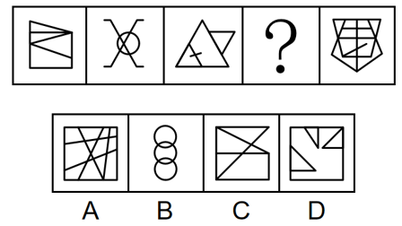

# 数量规律-笔画数（奇点法求一笔画-多笔画）

考点：[[20-考点/判断推理/图形推理/数量规律-笔画数（奇点法求一笔画-多笔画）|图形推理 / 数量规律-笔画数（奇点法求一笔画/多笔画）]]

**问法模型**：五图连续、元素组成不同且属性规律不明显，题干出现'田'字变形与多端点特征图 → 用奇点法数笔画，验证笔画数构成的数列规律

## 推理链
1. 第1步：元素组成不同，对称、曲直、开闭等属性规律均不明显，转向数量规律考查
2. 第2步：题干图2为多端点图形，且是'田'字变形图，属于笔画数的典型特征图，故优先考虑笔画数
3. 第3步：用奇点法求笔画数——从一点引出奇数条线的点为奇点，奇点数为0或2时为一笔画，否则笔画数=奇点数÷2，独立部分需相加
4. 第4步：数得题干图形笔画数依次为1、2、3、？、5，构成连续自然数列规律
5. 第5步：故问号处应填入笔画数为4的图形
6. 第6步：逐项数选项奇点：A数得4笔画；B为三个圆构成的图形，笔画数不为4；C、D按奇点法数得笔画数也均不为4
7. 第7步：只有A项符合4笔画要求，故正确答案为A

**最快解法**：⚡ 特征图定位+奇点法：看到'田'字变形图和多端点图形直接切换到笔画数维度；题干笔画数为1、2、3、？、5，问号选4笔画；B为三个圆先排除，A数奇点得4笔画即锁定答案

## 易错点
- ⚠ 奇点误判：把所有交点都当奇点，实际只有引出奇数条线的点才是奇点，露头的端点必为奇点，多数或漏数导致笔画数算错
- ⚠ 组合图形处理不当：由多个独立部分组成的图形（如B的三个圆），笔画数应相加，不能只数其中一部分
- ⚠ 规律方向跑偏：面数量、交点数无规律时，未及时由'田'字变形/多端点特征切换到笔画数这一数量维度

## 母题抽象
> 🧩 当题干（尤其五图连续）出现'田/日'字变形、多端点、多部分组合等特征图且属性无规律时，用奇点法求笔画数（奇点数÷2，奇点为0或2时为1笔画，独立部分相加），验证笔画数是否呈等差或常数规律

**同类特征**：田字变形图、多端点图形、五图连续规律、元素组成不同、无明显属性规律、笔画数呈连续自然数列

## 相关题
- [[10-真题/判断推理/图形推理/2262791 数量规律-笔画数（奇点法判定一笔画-两笔画）|2262791]]（天津 2016，相关度3）
- [[10-真题/判断推理/图形推理/4714952 数量规律-笔画数（一笔画与奇点数）|4714952]]（福建 2018，相关度3）
- [[10-真题/判断推理/图形推理/10204454 数量规律-部分数（黑白球连通区域数做和）|10204454]]（甘肃 2024，相关度2）
- [[10-真题/判断推理/图形推理/10297050 数量规律-特殊计数（线条穿过小白球的数量）|10297050]]（天津 2025，相关度2）
- [[10-真题/判断推理/图形推理/10297262 数量规律-面的形状种类（封闭面种类数分组）|10297262]]（浙江 2025，相关度2）

---

### 题干

从所给的四个选项中，选择最合适的一个填入问号处，使之呈现一定的规律性：

### 选项
- A. A　✅
- B. B
- C. C
- D. D

### 官方解析
元素组成不同，且无明显属性规律，考虑数量规律。观察发现，题干图2为多端点图形，且是“田”字变形图，考虑笔画数。题干图形的笔画数依次为1、2、3、？、5，故“？”处图形的笔画数应为4，只有A项符合。
故正确答案为A。

### 给定材料
（无）
