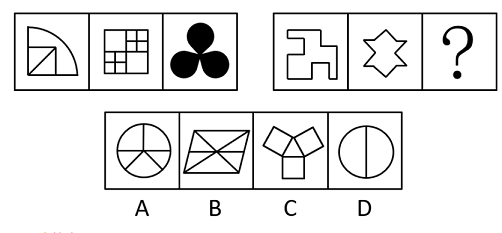

# 属性规律-对称性（对称轴数量递增）

考点：[[20-考点/判断推理/图形推理/属性规律-对称性（对称轴数量递增）|图形推理 / 属性规律-对称性（对称轴数量递增）]]

**问法模型**：两组图类比填问号，元素组成不同且图形规整 → 优先数对称轴数量找递增规律

## 推理链
1. 第1步：第一组图1为扇形内嵌三角形，是轴对称图形，对称轴1条；图2为正方形内套小方格，对称轴2条；图3为黑色三叶形，对称轴3条
2. 第2步：第二组图1为阶梯状凹多边形，对称轴1条；图2为不规则六角星形，对称轴2条
3. 第3步：归纳规律——两组图形均为轴对称图形，对称轴数量按1、2、3等差递增，问号处应填对称轴数量为3的图形
4. 第4步：逐项数选项对称轴：A圆形被内部分割线限定后仅1条，B平行四边形加对角线无对称轴（仅中心对称），C中央三角形与三个五边形呈120°均匀分布、有3条对称轴，D圆加一条竖直径有2条对称轴
5. 第5步：仅C项满足对称轴为3条，与两组递增规律吻合，故选C

**最快解法**：⚡ 数轴法：见图形规整且元素组成不同→直接数各图对称轴条数，确认1、2、3递增规律后逐项数选项，C为三叉均匀分布结构恰有3条，秒选C

## 易错点
- ⚠ 误把中心对称当轴对称：B项平行四边形加对角线只是中心对称图形，对称轴为0条
- ⚠ 忽视内部分割线对圆形对称轴的限制：A、D的圆轮廓本身有无数条对称轴，但内部线条使其分别只剩1条、2条
- ⚠ 第二组图2的不规则六角星易按正六角星误数为6条，实际图形不规则仅有2条

## 母题抽象
> 🧩 当两组图元素组成不同且整体规整时，优先数对称轴数量；若第一组呈1、2、3递增数列，第二组按相同数列续写问号处图形

**同类特征**：

## 相关题
- [[10-真题/判断推理/图形推理/2395213 属性规律-对称性（对称轴数量递增）|2395213]]（上海 2018，相关度2）

---

### 题干

从所给的四个选项中，选择最合适的一个填入问号处，使之呈现一定的规律性：

### 选项
- A. A
- B. B
- C. C　✅
- D. D

### 官方解析
元素组成不同，优先考虑属性规律。题干图形整体比较规整，考虑对称性。第一组图形均为轴对称图形，且对称轴的数量依次为1、2、3，第二组前两个图形的对称轴数量依次为1、2，故？处图形对称轴数量应为3，只有C项符合。
故正确答案为C。

### 给定材料
（无）
